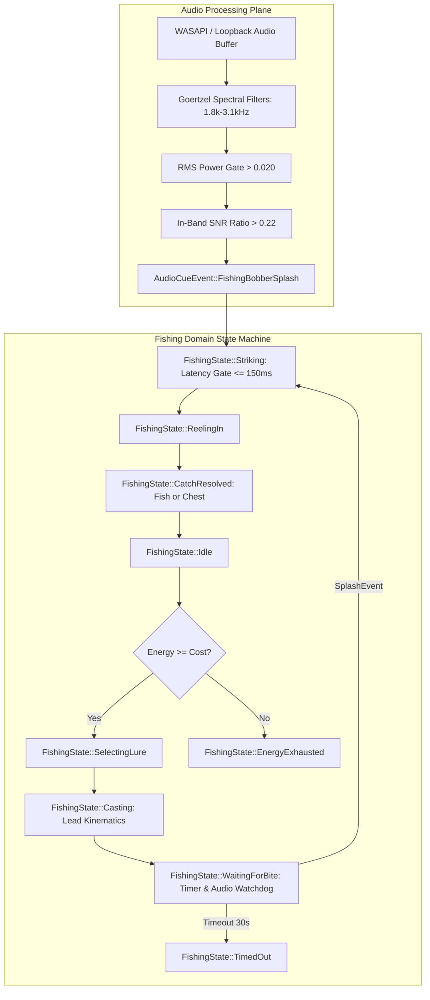

# Acoustic Fishing Reflex Engine

## 1. Operational Rationale & Architecture

Fishing in Wizard101 requires precise temporal coordination between visual or acoustic observations and motor dispatch:
1. The player activates fishing mode (`Shift+F` or UI click) and selects a lure corresponding to target fish schools.
2. The player casts the bobber into a pond near observable fish entities.
3. The bobber floats while swimming fish approach and perform 1 to 3 non-committal "nibbles" (slight ripples).
4. The fish takes the bait in a definitive **bite**, pulling the bobber fully underwater and emitting a loud, high-frequency water splash.
5. The player must strike (`Spacebar`) within a narrow reflex window (~1.0s to 1.5s total duration; optimal strike within $\le 150\text{ms}$ of bite detection) to hook the fish. Striking too early (during a nibble) or too late scares the fish away and expends energy without reward.

### Why Acoustic Reflex Beats Computer Vision
Visual bite detection in Wizard101 suffers from severe environmental interference:
- Dynamic water surface reflections, wave displacement, and specular glints.
- Variable camera tilt angles, occlusion by environmental geometry or player robes.
- Particle effects from swimming sentinel fish and atmospheric fog.

In contrast, the game's audio stream emits an unmistakable acoustic burst at the instant of a true bite:
- **`FishingBobberSplash`**: Resonant frequencies clustered at **1800 Hz, 2200 Hz, 2600 Hz, and 3100 Hz** with distinct in-band spectral concentration ($> 0.22$ SNR ratio over background noise).
- By processing loopback PCM audio frames with Goertzel single-bin energy filters (`crates/maelstrom-core/src/audio_cue.rs`), Maelstrom achieves sub-millisecond bite detection latency with zero memory-offset sensitivity and zero OCR/frame-capture overhead.

---

## 2. Energy Budget & Policy Preconditions

Fishing is governed by strict energy constraints:
- Each cast consumes between **2 and 5 Energy** points depending on lure rank (Rank 1 Minor Lure = 3 energy).
- Automated fishing without verified energy budgets risks rapid resource exhaustion or unexpected failure states.
- The `FishingStateMachine` enforces:
  1. **Pre-Cast Energy Assertion**: Verified energy observation $E_{\text{avail}} \ge E_{\text{cast}}$.
  2. **One-Attempt Gate**: Each cast is treated as a non-reentrant transaction. Re-casting is prohibited until the prior cast resolves (Catch, Escape, or Timeout).
  3. **Exhaustion Guard**: When $E_{\text{avail}} < E_{\text{cast}}$, the engine halts dispatch and transitions to `FishingState::EnergyExhausted`, preventing wasted clicks or potion consumption unless explicitly authorized.

---

## 3. Lead-Cast Kinematic Geometry

Fish in Wizard101 patrol dynamic circular or linear paths across the pond floor. Casting directly at the fish's current position $\mathbf{p}(t_0)$ causes the bobber to land behind the fish, outside its forward perception cone.

The engine computes a **lead cast point** $\mathbf{p}_{\text{cast}}$ by projecting the fish entity's velocity vector $\mathbf{v}_{\text{fish}}$ over the bobber flight duration $\Delta t_{\text{flight}}$:

$$\mathbf{p}_{\text{cast}} = \mathbf{p}_{\text{fish}} + \mathbf{v}_{\text{fish}} \cdot \Delta t_{\text{flight}} + \mathbf{u}_{\text{heading}} \cdot d_{\text{lead}}$$

Where:
- $\Delta t_{\text{flight}} \approx 0.65\text{ s}$ (bobber ballistic travel time).
- $d_{\text{lead}} \approx 25.0\text{ units}$ (forward offset ensuring the bobber lands in the fish's oncoming path).
- The resulting 3D coordinate is clamped to the pond's surveyed water surface elevation $Z_{\text{water}}$.

---

## 4. Reflex Latency Gate & Verification

The core invariant of the acoustic fishing reflex is the **reflex strike latency**:

$$\Delta t_{\text{reflex}} = t_{\text{strike\_dispatch}} - t_{\text{splash\_detection}} \le 150\text{ ms}$$

1. `AudioCueDetector` detects `FishingBobberSplash` at timestamp $t_{\text{cue}}$.
2. The event is pushed into `FishingStateMachine::handle_audio_cue(event, now_s)`.
3. If the state is `WaitingForBite`:
   - Validates that $\Delta t = \text{now\_s} - t_{\text{cue}} \le 0.150\text{ s}$.
   - Immediately transitions to `FishingState::Striking`.
   - Emits concrete proposal: `PROPOSAL:Fishing:ReflexStrike(Spacebar)`.
4. If dispatched beyond the 150ms window (e.g., due to thread scheduling stutter), the strike is flagged with a warning in telemetry.

---

## 5. Catch Outcome & Telemetry Accounting

Upon completion of the reel-in sequence, the state machine records structured session telemetry:
- **`FishCaught`**: Records species name, school, rank, weight/size in inches, XP gained, and small-fry/whopper classifications.
- **`ChestCaught`**: Records fishing chest retrieval (contains gold, gear, reagents, or housing items).
- **`FishEscaped`**: Records missed strikes or late reactions.
- **`SessionStats`**: Aggregates total casts, catch rate percentage, energy efficiency, and mean reflex latency $\mu_{\Delta t}$.

---

## 6. Behavior Tree & Scheduler Integration

Under the strict **Facts != Authority != Actions** contract:
1. `FishingDomain` emits purely advisory proposals:
   - `PROPOSAL:Fishing:SelectLure(slot)`
   - `PROPOSAL:Fishing:CastLure(screen_x, screen_y)`
   - `PROPOSAL:Fishing:ReflexStrike(Spacebar)`
2. The proposal channel is consumed by the C# `DesktopInputActuator` under the exclusive `GameInputLease`.
3. If window focus is lost or mouse movement is detected, dispatch pauses instantly, preserving safety and user takeover.
