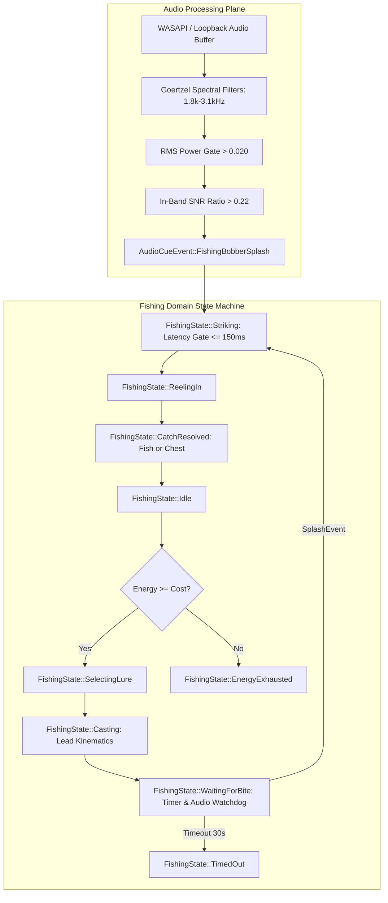

# Acoustic Fishing Reflex Engine

> **Status (audited 2026-11-20):** design document with a tested state machine behind it. `crates/maelstrom-core/src/fishing_domain.rs`
> implements the state machine, the cast planner and the session statistics, covered by 8 tests. Nothing calls it: no caller feeds it
> audio cues and nothing turns its proposals into input (`DesktopInputActuator` sends only `W`, `A`, `S`, `D` and clicks at viewport
> coordinates, and its live branch is a stub). The Wizard101 fishing mechanics and numbers in this document (hotkey, nibbles,
> strike window, energy costs, bite sound, flight time, lead distance, size thresholds) have no source in the repository and were
> not checked against the game. Notes marked **Today** say what the code does. Evidence:
> [W101-FISHING-CORE-02](coordination/results/W101-FISHING-CORE-02.md), audit note.

## 1. Operational Rationale & Architecture

Fishing in Wizard101 requires precise temporal coordination between visual or acoustic observations and motor dispatch:
1. The player activates fishing mode (`Shift+F` or UI click) and selects a lure corresponding to target fish schools.
2. The player casts the bobber into a pond near observable fish entities.
3. The bobber floats while swimming fish approach and perform 1 to 3 non-committal "nibbles" (slight ripples).
4. The fish takes the bait in a definitive **bite**, pulling the bobber fully underwater and emitting a loud, high-frequency water splash.
5. The player must strike (`Spacebar`) within a narrow reflex window (~1.0s to 1.5s total duration; optimal strike within $\le 150\text{ms}$ of bite detection) to hook the fish. Striking too early (during a nibble) or too late scares the fish away and expends energy without reward.

**Today:** steps 1-5 are the intended game behavior and are unsourced. The code has no nibble-versus-bite logic: `record_nibble` only
increments a counter, and a `FishingBobberSplash` cue received in `WaitingForBite` is treated as the bite.

### Why Acoustic Reflex Beats Computer Vision
Visual bite detection in Wizard101 suffers from severe environmental interference:
- Dynamic water surface reflections, wave displacement, and specular glints.
- Variable camera tilt angles, occlusion by environmental geometry or player robes.
- Particle effects from swimming sentinel fish and atmospheric fog.

In contrast, the game's audio stream emits an unmistakable acoustic burst at the instant of a true bite:
- **`FishingBobberSplash`**: Resonant frequencies clustered at **1800 Hz, 2200 Hz, 2600 Hz, and 3100 Hz** with distinct in-band spectral concentration ($> 0.22$ SNR ratio over background noise).
- By processing loopback PCM audio frames with Goertzel single-bin energy filters (`crates/maelstrom-core/src/audio_cue.rs`), Maelstrom achieves sub-millisecond bite detection latency with zero memory-offset sensitivity and zero OCR/frame-capture overhead.

**Today:** the four frequencies are the detector's default profile, not measured from game audio, and the sub-millisecond figure is
unmeasured (see the audit corrections in [W101-AUDIO-CORE-02](coordination/results/W101-AUDIO-CORE-02.md)). The detector classifies
whole buffers (that report cites 1024 or 2048 samples at 44.1 or 48 kHz, about 21-46 ms), so the figure can only describe compute
time per buffer, not the delay from the sound to the decision.

**Today:** `FishingState::TimedOut` does not exist (a timeout is `CatchResolved { outcome: CastTimedOut }`). `Casting` to
`WaitingForBite` needs the caller to call `confirm_bobber_landed`, and `CatchResolved` to `Idle` needs `reset_to_idle`. The RMS and
SNR gates in the diagram live in `audio_cue.rs`, not in this module.

---

## 2. Energy Budget & Policy Preconditions

Fishing is governed by strict energy constraints:
- Each cast consumes the lure's energy cost. In the code every lure rank (Minor, regular, Mega) costs 3, Winnow costs 10 and Reveal
  School costs 5. These numbers are unsourced; the earlier "2 to 5 depending on lure rank" is not what the code does.
- Automated fishing without verified energy budgets risks rapid resource exhaustion or unexpected failure states.
- The `FishingStateMachine` enforces:
  1. **Pre-Cast Energy Assertion**: Verified energy observation $E_{\text{avail}} \ge E_{\text{cast}}$.
  2. **One-Attempt Gate**: Each cast is treated as a non-reentrant transaction. Re-casting is prohibited until the prior cast resolves (Catch, Escape, or Timeout).
  3. **Exhaustion Guard**: When $E_{\text{avail}} < E_{\text{cast}}$, the engine halts dispatch and transitions to `FishingState::EnergyExhausted`, preventing wasted clicks or potion consumption unless explicitly authorized.

**Today:** `current_energy` is a field the caller sets: nothing observes the game's energy, nothing regenerates it and `max_energy` is
never read. The check is made once, in `start_fishing` (which also requires `Idle`). `dispatch_cast` only subtracts, saturating at
zero, and adds the full cost to `total_energy_spent`; measured: energy changed to 1 between the two calls, cost 3, result energy 0
and 3 spent. `resolve_catch` has no state guard: it can be called from `Idle` with no cast, and twice for one catch (measured: two
`fish_caught`, double XP).

---

## 3. Lead-Cast Kinematic Geometry

Fish in Wizard101 patrol dynamic circular or linear paths across the pond floor. Casting directly at the fish's current position $\mathbf{p}(t_0)$ causes the bobber to land behind the fish, outside its forward perception cone.

The engine computes a **lead cast point** $\mathbf{p}_{\text{cast}}$ by projecting the fish entity's velocity vector $\mathbf{v}_{\text{fish}}$ over the bobber flight duration $\Delta t_{\text{flight}}$:

$$\mathbf{p}_{\text{cast}} = \mathbf{p}_{\text{fish}} + \mathbf{v}_{\text{fish}} \cdot \Delta t_{\text{flight}} + \mathbf{u}_{\text{heading}} \cdot d_{\text{lead}}$$

Where:
- $\Delta t_{\text{flight}} \approx 0.65\text{ s}$ (bobber ballistic travel time).
- $d_{\text{lead}} \approx 25.0\text{ units}$ (forward offset ensuring the bobber lands in the fish's oncoming path).
- The resulting 3D coordinate is clamped to the pond's surveyed water surface elevation $Z_{\text{water}}$.

**Today:** the lead is a fixed offset that does not scale with speed: for a fish at x = 20 the cast lands at x = 45.65 when it swims at
1 unit/s and 54.75 at 15 units/s (measured), and a stationary fish is cast at its current position. The point is also pulled in to
95% of the pond radius. The 0.65 s and 25 unit constants are unsourced. `CastLure` carries a world position (x, y, z), not the screen
coordinates used in section 6; nothing in the repository converts it to a viewport pixel.

---

## 4. Reflex Latency Gate & Verification

The core invariant of the acoustic fishing reflex is the **reflex strike latency**:

$$\Delta t_{\text{reflex}} = t_{\text{strike\_dispatch}} - t_{\text{splash\_detection}} \le 150\text{ ms}$$

1. `AudioCueDetector` detects `FishingBobberSplash` at timestamp $t_{\text{cue}}$.
2. The event is pushed into `FishingStateMachine::handle_audio_cue(event, now_s)`.
3. If the state is `WaitingForBite`:
   - Computes $\Delta t = \text{now\_s} - t_{\text{cue}}$ (clamped at zero) and sets `is_sub_150ms`. It does not reject a late cue.
   - Immediately transitions to `FishingState::Striking`.
   - Emits `FishingProposal::ReflexStrike { key: "Spacebar", latency_ms, is_sub_150ms }`. The string `PROPOSAL:Fishing:...` appears
     nowhere in the code.
4. A cue handled after 150 ms still produces the proposal, with `is_sub_150ms = false` (also kept in `FishingState::Striking`). There is
   no warning in `FishingSessionStats`: a late latency is simply added to the mean.

**Today:** the measured interval ends when the state machine handles the cue (`now_s` is supplied by the caller), not when a key is
sent: `confirm_strike_dispatched` records no latency, so detection time and actuator time are outside the 150 ms figure. Cues are
not checked against the cast: a cue stamped 0.35 s before the bobber landed strikes at once (measured: latency 400 ms, flagged
late), and a cue stamped in the future reports latency 0 and passes the gate.

---

## 5. Catch Outcome & Telemetry Accounting

Upon completion of the reel-in sequence, the state machine records structured session telemetry:
- **`FishCaught`**: Records species name, school, rank, size in inches, XP gained and small-fry (12 inches or less) and whopper (35
  inches or more) flags. There is no rarity or weight field, and the thresholds are unsourced.
- **`ChestCaught`**: Records fishing chest retrieval (contains gold, gear, reagents, or housing items).
- **`FishGotAway`, `StruckTooEarly` and `CastTimedOut`**: escapes and timeouts are counted only when the caller passes them to
  `resolve_catch`, or by `update_timer` for the timeout. The state machine never decides that a strike was too early or that a fish
  escaped. The only watchdog is the `WaitingForBite` timeout: `Casting`, `Striking` and `ReelingIn` can wait forever (measured).
- **`SessionStats`**: casts, fish, chests, escapes, timeouts, energy spent, XP, mean reflex latency and a catch success rate (a
  fraction, not a percentage). There is no energy-efficiency or strike-accuracy figure.

---

## 6. Behavior Tree & Scheduler Integration

Under the strict **Facts != Authority != Actions** contract:
1. The state machine returns advisory `FishingProposal` values: `SelectLureSpell { slot_index, spell_name }`,
   `CastLure { target_world_pos }` (world coordinates), `ReflexStrike { key: "Spacebar", latency_ms, is_sub_150ms }`,
   `DismissRewardPopup` and `HaltDueToExhaustion { current_energy }`.
2. Nothing consumes them. `DesktopInputActuator` can send only `W`, `A`, `S`, `D` and a left click at viewport coordinates, so it has
   no way to send `Spacebar` or a hotbar key, and its live `actuate` branch is a stub (see
   [JobDeckHost Actuation Loop](JOB_DECK_ACTUATION_LOOP.md)).
3. Focus loss and user takeover are not handled in this module; they belong to the input owner and the actuator's `ready()` delegate.
