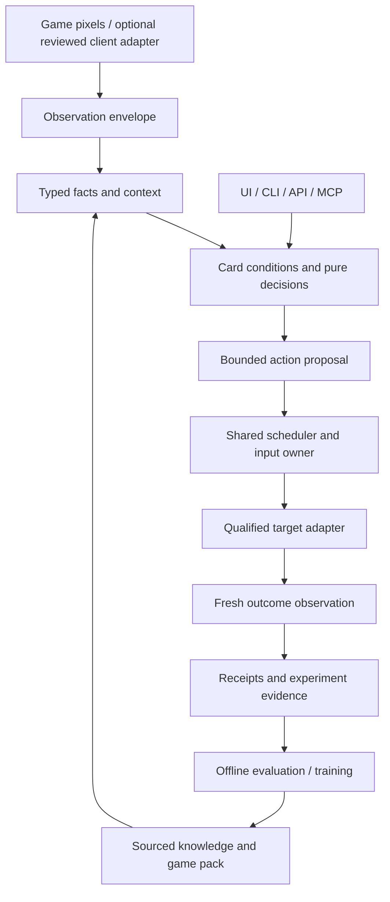

# Maelstrom architecture and integration audit

2026-11-11 · CORE-ARCH-AUDIT-01 · root coordinator.
Scope: actual source, public entry points, local imported projects, recorded
release evidence and representative official game references. Three parallel
reviews covered [cards](coordination/results/CORE-CARD-AUDIT-01.md),
[reuse](coordination/results/CORE-REUSE-AUDIT-01.md) and
[knowledge](coordination/results/W101-KNOWLEDGE-AUDIT-01.md).
No gameplay, desktop use, models, credentials, source-library execution or
installation was part of this audit. The narrow contract repair is source-only.

## Direct answers

| Question | Finding |
| --- | --- |
| Is it streamlined? | Partly. There is one shared scheduler/input owner, but specialist entry points, schemas and discovery remain fragmented. Integrate these before adding another engine. |
| Are functions mapped and callable? | Some are. UI/CLI/MCP and local API exist, but not every specialist is registered there. The new audit inventory maps selected workflow families; it does not claim all methods are discoverable or executable. |
| Do job cards have constraints? | Yes: trusted adapters, game/target identity, conditions, exact filters, freshness, copies/attempts/time/cooldowns, revisions, duplicate suppression, cleanup and recovery. Resource-producing facts and guided validation are incomplete. |
| Are imported projects fully used? | No. All 25 root archives have dispositions, but few complete operations have been integrated. Some are better retained as references, data sources or independent comparison implementations. |
| Can components update independently? | There are versions, hashes and strict parsers; a complete compatibility/migration/rollback contract is still missing. Layering reduces breakage but cannot guarantee arbitrary updates never break consumers. |
| Is there a clear plan? | There was a board and roadmap, but the roadmap had stale release statements. The reconciled roadmap now has ordered deliverables and measurable gates. |
| Is game knowledge accurate? | Uneven. Representative defaults are source-supported, while fixed layouts, formulas and some claimed workflows were unqualified. The working reference is corrected; the database is still a small first import. |

## What actually works versus what is merely exposed

`JobDeckRoutines.Create` has **19 entries**, of which **two have dispatch
adapters**: saved-session replay and bounded selected-conversation quest work.
The other **17 are explicitly preparation-only**. A standalone Dance teacher is
not yet a full Dance deck card; generic quest parsing is not navigation/combat.

The current host deliberately reports health, mana, Energy, potions, inventory,
current area and quest ID/type unavailable. Objective destination is not current
location. This prevents made-up resources, but also means a resource-driven deck
cannot yet perform quest → sell → restock → pets → potions → resume.

Source searches found no production call to `ModuleOperation.SubmitOwned`.
Shared navigation/sigil/menu/Auto-Idle modules are real reusable components and
replay paths, but their generic card execution wiring is unfinished. Native Idle
entry, safe exit and a between-card policy are distinct operations to qualify.

The deck's one-second scan reads cached facts. Explicit observation/start and
quest checks update them; ordinary waiting does not own a recurring refresh.
Facts expire after two seconds. A waiting deck therefore needs a bounded producer
before it can react independently to new external conditions.

See the [machine-readable audit map](../research/maelstrom-capabilities.json).
It records source anchors, surfaces, limits and evidence. The checker verifies
record integrity and references, **not semantic completeness or live readiness**.
It is advisory data and cannot register or execute an operation.

## Aaroneous-style layers without black boxes

Use "transformer" to mean a small, inspectable conversion between contracts.
It need not be a neural model. Preserve the current C# runtime and bounded Python
tools; import useful behavior behind interfaces rather than entire controllers.

These are architectural boundaries to consolidate, not seven new services.
The existing runner, catalog, scheduler, worker and journal implement portions.
The owner's subsequent proposal is normalized in [Cards, routines and decks](ROUTINE_EXECUTION_MODEL.md):
Action Cards and Routine Cards share the same contract, coordinated by the existing
Routine Deck. Completion requires outcomes, interrupts preserve ownership, and
current resource readings replace fixed example capacities.

| Boundary | Required contract | How to prevent a hidden failure |
| --- | --- | --- |
| Source → observation | Target/process generation, acquisition time, source/adapter/build, geometry, sequence and evidence reference | Unavailable, stale and absent are different; no default success metrics. |
| Observation → fact | Stable fact ID, type/unit, producer, scope, freshness and uncertainty | Unknown field names rejected in authoring; conflicts visible; derived facts retain provenance. |
| Fact/context → decision | Pack/policy version, constraints, resources, reason and supported action IDs | Pure replayable decision; no input, sleeps, network calls or hidden model state. |
| Decision → proposal | Target binding, action version, bounded parameters, deadline, prerequisites and expected postcondition | Conversions explicitly narrow limits; a pack's 500 ms action cannot silently become a 150 ms module pulse. |
| Proposal → execution | Immutable admitted inputs, idempotency, one owner, cancellation and recovery | Recheck current facts/target at dispatch; preserve ownership until releases/cleanup verified. |
| Execution → outcome | Receipt plus newer independent observation tied to the proposal | "Sent" is not "worked"; closed combat UI is not victory; failed cleanup blocks new gameplay. |
| Outcome → learning | Frozen run inputs, policy/version, experiment attempt, reward definition and held-out tests | Preserve failures; do not train/test on the same claimed independent games; compare cost and accuracy. |

Suggested common envelope fields are a **design task**, not an assertion that
every current record already carries them. Extend only the consumer that needs a
field, with a documented compatible version. Avoid a giant universal record.

## Card constraints to preserve and finish

Implemented: schema/size limits, at most 64 cards, bounded deck and per-card
attempts/durations, cooldowns, exact include/exclude scopes, unknown-resource
waiting, selected game/target matching, two-second freshness for live work,
trusted callbacks, admission rechecks, immutable evidence and recovery holds.
Preparation cards cannot install delegates or become live through imported JSON.

Missing or incomplete:

- Typed fact catalog: a syntactically valid typo can currently wait forever.
- Producer/readiness explanation before an attempt, including action opt-ins.
- Bounded refresh coordinated with active readers and the existing owner.
- Measured resource facts and per-routine consumption/reserve policies.
- Shared allowed/forbidden effects, supported layouts and verified postconditions
  published consistently across UI, CLI and MCP.
- Atomic configuration/version changes, compatibility negotiation and explicit
  migration support for all pack/module/routine/deck artifacts.

Do not use random card draws to starve necessary cleanup or maintenance. The card
metaphor is presentation; readiness, priorities and bounded scheduling remain
deterministic. Do not bypass ownership/conditions for a "treasure card" override.

## Reuse decisions

The review used local Aaroneous `a3383f2`, Devtools `7e7a3d3` and Guild `b3749df`;
these are exact inspected snapshots, **not an upstream freshness claim**.
The report records full hashes and paths.

| Source family | Reuse that fits | Avoid or defer |
| --- | --- | --- |
| Aaroneous | Typed command/telemetry separation, platform observation/action interfaces, `.si` artifact and learner concepts | Unbounded bridge queues, optimistic default metrics, mock runtime treated as production, whole Rust rewrite. |
| Devtools / Guild / Steward | Immutable requests/attempts, claims, receipts, verifiable lifecycle and resource admission patterns | Second scheduler, merge-specific machinery in game loops, abandoned-run auto-resume without checks. |
| WorkBench / Library / Merlin | Provenance, artifact verification and project/knowledge organization patterns | Copying whole services before a bounded consumer needs them. |
| wizwalker / Deimos / wizSDK | Reviewed optional readers; navigation/combat routines as candidates behind existing owner | Old offsets/coordinates as current truth, separate uncontrolled input loops or live network manipulation. |
| Pet Dance and visual tools | Existing teacher assets, calibrated recognition, supervised examples and comparisons | Treating one layout/PERFECT game as broad full-visit reliability. |
| Other solvers, calculators, WAD/wiki/patch tools | Pure algorithms, offline imports, source metadata and update diagnostics | Arithmetic correctness mistaken for current game-rule correctness. |
| MaaFramework / Airtest | Bounded visual-matching comparisons and adapter patterns | Bundling entire stacks without measured quality/resource benefit. |

The old legacy work-package snapshot still contains superseded UI-only blocks
and pre-qualification Dance statements. It remains historical planning evidence,
not the current authorization or feature matrix. The W101 client-side exception
permits reviewed optional client functionality; every integration still needs
qualification. Network manipulation remains excluded.

## Knowledge accuracy and maintenance

The corrected [working reference](WIZARD101_GAME_KNOWLEDGE.md) now cites primary
controls/navigation/pet sources and labels remaining numbers/formulas unknown.
The previous unsourced "exhaustive" guide incorrectly described AutoIdle as an
input sender and framed planned routines as implemented; those claims are removed.

The existing knowledge bundle has **8 sources, 9 claims, 12 evidence edges and
zero observations/qualifications/runtime candidates**, as verified read-only in
the knowledge audit. A schema and one importer are not a complete game database.
Knowledge export, additional explicit mappings, native consumption and bounded
refresh remain planned. Dates, region/build and contradictory claims must survive
every transformation. No importing step may silently mark a claim qualified.

## Ordered backlog and delivery evidence

The [roadmap](ROADMAP.md) carries the current order and acceptance gates:
canonical validation → typed catalog → observation refresh → combat qualification
→ module/card composition → complete Dance visit → knowledge export → versioned
updates → authoring → integrated release. Knowledge, Conjuration and isolated Dodge
work may proceed in disjoint parallel lanes without blocking the main integration.

One immediate repair uses this architecture: the divergent Python MCP validator
is replaced with a call to the native routine validator through the existing
bounded local API. This removes conflicting definitions instead of adding a
third schema. [Repair and validation evidence](coordination/results/CORE-CONTRACT-REPAIR-01.md).

The last installed checkpoint is documented in
[CORE-DECK-RELEASE-02](coordination/results/CORE-DECK-RELEASE-02.md); the later
[CONNECT-06](coordination/results/W101-COMBAT-CONNECT-06.md) is source-only.
Its 2,047 native tests are prior checkpoint evidence, not a new audit rerun.
No complete combat, automatic launcher sign-in, repeatable all-layout Dance or
Dodge average-50 result is claimed here.

## Validation of this change

- Native full suite: **2,059 passed, zero failed/skipped**, warnings-as-errors,
  with two worker cores. Report: `.local/architecture-audit-20261111/architecture-audit-native.trx`.
- Python: **31 passed** (14 MCP and 17 capability-inventory tests). Black and
  syntax checks passed on owned Python files; native scoped whitespace and
  analyzer verification passed. The restricted formatter could not connect to
  its build-host pipe; the bounded host retry passed.
- Actual built-app MCP → CLI → named pipe → canonical native parser check passed:
  native schema accepted, former schema-2 shape rejected, unchanged deck state,
  no game connection, clean host exit, and stopped-owner result unconfirmed.
  Receipt: `.local/architecture-audit-20261111/native-wire-0f75d1dc725048dd9ae6f970ce134517/result.json`.
- The new advisory inventory covers **26 selected workflow families**. It is
  intentionally not an exhaustive method registry or proof of installation.
- The working reference, index and roadmap were reconciled; the owner's three-level
  card/routine/deck proposal is documented with verified outcomes and shared limits.

No package or installation was produced in this audit. The installed version
does not yet provide the new validation command; its explicit unavailable result
is expected until a matching update is installed. Static audits cannot certify
an entire application or the live accuracy of every imported algorithm.
