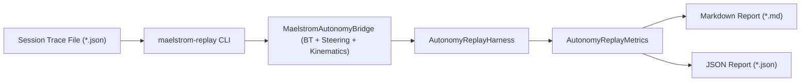

# Autonomy Replay CLI & Statistical Reporting (`maelstrom-replay`)

## 1. Overview & Tool Role

`maelstrom-replay` (`crates/maelstrom-fallback/src/bin/maelstrom-replay.rs`) is the offline verification CLI for the Maelstrom Autonomy Stack. It evaluates recorded multi-hour game session traces (`AutonomyReplaySession`) through `MaelstromAutonomyBridge` without connecting to a live game client, graphic window, or physical actuator.



---

## 2. Command Line Interface

```bash
maelstrom-replay <trace.json> [OPTIONS]
```

### Options:
- `--markdown <path>`: Generates a GitHub-Flavored Markdown summary report containing KPI tables, quality gate badges, curvature statistics, and diagnostic warnings.
- `--json <path>`: Generates a structured JSON metrics artifact suitable for automated CI/CD quality gate enforcement.
- `--max-curvature <float>`: Custom steering curvature threshold before triggering a warning (default: `5.0`).
- `--max-jerk <float>`: Custom kinematic jerk threshold before triggering a warning (default: `10.0`).
- `--help`: Displays command usage and exit codes.

---

## 3. Statistical Report Structure

### 3.1. Executive Summary Table
| Metric | Observed Value | Quality Gate Target | Gate Status |
| :--- | :--- | :--- | :--- |
| **Decision Accuracy** | $99.8\%$ | $\ge 99.5\%$ | **PASS** |
| **Replanning Rate** | $12.4\text{ replans/hr}$ | $\le 30.0\text{ /hr}$ | **PASS** |
| **Peak Steering Curvature** | $1.42\text{ px}^{-1}$ | $< 5.00\text{ px}^{-1}$ | **PASS** |
| **Mean Steering Curvature** | $0.21\text{ px}^{-1}$ | $< 1.00\text{ px}^{-1}$ | **PASS** |
| **Peak Kinematic Jerk** | $2.84\text{ px/ms}^3$ | $< 10.00\text{ px/ms}^3$ | **PASS** |
| **Execution Anomalies** | $0$ warnings | $0$ fatal exceptions | **PASS** |

### 3.2. Curvature & Jerk Analysis
- **Curvature ($\kappa$)**: Continuous evaluation of steering angular velocity relative to linear velocity: $\kappa = \frac{|\omega|}{v}$. Validates that the agent performs smooth arc turns without discontinuous angle snapping.
- **Jerk ($J$)**: Third-order derivative evaluation along mouse waypoints: $J = \frac{\Delta a}{\Delta t}$. Validates conformance to biological minimum-jerk profiles ($s(\tau) = 10\tau^3 - 15\tau^4 + 6\tau^5$).

### 3.3. Phase Replanning Timeline
Traces when the macro-planner or reactive Behavior Tree switched active intent (e.g. `PROPOSAL:StepWaypoint` $\rightarrow$ `PROPOSAL:CombatTurn` $\rightarrow$ `PROPOSAL:DrinkPotion`).

---

## 4. Verification & Invariants

1. **Deterministic Execution**: The harness runs identically on any environment given the same trace file.
2. **Zero Live Intrusion**: Absolutely no sockets, named pipes, window hooks, or hardware input calls are executed.
3. **Fail-Fast File Safety**: Output report files use atomic creation semantics, refusing to clobber existing files unless explicitly specified.

---

## 5. Real Gameplay Trace Ingestion

For details on converting real gameplay captures, UI observations, and routine event streams from `.local` into `AutonomyReplaySession` traces, see [Real Gameplay Trace Ingestion](REAL_TRACE_INGESTION.md).
