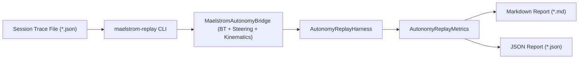

# Autonomy Replay CLI & Statistical Reporting (`maelstrom-replay`)

> **Status (audit 2026-11-20, Claude):** the CLI (`crates/maelstrom-fallback/src/bin/maelstrom-replay.rs`) and its tests are real and run offline. This page
> was written before the binary and described a report, flags and safety properties the binary does not have; it is corrected below. The
> numbers the report prints are the harness's proxies, see [OFFLINE_AUTONOMY_REPLAY.md](OFFLINE_AUTONOMY_REPLAY.md). Notes marked **Today**
> say what the binary does. Evidence: [W101-REPLAY-CLI-CORE-02](coordination/results/W101-REPLAY-CLI-CORE-02.md) and
> [W101-REPLAY-CLI-DOCS-01](coordination/results/W101-REPLAY-CLI-DOCS-01.md), audit notes.

## 1. Overview & Tool Role

`maelstrom-replay` (`crates/maelstrom-fallback/src/bin/maelstrom-replay.rs`) is the offline verification CLI for the Maelstrom Autonomy Stack. It evaluates serialized session traces (`AutonomyReplaySession` JSON; in this repository synthetic fixtures, or frames ingested from event and UI logs) through `MaelstromAutonomyBridge` without connecting to a live game client, graphic window, or physical actuator. It has two modes: one trace file, or `--batch-dir` over a directory.



---

## 2. Command Line Interface

```bash
maelstrom-replay <trace.json> [OPTIONS]
maelstrom-replay --batch-dir <dir> [OPTIONS]
```

### Options:
- `--markdown <path>`: Writes the Markdown report (single trace). In `--batch-dir` mode it is the matrix path when `--matrix-out` is absent.
- `--json <path>`: Writes the metrics (`AutonomyReplayMetrics`) as JSON (single trace): raw numbers and warnings, no thresholds and no gate status. In batch mode it is the fallback for `--matrix-json`.
- `--batch-dir <dir>`: Scans a directory recursively for `*.json` sessions, `events.jsonl` or `*-events.jsonl`, and `ui-observations.jsonl` or `*-ui.jsonl` traces and replays them all. Files that do not parse, and sessions with no frames, are skipped without a message; see [Replay Batch Benchmark](REPLAY_BATCH_BENCHMARK.md).
- `--matrix-out <path>` and `--matrix-json <path>`: Output paths for the batch matrix (Markdown and JSON).
- `--max-curvature <float>` and `--max-jerk <float>`: Thresholds above which the harness records a warning (defaults `5.0` and `10.0`). They do not change the report's gate rows or the exit code (see 3.1).
- `--help` (or `-h`, or no argument at all): Prints usage and exits 0. The help text does not list exit codes.

### Exit codes
| Code | When |
| :--- | :--- |
| 0 | The report was written or printed and, for a single trace, decision accuracy is at least 95.0% (a trace with no labels counts as 100%); in batch mode no session fell below 95.0%. Also `--help`. |
| 1 | Input or I/O error: unknown or incomplete option, unparsable number, missing or unparsable trace, no traces found in the batch directory, or a failed write (message on stderr). |
| 2 | Quality gate: a single trace with decision accuracy below 95.0%, or a batch with at least one session below 95.0% (message on stderr; the reports are written first). |

Curvature, jerk and warnings never change the exit code. The 99.5% figure appears only in the Markdown report's status column.

---

## 3. Statistical Report Structure

### 3.1. Executive Summary Table
The report below is the actual output of `maelstrom-replay` for a synthetic 100-frame fixture built for this audit: 40 straight-line navigation frames, 30 combat
frames, 10 low-health frames and 20 more navigation frames, with labels written to match the tree (a throwaway program, not committed). It is not a recorded
session.

| Metric | Value | Target | Status |
| :--- | :--- | :--- | :--- |
| **Decision Accuracy** | 100.00% | >= 99.5% | **PASS** |
| **Replanning Rate** | 1090.91 replans/hr | <= 30.0 /hr | **PASS** |
| **Replan Count** | 3 | N/A | INFO |
| **Peak Steering Curvature** | 0.000 px^-1 | < 5.000 px^-1 | **PASS** |
| **Mean Steering Curvature** | 0.000 px^-1 | < 1.000 px^-1 | INFO |
| **Peak Kinematic Jerk** | 0.474 px/ms^3 | < 10.000 px/ms^3 | **PASS** |
| **Total Steering Commands** | 60 | N/A | INFO |
| **Total Kinematic Plans** | 30 | N/A | INFO |
| **Diagnostic Warnings** | 0 | 0 warnings | **PASS** |

**Today:**
- An earlier version of this page showed sample values (99.8%, 12.4 replans/hr, 1.42 and 0.21 px^-1, 2.84 px/ms^3) that no run produced, under the heading
  "Observed Value", and an "Execution Anomalies" row that the report does not have (it prints "Diagnostic Warnings", with WARN rather than FAIL).
- The Replanning Rate status is a constant PASS: 3 intent changes over a 9.9 s trace extrapolate to 1090.91 replans/hr, printed beside "<= 30.0 /hr" as PASS,
  because nothing compares the two.
- The curvature rows read 0.000 because the fixture's target lies straight ahead of a heading of zero (see 3.2). Mean curvature has no status (INFO).
- The Target column and the PASS/FAIL for curvature and jerk are the literals 5.0 and 10.0 even when `--max-curvature` or `--max-jerk` is given: with
  `--max-jerk 0.001` the same trace reported 30 warnings (status WARN) while the jerk row still read "< 10.000 ... PASS", and each warning printed its
  threshold as `0.0`.
- The JSON artifact holds only the raw fields (`total_ticks`, `labeled_ticks`, `matched_intent_ticks`, `decision_accuracy_pct`, `replan_count`,
  `replan_rate_per_hour`, `total_steering_commands`, `total_kinematic_plans`, `max_steering_curvature`, `avg_steering_curvature`, `max_kinematic_jerk`,
  `warnings`). It carries no thresholds and no gate status, so a CI job must compare the numbers itself or rely on the exit code.

### 3.2. Curvature & Jerk Analysis
- **Curvature ($\kappa$)**: read from the Pure Pursuit controller's command, $\kappa = 2\sin\alpha / d$, where $\alpha$ is the angle between the heading and the
  lookahead point and $d$ the distance to it (at least 1.0), in world-coordinate units. It is not $|\omega| / v$ and is not measured from motion.
- **Jerk ($J$)**: a scale-dependent proxy from the click-plan summary, `dist / T^3 * 0.001`, with `dist` taken from a fixed screen centre (640, 360); not a
  third derivative along mouse waypoints, and no minimum-jerk conformance is tested. See [OFFLINE_AUTONOMY_REPLAY.md](OFFLINE_AUTONOMY_REPLAY.md) for both.

**Today:** the heading is not observed. `MaelstromAutonomyBridge::process_state` builds the steering pose as `Pose2D::new(x, y, z)`, so the world z coordinate is
passed as the heading in radians, and `NativeHostState` has no heading fact. Probe (x = 100 and y = 150 fixed, target straight ahead on +x): z = 0 gave
$\alpha$ = 0 and a 250 ms forward pulse; z = 0.5 gave $\alpha$ = -0.5 with a 250 ms forward pulse and a 159 ms right turn; z = 1.5 gave no forward pulse and a 477 ms right
turn. The steering figures in a replay therefore describe the z coordinate, not a heading. That is an open design item (where a heading would come from),
not changed here. With a distant target the values are also tiny (about 0.001 in the probe).

### 3.3. Phase Replanning Timeline (not implemented)
The intended output is a timeline of when the active intent switched (e.g. `PROPOSAL:StepWaypoint` $\rightarrow$ `PROPOSAL:CombatTurn` $\rightarrow$ `PROPOSAL:DrinkPotion`).

**Today:** neither the Markdown report nor the JSON has a timeline. They carry only `replan_count` (3 for the fixture above) and the rate. The count is an
intent-change counter over the Behavior Tree's output; no macro-planner takes part.

---

## 4. Verification & Invariants

1. **Deterministic Execution (checked on one machine)**: two runs of the same trace wrote byte-identical Markdown and JSON, and the bridge's PRNG has a fixed seed.
   Identity across machines or builds is not verified.
2. **Zero Live Intrusion (by reading the code)**: `process_state` does no I/O, and the binary opens no socket or named pipe and calls no input function
   (`compute_pipe_name` only hashes a path). It does read the trace, write the report files you name and, in batch mode, create and remove temporary directories.
3. **File safety is not what this page said**: output files are written with `File::create`. An existing file is truncated and overwritten without a message
   (probe: a file holding a sentinel line was replaced), parent directories are created, and the write is not atomic (no temporary file and rename). There is no
   overwrite flag and no refusal to clobber.

---

## 5. Real Gameplay Trace Ingestion

For details on converting real gameplay captures, UI observations, and routine event streams from `.local` into `AutonomyReplaySession` traces, see [Real Gameplay Trace Ingestion](REAL_TRACE_INGESTION.md).
