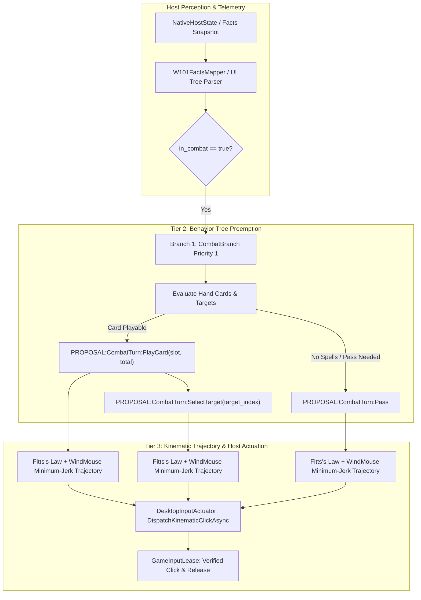

# End-to-End Combat Dueling Loop Integration

## 1. Overview & Operational Architecture

The Wizard101 dueling ring constitutes an isolated turn-based state machine governed by discrete planning phases (30-second planning timer), card drawing, pip accumulation, spell casting, and target arbitration. Under the Maelstrom autonomy architecture, combat transitions are managed via **Tier 2 Behavior Tree Preemption**, while tactile card and target selections are actuated through **Tier 3 Kinematic Input Leases**.

This document specifies the end-to-end integration between the tactical Behavior Tree combat subtree (`Branch 1: CombatInterruption`), screen geometry coordinate transformers (`crates/maelstrom-core/src/combat_geometry.rs`), the autonomy bridge intent synthesizer (`crates/maelstrom-fallback/src/maelstrom_bridge.rs`), and the host actuator (`DesktopInputActuator.cs`).

---

## 2. Dueling Turn Lifecycle & Intent Flow

When `in_combat == true`, the Behavior Tree root selector immediately preempts all lower-priority branches (vital replenishment, stuck recovery, navigation, idle). The combat turn execution advances through a 3-stage transactional sequence:

### Stage 1: Card Selection (`PROPOSAL:CombatTurn:PlayCard`)
- **Precondition**: `in_combat == true`, hand contains $\ge 1$ cards, playable spell selected.
- **Intent Format**: `"PROPOSAL:CombatTurn:PlayCard"` with parameters:
  - `card_slot`: 0-indexed hand slot ($0 \le \text{slot} < \text{total\_cards}$).
  - `total_cards`: total cards in hand ($1 \le \text{total} \le 7$).
- **Screen Geometry**:
  $$\text{Target} = \text{CombatGeometry::get\_hand\_card\_coordinates}(\text{slot}, \text{total})$$
  scaled to active viewport ($1280 \times 720$).
- **Actuation**: Generates minimum-jerk trajectory from current cursor pose to target box, followed by left mouse click with log-normal dwell ($40\text{ms} \le t_{\text{dwell}} \le 200\text{ms}$).

### Stage 2: Target Selection (`PROPOSAL:CombatTurn:SelectTarget`)
- **Precondition**: Card selected, spell requires explicit target (single-target damage or buff/heal).
- **Intent Format**: `"PROPOSAL:CombatTurn:SelectTarget"` with parameters:
  - `target_index`: 0..3 for enemy pedestals (top row); 4..7 for ally pedestals (bottom row).
- **Screen Geometry**:
  $$\text{Target} = \text{CombatGeometry::calculate\_target\_coordinates}(\text{target\_index})$$
- **Actuation**: Smooth cursor glide from card hand area to target sigil, terminating with a verified single click.

### Stage 3: Pass Fallback (`PROPOSAL:CombatTurn:Pass`)
- **Precondition**: `in_combat == true`, zero playable cards, or strategic round pass requested.
- **Intent Format**: `"PROPOSAL:CombatTurn:Pass"`.
- **Screen Geometry**:
  $$\text{Target} = \text{CombatGeometry::PASS\_BUTTON} \quad (\text{scaled to viewport})$$
- **Actuation**: Smooth cursor trajectory to the pass button followed by mouse click.

---

## 3. Viewport Geometry & Coordinate Transformation

Legacy Wizard101 UI measurements are grounded in canonical $800 \times 600$ window coordinates. Maelstrom normalizes desktop inputs across viewports using affine scaling to the standard $1280 \times 720$ base calibration:

$$x_{720} = x_{800} \times \frac{1280}{800} = 1.6 \cdot x_{800}$$
$$y_{720} = y_{800} \times \frac{720}{600} = 1.2 \cdot y_{800}$$

### Coordinate Mapping Matrix:

| UI Element | 800x600 Canonical | 1280x720 Viewport Base | Bounding Radius |
| :--- | :--- | :--- | :--- |
| **Pass Button** | `(254, 398)` | `(406.4, 477.6)` | $\pm 18\text{px}$ |
| **Flee Button** | `(546, 398)` | `(873.6, 477.6)` | $\pm 18\text{px}$ |
| **Spell Area Rect** | `[245, 290, 370, 70]` | `[392.0, 348.0, 592.0, 84.0]` | Hand Container |
| **Enemy 0 (Primary)** | `(130, 50)` | `(208.0, 60.0)` | $\pm 35\text{px}$ Pedestal |
| **Enemy 1** | `(304, 50)` | `(486.4, 60.0)` | $\pm 35\text{px}$ Pedestal |
| **Enemy 2** | `(478, 50)` | `(764.8, 60.0)` | $\pm 35\text{px}$ Pedestal |
| **Enemy 3** | `(652, 50)` | `(1043.2, 60.0)` | $\pm 35\text{px}$ Pedestal |
| **Ally 4 (Self)** | `(682, 590)` | `(1091.2, 708.0)` | $\pm 35\text{px}$ Pedestal |

Every mouse click applies non-centered Gaussian jitter ($\sigma = 0.15 \cdot \text{dimension}$) within the calibrated bounding target, ensuring completely humanized actuation with zero robotic center-pixel clicking.

---

## 4. Host Actuator Invariants & Lease Execution

All combat clicks are dispatched by `DesktopInputActuator.DispatchKinematicClickAsync` under the following hard runtime guarantees:

1. **Exclusive Input Lease (`GameInputLease.Current`)**: Dispatches are rejected immediately if the lease is unowned or expired.
2. **Foreground & Focus Validation**: The Wizard101 process handle must be foreground and focused. Any window change or user mouse bump ($> 2\text{px}$) aborts the click sequence.
3. **Mid-Pulse Polling**: Trajectories poll cancellation and focus every $10\text{ms}$.
4. **Post-Click Release Verification**: On physical click release, mouse button state is verified up before returning success. If release fails, recovery escalation triggers `mouse_event(MOUSEEVENTF_LEFTUP)`.

---

## 5. Verification & Acceptance Criteria

1. **Card Coordinate Validity**: For any valid hand count ($1 \le n \le 7$) and card slot ($0 \le k < n$), calculated coordinates must fall strictly within the 1280x720 screen boundaries.
2. **Target Resolution**: Target indices $0 \le t \le 7$ must map to strictly distinct, non-overlapping screen positions.
3. **Preemption Resiliency**: If combat finishes mid-turn (`in_combat` flips to `false`), the Behavior Tree must immediately reset the combat branch and yield back to navigation or recovery.
4. **End-to-End Simulation**: Autonomy intents must parse cleanly through the named-pipe `"actuate"` command, producing verified simulation receipts.

---

## 6. Pre-Battle Deck Profile Selection & Spellbook Invariants

Before entering combat, deck profiles (`MobAoE`, `BossFeint`, `SchoolPrism`, `HealSupport`) must be verified and switched while strictly outside combat in a verified safe zone. See [Pre-Battle Deck Profile Switching](PRE_BATTLE_DECK_PROFILES.md) for full geometry, safe-margin preconditions, and GOAP integration contracts.

---

## 7. Concrete Turn-by-Turn Card Evaluation

During each 30-second combat planning window, cards in hand are evaluated against available pips (regular vs. power pips), active blade/trap multipliers, and lethal kill thresholds. See [Combat Turn Evaluator Engine](COMBAT_TURN_EVALUATOR.md) for full pip math, scoring formulas, and pedestal selection logic.

