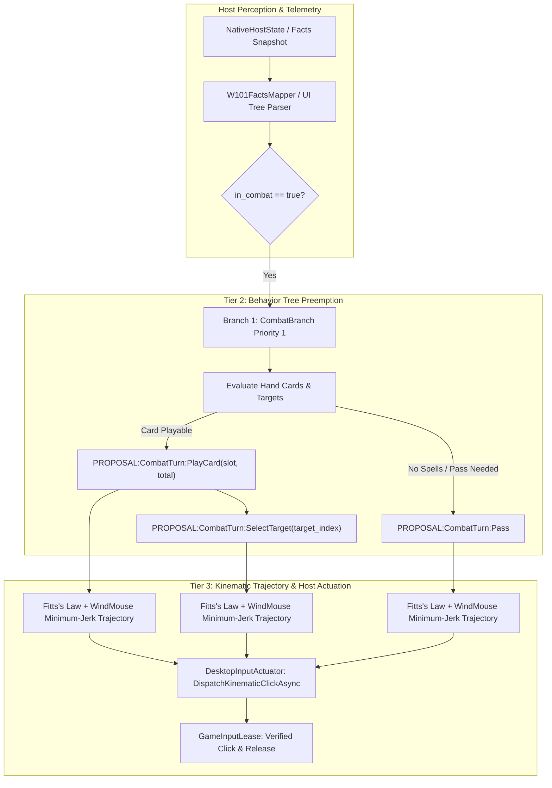

# End-to-End Combat Dueling Loop Integration

> **Status (audited 2026-11-20):** design plus pieces that do not connect. In code: `CombatGeometry` (800x600 constants and their scaling to
> 1280x720, 10 geometry tests including spellbook ones), the `ExecuteCombatTurn` action that copies a blackboard string into `PROPOSAL:CombatTurn[:...]`, the bridge
> branch that turns that string into a sampled click target and a Fitts/Bezier plan summary (8 bridge tests), and
> `DesktopInputActuator.DispatchKinematicClickAsync` (4 click tests). Not in code: any choice of card, target or pass (only tests set
> `combat_turn_action`; see [COMBAT_TURN_EVALUATOR.md](COMBAT_TURN_EVALUATOR.md)), any hand or pip evaluation, the three-stage
> sequencing, and any Rust-to-host path (no Rust code sends `actuate`, and the host's live branch sends no input). The 1280x720
> coordinates are the 800x600 values multiplied by 1.6 and 1.2; they were never measured at 1280x720, and this repository's own
> resolution plan says such geometry must be measured. Notes marked **Today** say what the code does. Evidence:
> [W101-COMBAT-DUEL-CORE-02](coordination/results/W101-COMBAT-DUEL-CORE-02.md) and
> [W101-COMBAT-DUEL-DOCS-01](coordination/results/W101-COMBAT-DUEL-DOCS-01.md), audit notes.

## 1. Overview & Operational Architecture

The Wizard101 dueling ring constitutes an isolated turn-based state machine governed by discrete planning phases (30-second planning timer), card drawing, pip accumulation, spell casting, and target arbitration (the 30-second timer and the other game rules here have no source in this repository; see
[COMBAT_TURN_EVALUATOR.md](COMBAT_TURN_EVALUATOR.md)). Under the Maelstrom autonomy architecture, combat transitions are managed via **Tier 2 Behavior Tree Preemption**, while tactile card and target selections are actuated through **Tier 3 Kinematic Input Leases**.

This document specifies the end-to-end integration between the tactical Behavior Tree combat subtree (`Branch 1: CombatInterruption`), screen geometry coordinate transformers (`crates/maelstrom-core/src/combat_geometry.rs`), the autonomy bridge intent synthesizer (`crates/maelstrom-fallback/src/maelstrom_bridge.rs`), and the host actuator (`DesktopInputActuator.cs`).

**Today:** the diagram is the intended flow, not what runs. Nothing implements `EvalHand`; the three proposal nodes are not a sequence
(one blackboard string, set only by tests); the bridge plans with `BezierTrajectoryGenerator`, not WindMouse (`WindMouseGenerator`
exists in `kinematics.rs` and the bridge does not call it); and the arrow from the kinematic nodes to the actuator carries only an end
point and a dwell, and only when someone sends it, because no Rust code does.

---

## 2. Dueling Turn Lifecycle & Intent Flow

When `in_combat == true`, the Behavior Tree root selector immediately preempts all lower-priority branches (vital replenishment, stuck recovery, navigation, idle). The combat turn execution advances through a 3-stage transactional sequence:

**Today:** `in_combat` preemption is real: `CombatBranch` is the first branch and `ExecuteCombatTurn` returns `Running`. The rest of this
section is intent. `ExecuteCombatTurn` only copies `blackboard.combat_turn_action` into `PROPOSAL:CombatTurn:<action>` (the bare
`PROPOSAL:CombatTurn` when it is `None`) and never clears it, so one action is re-proposed on every tick; there are no stages,
preconditions or transitions between them. The action strings are `Pass`, `PlayCard:<slot>/<total>` and `SelectTarget:<index>`, not
separate "parameters". When combat ends nothing "resets" the branch: the next tick fails `CheckInCombat` and falls through, and a
stale `combat_turn_action` stays on the blackboard for the next fight.

### Stage 1: Card Selection (`PROPOSAL:CombatTurn:PlayCard`)
- **Precondition**: `in_combat == true`, hand contains $\ge 1$ cards, playable spell selected.
- **Intent Format**: `"PROPOSAL:CombatTurn:PlayCard"` with parameters:
  - `card_slot`: 0-indexed hand slot ($0 \le \text{slot} < \text{total\_cards}$).
  - `total_cards`: total cards in hand ($1 \le \text{total} \le 7$).
- **Screen Geometry**:
  $$\text{Target} = \text{CombatGeometry::get\_hand\_card\_coordinates}(\text{slot}, \text{total})$$
  scaled to active viewport ($1280 \times 720$).
- **Actuation**: Generates minimum-jerk trajectory from current cursor pose to target box, followed by left mouse click with log-normal dwell ($40\text{ms} \le t_{\text{dwell}} \le 200\text{ms}$).

### Stage 2: Target Selection (`PROPOSAL:CombatTurn:SelectTarget`)
- **Precondition**: Card selected, spell requires explicit target (single-target damage or buff/heal).
- **Intent Format**: `"PROPOSAL:CombatTurn:SelectTarget"` with parameters:
  - `target_index`: 0..3 for enemy pedestals (top row); 4..7 for ally pedestals (bottom row).
- **Screen Geometry**:
  $$\text{Target} = \text{CombatGeometry::calculate\_target\_coordinates}(\text{target\_index})$$
- **Actuation**: Smooth cursor glide from card hand area to target sigil, terminating with a verified single click.

### Stage 3: Pass Fallback (`PROPOSAL:CombatTurn:Pass`)
- **Precondition**: `in_combat == true`, zero playable cards, or strategic round pass requested.
- **Intent Format**: `"PROPOSAL:CombatTurn:Pass"`.
- **Screen Geometry**:
  $$\text{Target} = \text{CombatGeometry::PASS\_BUTTON} \quad (\text{scaled to viewport})$$
- **Actuation**: Smooth cursor trajectory to the pass button followed by mouse click.

**Today (actuation and malformed intents):**
- The trajectory starts at the player's world position (`blackboard.current_pose`, x and y), not at the cursor. Probe: the same Pass
  click was planned at 139 ms from a pose of (406, 477), 738 ms from (100, 100) and 1319 ms from (5000, 5000). The plan summary carries
  only the end point, the dwell and the totals, and `DispatchKinematicClickAsync` uses only the end point and the dwell: it sends a
  button-down and a button-up at the target and does not move the cursor along the path or honor the duration.
- Malformed or unknown actions still produce a click target. `PlayCard:9/4` and `PlayCard:0/9` fall back to the single-card position
  (688, 390); `PlayCard:x/y` gives slot 0 of 4 and `PlayCard:2` slot 2 of 4; `SelectTarget:99` and `SelectTarget:abc` fall back to Enemy 0;
  an unknown action such as `Flee` or `Foo`, and the bare intent, are treated as a card click (slot 0 of 4). No `Flee` action exists,
  although a flee button position does. `CombatGeometry` itself returns `Err` for these inputs; the bridge discards the error with
  `unwrap_or`.
- Dwell: the Rust profile samples 40-180 ms (median about 75 ms by construction, not measured), and the actuator clamps whatever it
  receives to 40-200 ms. The Fitts constants (120 ms intercept, 160 ms slope) are likewise unsourced.

---

## 3. Viewport Geometry & Coordinate Transformation

Legacy Wizard101 UI measurements are grounded in canonical $800 \times 600$ window coordinates. Maelstrom normalizes desktop inputs across viewports using affine scaling to the standard $1280 \times 720$ base calibration:

$$x_{720} = x_{800} \times \frac{1280}{800} = 1.6 \cdot x_{800}$$
$$y_{720} = y_{800} \times \frac{720}{600} = 1.2 \cdot y_{800}$$

**Today:** these are plain multiplications of the 800x600 constants ported from WizSDK, Deimos and `CombatGeometry.cs`; "calibrated" and
"canonical" do not mean measured. Whether the game's combat UI scales that way in a 16:9 window is not established here, and
[RESOLUTION-1440P-01](coordination/results/RESOLUTION-1440P-01.md) records that client geometry must be measured, never inferred from
scale (a game window observed on 2026-11-16 had a 2033 x 1066 client area, not 1280 x 720).

### Coordinate Mapping Matrix:

| UI Element | 800x600 Canonical | 1280x720 Viewport Base | Bounding Radius |
| :--- | :--- | :--- | :--- |
| **Pass Button** | `(254, 398)` | `(406.4, 477.6)` | $\pm 18 \times \pm 10\text{px}$ (36 x 20 box in the bridge) |
| **Flee Button** | `(546, 398)` | `(873.6, 477.6)` | none: no click path or `Flee` action uses it |
| **Spell Area Rect** | `[245, 290, 370, 70]` | `[392.0, 348.0, 592.0, 84.0]` | Hand Container |
| **Enemy 0 (Primary)** | `(130, 50)` | `(208.0, 60.0)` | $\pm 25\text{px}$ (50 x 50 box) |
| **Enemy 1** | `(304, 50)` | `(486.4, 60.0)` | $\pm 25\text{px}$ (50 x 50 box) |
| **Enemy 2** | `(478, 50)` | `(764.8, 60.0)` | $\pm 25\text{px}$ (50 x 50 box) |
| **Enemy 3** | `(652, 50)` | `(1043.2, 60.0)` | $\pm 25\text{px}$ (50 x 50 box) |
| **Ally 4** | `(682, 590)` | `(1091.2, 708.0)` | $\pm 25\text{px}$ (50 x 50 box); that index 4 is the player's own pedestal is unsourced |

Allies 5, 6 and 7 are at x = 812.8, 534.4 and 256.0 (right to left), all at y = 708.0. A 7-card hand spans x = 438.4 to 937.6 at
y = 390.0.

Click targets are sampled by `sample_target_in_rect`: a Gaussian centered on the box (not off-center) with a standard deviation of about
0.17 of the box size, clamped to 0.425 of it either side. The 0.15 passed in is a margin ratio, not the standard deviation. Probe over
20,000 draws: 6.0 x 3.4 px for Pass, 8.4 px for a pedestal, 10.1 x 11.8 px for a card. Whether this placement matters beyond not always
hitting the exact center is unsourced.

**Today:** the ally row sits at y = 708 of 720, so the jitter box crosses the bottom edge: in the probe 7.8% of sampled clicks for
allies 4 and 5 had y above 720 (allies 6 and 7 share the row and box size) and the actuator's bounds check would reject them. The "zero out-of-bounds clicks" guarantee holds only
because the actuator refuses those clicks.

---

## 4. Host Actuator Invariants & Lease Execution

All combat clicks are dispatched by `DesktopInputActuator.DispatchKinematicClickAsync` under the following checks:

1. **Exclusive Input Lease (`GameInputLease.Current`)**: Dispatches are rejected immediately if the lease is unowned or expired.
2. **Foreground, focus and takeover**: not in the actuator. It calls a caller-supplied `ready()` delegate (`() => true` in simulation and
   `() => _session != null` in the live branch). No pointer-movement threshold (the earlier "> 2 px" rule) exists in this code.
3. **Re-check during the dwell**: there is no trajectory to poll. While the button is held, lease identity, the cancellation token and
   `ready()` are re-checked about every 10 ms; a failed check stops the hold and the button is released.
4. **Release**: a second `SendMouse(..., up: true)`, retried every 100 ms for up to 5 s. Its boolean result is the confirmation (the button
   state is not read back), and a failure puts the lease into `RequireRecovery`. The actuator does not call `mouse_event`.

**Today:** the host's live `actuate` branch builds the actuator with a runtime whose key and mouse sends return `false`, so a live click
is never accepted; it runs the 5 s release retry and then requires recovery. Only the simulation branch records events (with a no-op
delay). See [Desktop Input Actuator](DESKTOP_INPUT_ACTUATOR.md).

---

## 5. Verification & Acceptance Criteria

1. **Card Coordinate Validity**: For any valid hand count ($1 \le n \le 7$) and card slot ($0 \le k < n$), calculated coordinates must fall strictly within the 1280x720 screen boundaries.
2. **Target Resolution**: Target indices $0 \le t \le 7$ must map to strictly distinct, non-overlapping screen positions.
3. **Preemption Resiliency**: If combat finishes mid-turn (`in_combat` flips to `false`), the Behavior Tree must immediately reset the combat branch and yield back to navigation or recovery.
4. **End-to-End Simulation**: Autonomy intents must parse cleanly through the named-pipe `"actuate"` command, producing verified simulation receipts.

**Today:** criterion 1 is tested for card centers (`test_combat_hand_card_spacing_all_hand_sizes`), and criterion 2 holds (the eight
positions are distinct and at least 278 px apart in x within a row). Criterion 3 is not implemented as written (see section 2).
Criterion 4 is untested end to end: no Rust code sends `actuate`, and the host tests build the click summary by hand with coordinates
copied from the Rust constants, so nothing checks that a bridge plan is accepted by the host.

---

## 6. Pre-Battle Deck Profile Selection & Spellbook Invariants

Before entering combat, deck profiles (`MobAoE`, `BossFeint`, `SchoolPrism`, `HealSupport`) must be verified and switched while strictly outside combat in a verified safe zone. See [Pre-Battle Deck Profile Switching](PRE_BATTLE_DECK_PROFILES.md) for full geometry, safe-margin preconditions, and GOAP integration contracts.

> **Status (audit 2026-11-19):** design intent. The safe-zone distance rule and the Spellbook sequence are not implemented;
> see the status banner in [Pre-Battle Deck Profile Switching](PRE_BATTLE_DECK_PROFILES.md).

---

## 7. Concrete Turn-by-Turn Card Evaluation

During each 30-second combat planning window, cards in hand are evaluated against available pips (regular vs. power pips), active blade/trap multipliers, and lethal kill thresholds. See [Combat Turn Evaluator Engine](COMBAT_TURN_EVALUATOR.md) for full pip math, scoring formulas, and pedestal selection logic.

