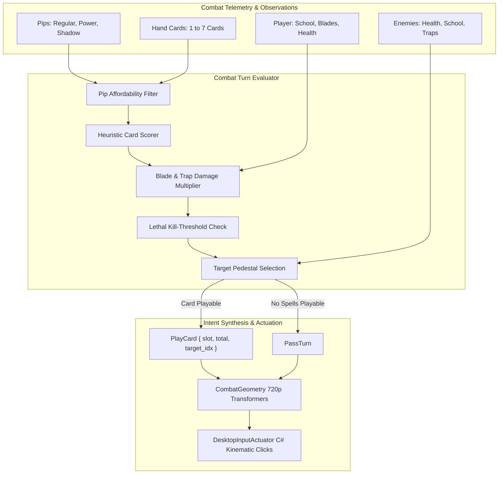

# Combat Turn Evaluator Engine

> **Status (audit 2026-11-19, Claude):** the evaluator module and its 11 tests exist and pass; the rest of this page's
> pipeline is not built. Nothing outside `combat_turn_evaluator.rs` and its own tests calls `CombatTurnEvaluator`, no Behavior
> Tree branch runs it, and no code turns a `CombatDecision` into the `PROPOSAL:CombatTurn:...` strings. The game-rule figures
> below (30-second window, 7-card hand, power-pip doubling, Blade and Feint percentages, the 4-pip AoE list) have no source in
> this repository. Sections 2 to 5 were corrected to what the code does; the evidence is in the audit note of
> [W101-COMBAT-EVAL-DOCS-01](coordination/results/W101-COMBAT-EVAL-DOCS-01.md).

## 1. Operational Rationale & Architecture

In Wizard101 dueling circles, turn-based combat planning takes place within a strict **30-second decision window**. During this window, players must assess their available pips, evaluate up to 7 cards in hand, apply enchantments, stack buffs/blades, and select enemy pedestals or pass.

The **Combat Turn Evaluator Engine** (`crates/maelstrom-core/src/combat_turn_evaluator.rs`) operates as a purely functional, deterministic decision synthesizer. Given immutable observations of the duel circle state, it picks an action with a fixed priority list (Section 3), which is a heuristic and not proven optimal, and returns a `CombatDecision`. Turning that decision into intents for the kinematics and actuation layers is not implemented (see the status note above); the diagram shows the intended flow:

> The **Intent Synthesis & Actuation** block is a plan, not code: `CombatTurnEvaluator` returns a `CombatDecision` and stops
> there. The evaluator stages drawn above are also looser than the code, which is a priority list (Section 3).

---

## 2. Pip Arithmetic & Power Pip Accounting

Wizard101 enforces distinct rules for regular pips and power pips:
- **Regular Pip**: Yields 1 pip for any spell of any school.
- **Power Pip**: Counts as 2 pips for a spell of the player's primary school and as 1 pip otherwise. The code also counts a power pip as 2 for any Balance spell, whatever the player's school. **Unsourced:** neither rule is cited in this repository.

### Effective Pip Equation
For a candidate card of school $S_{\text{card}}$ evaluated by a player with primary school $S_{\text{player}}$:

$$P_{\text{eff}}(S_{\text{card}}) = N_{\text{regular}} + \begin{cases} 2 \cdot N_{\text{power}} & \text{if } S_{\text{card}} == S_{\text{player}} \lor S_{\text{card}} == \text{Balance} \\ N_{\text{power}} & \text{otherwise} \end{cases}$$

A card is strictly **unaffordable** and pruned from the decision tree if:
$$P_{\text{cost}} > P_{\text{eff}}(S_{\text{card}})$$

Mastery amulets are not modeled: `CombatPips::effective_pips` takes only the card school and the player's school. Shadow pips
are a separate check: a card is also unaffordable when its `shadow_pip_cost` exceeds the shadow pips available.

---

## 3. Damage Calculation & Lethal Kill Priority

Spells are scored dynamically based on their ability to eliminate opponents and minimize incoming damage over the turn horizon.

### Estimated Damage Model
$$D_{\text{est}} = D_{\text{base}} \cdot (1 + \text{gear\_damage}) \cdot \prod_{b \in \text{blades}} (1 + b) \cdot \prod_{t \in \text{traps}} (1 + t) \cdot (1 - \text{target\_resist})$$

In the code the blades are the player's active blades, the traps are the target's, and `target_resist` is a single number per
combatant (clamped to -1..1 and applied as `max(0, 1 - resist)`), not a per-school lookup, so the spell's school does not change
it. A boss rule with `CapDamagePerHit` caps the result.

### Priority Ranking (as implemented in `evaluate_turn`)
The first rule that applies wins, and only affordable cards are considered. An empty hand, no living enemy or no affordable card
gives a Pass.
1. **Heal**: if the player is below 30 percent of maximum health, healing is not forbidden by a boss rule and an affordable `HealSelf`
   card is in hand, play it on the player's own pedestal.
2. **Required damage over time**: if a living enemy's boss rule requires damage over time and an affordable `DamageOverTime` card
   is in hand, play the one with the highest base damage on the lowest-health living enemy.
3. **Area damage**: with 2 or more living enemies (and no damage-over-time requirement), play the first affordable `DamageAoE`
   card in hand on pedestal 0, whatever its pip cost and whatever it would deal, even when a single-target card could kill an enemy
   outright. `is_lethal` is set when the estimate kills any enemy.
4. **Lethal hit**: otherwise, the first affordable single-target or damage-over-time card in hand order that can kill a living enemy,
   aimed at the first such enemy in the order the enemies were supplied. The estimate includes the blades already active on the
   player and the traps already on that enemy. With exactly one living enemy, an affordable `DamageAoE` card that kills it also
   qualifies, in hand order.
5. **Blade stacking**: if blades are not forbidden and fewer than 2 are active on the player, play the affordable `BladeSelf` card
   with the highest `buff_percentage` on the player's pedestal.
6. **Trap stacking**: if traps are not forbidden, play the affordable `TrapEnemy` card with the highest `buff_percentage` on the
   first living enemy that has no trap.
7. **Damage fallback**: play the affordable single-target (or damage-over-time) card with the highest base damage on the
   lowest-health living enemy.
8. **Pass** otherwise. `ShieldSelf` and `EnchantDamage` cards are never played.

The code does not look ahead: it never plays a blade to set up a lethal hit next round and does not weigh saving pips. Earlier
versions of this section also gave Blade +35 or +40 percent, Feint +70 percent and a list of 4-pip AoE cards (Meteor Strike,
Tempest, Blizzard, Sandstorm); none of that is in the code, where each card carries its own `buff_percentage` and AoE cards of any
cost qualify.

---

## 4. Target Pedestal Arbitration

| Spell Target Type | Target the code selects | Coordinate Resolution Anchor |
| :--- | :--- | :--- |
| **Single Target Damage** | The first enemy, in the order supplied, that the card can kill; otherwise the lowest-health living enemy. There is no boss preference, and the index is the enemy's own `pedestal_index`, which is not checked against 0..3. | `CombatGeometry::calculate_target_coordinates` (not called by the evaluator) |
| **All Enemies (AoE)** | Always pedestal 0 | `CombatGeometry::calculate_target_coordinates(0)` (not called by the evaluator) |
| **Blade (self buff)** | The player's own `pedestal_index` (4 in this page's convention) | `CombatGeometry::calculate_target_coordinates(4)` (not called by the evaluator) |
| **Trap** | The first living enemy with no trap | `CombatGeometry::calculate_target_coordinates` (not called by the evaluator) |
| **Heal** | The player only: `HealSelf` below 30 percent health. There is no ally healing and no selection of allies 4..7. | `CombatGeometry::calculate_target_coordinates(4)` (not called by the evaluator) |
| **Shield, enchant** | Never played | none |

---

## 5. Behavior Tree & Scheduler Integration

> **Not implemented.** `CombatInterruptionBranch` does not exist, and there is no `CombatTurnEvaluator::evaluate`; the method is
> `evaluate_turn(pips, hand, player, enemies)`. Nothing calls it outside its own tests.

What exists around it, unconnected:
1. The Behavior Tree's combat branch (`ExecuteCombatTurn` in `behavior_tree.rs`) turns a plain string in the blackboard field
   `combat_turn_action` into `PROPOSAL:CombatTurn:<string>`. Only tests set that field; nothing derives it from a `CombatDecision`.
2. The bridge (`maelstrom_bridge.rs`) parses `PROPOSAL:CombatTurn:Pass`, `PROPOSAL:CombatTurn:SelectTarget:<index>` and
   `PROPOSAL:CombatTurn:PlayCard:<slot>/<total>` into a Bezier click plan using `CombatGeometry`. Those colon and slash forms are
   not the `PlayCard(slot, total_cards)` form once written here.
3. Nothing sends a click plan to the host. The host's `DesktopInputActuator` and `GameInputLease` exist, but no Rust code sends
   them an intent (see [W101-IPC-CORE-02](coordination/results/W101-IPC-CORE-02.md)).
