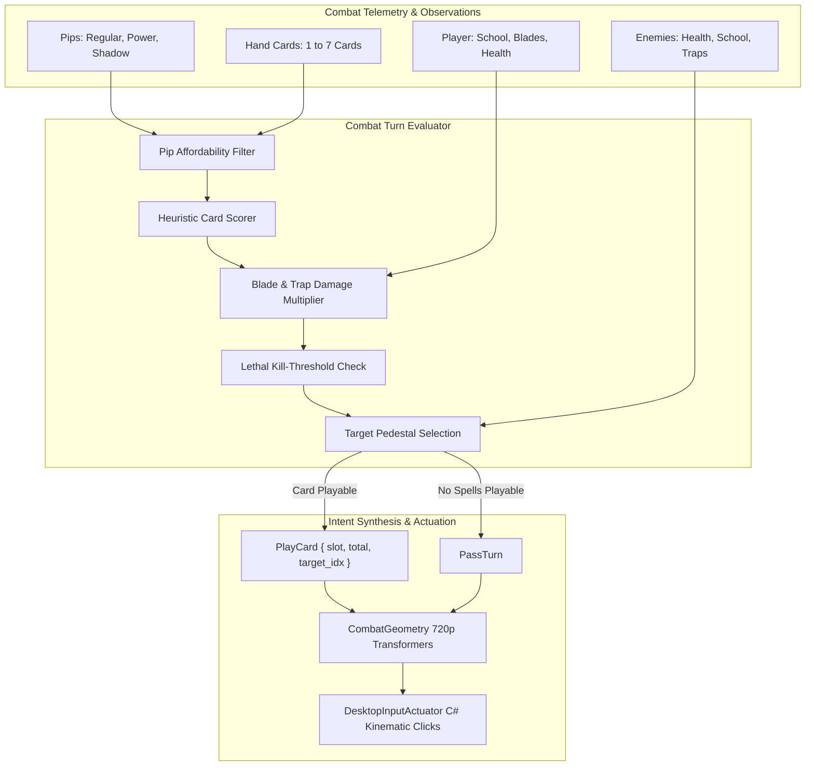

# Combat Turn Evaluator Engine

## 1. Operational Rationale & Architecture

In Wizard101 dueling circles, turn-based combat planning takes place within a strict **30-second decision window**. During this window, players must assess their available pips, evaluate up to 7 cards in hand, apply enchantments, stack buffs/blades, and select enemy pedestals or pass.

The **Combat Turn Evaluator Engine** (`crates/maelstrom-core/src/combat_turn_evaluator.rs`) operates as a purely functional, deterministic decision synthesizer. Given immutable observations of the duel circle state, it determines the mathematically optimal action and emits concrete, executable intents for the kinematics and actuation layers:

---

## 2. Pip Arithmetic & Power Pip Accounting

Wizard101 enforces distinct rules for regular pips and power pips:
- **Regular Pip**: Yields 1 pip for any spell of any school.
- **Power Pip**: Yields 2 pips for spells matching the player's primary school (or an equipped Mastery Amulet school), but only 1 pip for off-school spells.

### Effective Pip Equation
For a candidate card of school $S_{\text{card}}$ evaluated by a player with primary school $S_{\text{player}}$:

$$P_{\text{eff}}(S_{\text{card}}) = N_{\text{regular}} + \begin{cases} 2 \cdot N_{\text{power}} & \text{if } S_{\text{card}} == S_{\text{player}} \lor \text{Mastery}(S_{\text{card}}) \\ N_{\text{power}} & \text{otherwise} \end{cases}$$

A card is strictly **unaffordable** and pruned from the decision tree if:
$$P_{\text{cost}} > P_{\text{eff}}(S_{\text{card}})$$

---

## 3. Damage Calculation & Lethal Kill Priority

Spells are scored dynamically based on their ability to eliminate opponents and minimize incoming damage over the turn horizon.

### Estimated Damage Model
$$D_{\text{est}} = D_{\text{base}} \cdot (1 + \text{gear\_damage}) \cdot \prod_{b \in \text{blades}} (1 + b) \cdot \prod_{t \in \text{traps}} (1 + t) \cdot (1 - \text{target\_resist})$$

### Priority Ranking
1. **Lethal Kill Priority**: If $D_{\text{est}} \ge \text{target.health}$, the spell guarantees an immediate kill, removing an enemy turn and eliminating subsequent round damage.
2. **Buff Stacking Priority**: If a damage spell cannot achieve a lethal kill, and a compatible Blade (+35% / +40%) or Feint (+70%) is in hand and not yet active on the target, prioritize playing the buff to set up a lethal hit next round.
3. **AoE Priority**: In multi-mob street encounters, 4-pip AoE cards (Meteor Strike, Tempest, Blizzard, Sandstorm) take precedence when 2+ enemies are present.
4. **Pass Fallback**: If no card can be cast or it is optimal to save pips for a high-value spell next round, dispatch a Pass.

---

## 4. Target Pedestal Arbitration

| Spell Target Type | Selected Target Pedestal | Coordinate Resolution Anchor |
| :--- | :--- | :--- |
| **Single Target Damage** | Enemy with lowest health $\le D_{\text{est}}$, or boss | Pedestals 0..3 (`CombatGeometry::calculate_target_coordinates`) |
| **All Enemies (AoE)** | Always Pedestal 0 (applies to all) | Pedestal 0 (`CombatGeometry::calculate_target_coordinates(0)`) |
| **Self Buff (Blade / Shield)** | Always Ally 4 (Self) | Pedestal 4 (`CombatGeometry::calculate_target_coordinates(4)`) |
| **Heal** | Ally with lowest health percentage | Pedestal 4 (Self) or lowest ally 4..7 |

---

## 5. Behavior Tree & Scheduler Integration

1. `CombatInterruptionBranch` ticks every planning round.
2. `CombatTurnEvaluator::evaluate(&combat_obs)` produces a `CombatDecision`.
3. If `CombatDecision::PlayCard { slot, total_cards, target_index }`:
   - Emits `PROPOSAL:CombatTurn:PlayCard(slot, total_cards)`.
   - Emits `PROPOSAL:CombatTurn:SelectTarget(target_index)`.
4. If `CombatDecision::Pass`:
   - Emits `PROPOSAL:CombatTurn:Pass`.
5. The C# host actuator executes the trajectory via `DesktopInputActuator` under the `GameInputLease`.
