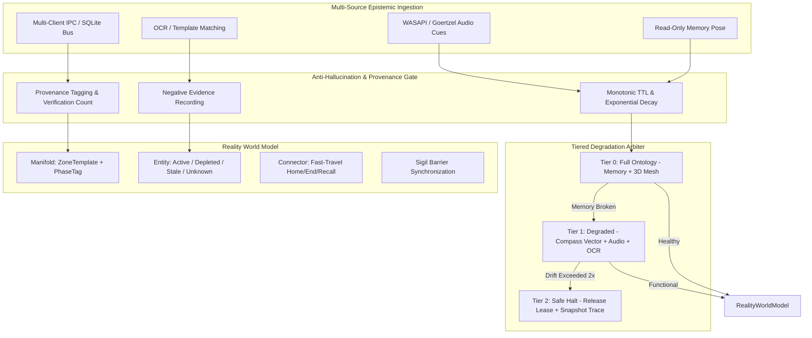
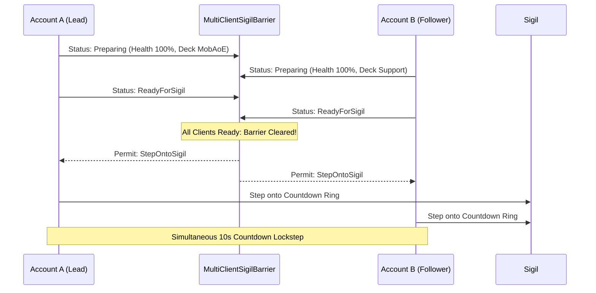
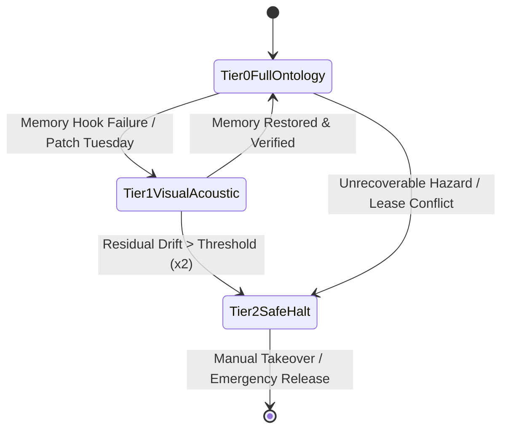

# Epistemic Reality Runtime Hardening

## 1. Operational Rationale & Systems-Level Failure Modes

When Maelstrom operates as a **reality environment runtime** governed by a formal primitive ontology (`Manifold`, `Entity`, `Affordance`, `Connector`, `Hazard`, `Resource`, `Predicate`), the critical operational bottlenecks shift from game-specific scripting to **epistemic failure modes**:
- External reality drifts, stalls, or mutates non-deterministically.
- Sensor inputs drop frames, memory offsets break after game client patches, or environmental occlusions distort screen space.
- Stale world facts persist past their expiration date, causing autonomous agents to plan paths around "ghost" obstacles or detour toward already-harvested reagent anchors.

This specification formalizes the systems-level architecture required to guarantee deterministic operation, anti-hallucination discipline, multi-client lockstep, and tiered graceful degradation.

---

## 2. Native Client Affordances as First-Class Ontology Shortcuts

Rather than computing expensive, high-risk 3D walking trajectories across multi-zone corridors, Maelstrom models Wizard101's built-in keyboard navigation shortcuts directly as **$O(1)$ low-cost Connector edges and Affordance primitives**:

### Fast-Travel Topological Connectors
| Shortcut Key | Ontology Connector | Traversal Cost | Operational Contract |
| :--- | :--- | :--- | :--- |
| **`Home`** | `ConnectorKind::FastTravelHome` | $0.1$ | Instant zero-pathing transition from any non-combat overworld location to the player's Dorm or Castle. |
| **`End`** | `ConnectorKind::FastTravelCommons` | $0.1$ | Instant zero-pathing transition to the world's central hub (e.g., Commons in Wizard City). |
| **`Page Down`** | `AffordanceKind::SetMarker` | $0.05$ | Records a dynamic teleport anchor $(X, Y, Z, \text{manifold})$ at the current safe coordinate. |
| **`Page Up`** | `ConnectorKind::MarkerRecall` | $0.1$ | Instant zero-pathing recall to the recorded marker, consuming 20% Mana. Enables risk-free dungeon checkpointing and rapid potion refills. |
| **`Ctrl+O`** | `AffordanceKind::EmergencyPotion` | $0.05$ | Out-of-combat instant replenishment of 100% Health and 50% Mana, bypassing potion vendor routing. |

### Zero-Click UI Navigation Toggles
- **`Ctrl+Shift+Q`**: Snaps the built-in Quest Helper arrow to the nearest available objective, yielding an immediate orientation bearing vector without journal parsing.
- **`N`**: Toggles 3D in-world navigation bubbles on/off.
- **`Ctrl+T`**: Toggles the active quest tracker HUD window.
- **`Ctrl+K`**: Toggles out-of-combat deck switching, exposing pre-configured deck profiles (MobAoE, BossFeint) without menu tree navigation.
- **`Ctrl+M`**: Opens the Realm Switcher dialog directly, enabling $O(1)$ realm-hopping for reagent farming and quiet realms.

---

## 3. Epistemic Decay, Staleness & Anti-Hallucination TTLs

A reality runtime that trusts stale facts is prone to catastrophic hallucinations.

### Temporal Decay Half-Life Formulation
Every dynamic `Entity` and grounded `Predicate` carries a monotonic timestamp $t_0$ and a half-life parameter $\lambda$:

$$C(t) = C_0 \cdot \exp\left(-\lambda (t - t_0)\right)$$

| Entity / Predicate Kind | Observation TTL | Decay Half-Life $\lambda^{-1}$ | Expiration State |
| :--- | :--- | :--- | :--- |
| **Static Geometry / Manifold** | $\infty$ (Immutable) | $\infty$ | Static Baseline |
| **Dynamic Roaming Mob** | $500\text{ ms}$ | $150\text{ ms}$ | `EntityEpistemicState::Unknown` |
| **Active Reagent / Chest** | $45\text{ s}$ | $10\text{ s}$ | `EntityEpistemicState::Stale` |
| **Harvested Reagent Node** | Node Cooldown (e.g. 60s) | $\infty$ until cooldown | `EntityEpistemicState::Depleted(cooldown_until)` |
| **InCombat Predicate** | $2000\text{ ms}$ | $500\text{ ms}$ | Re-verified via Combat Fanfare or HUD check |

### Negative Evidence Recording
When the path planner routes to an anticipated reagent or chest anchor and sensory inspection (visual bounding box or memory occupancy) confirms **nothing is present**, the runtime records **negative evidence**:

$$P(\text{spawn}) \leftarrow \frac{\alpha}{\alpha + \beta + N_{\text{negative}}}$$

This updates local Bayesian spawn-rate priors, halts futile detour evaluations, and prevents the planner from ping-ponging back and forth between empty spawn coordinates.

---

## 4. Multi-Client Synchronization & Hivemind Sigil Lockstep

When multiple accounts or observer nodes operate concurrently on a single workstation or network cluster, they share an overlapping reality plane:

### Shared Spatial Blackboard
Observations made by Client A are broadcast via an IPC/SQLite pub-sub ring to Client B:
- **Discovered Reagents**: Broadcasts exact $(X, Y, Z)$ coordinates and spawn timestamps.
- **Dynamic Threat Field**: Broadcasts roaming boss/mob vectors, updating all local costmaps to avoid aggro corridors.
- **Depletion Broadcasts**: When Client A harvests a node, Client B immediately marks it `Depleted`, avoiding duplicate routing.

### Sigil Barrier Synchronization Protocol
Stepping onto an instanced dungeon sigil initiates a **10-second countdown**. To ensure dual-boxed or multi-account teams enter together:

1. **Phase 1 (Preparation)**: Both clients hold outside the sigil radius, replenishing mana, verifying deck profiles, and ensuring `GameInputLease` is idle.
2. **Phase 2 (Barrier Assertion)**: Once all participating clients publish `ReadyForSigil`, the barrier unlocks.
3. **Phase 3 (Simultaneous Step)**: Both clients step forward onto the sigil pedestals within $\le 200\text{ms}$ of each other, guaranteeing joint instance admission.

---

## 5. Dynamic Zone Instancing, Phasing & Non-Euclidean Interiors

Dungeons, housing instances, and phased quest towers generate private world instances whose process pointers and entity tables reset on entry.

### Decoupled Zone Keys
Manifolds are keyed by a composite tuple:
$$\text{ZoneKey} = (\text{zone\_template\_id}, \text{phase\_tag})$$
- `zone_template_id`: Sourced from `.WAD` static asset identifiers (e.g., `WC_GolemTower_F1`).
- `phase_tag`: Dynamic session phase tag.
- By decoupling learned geometry, door connectors, and navigation meshes from raw runtime memory addresses, static spatial priors survive re-entry indefinitely.

### Canonical Camera Calibration Reset
Third-person camera collisions against narrow staircases or dungeon pillars cause pitch/yaw distortions, corrupting 2D screen-space template matches and OCR bounding boxes.
- Before executing visual prompt scans or dialogue clicks, Maelstrom dispatches a **canonical camera reset** (`Home` key or mouse wheel roll) to guarantee reproducible screen-space projections.

---

## 6. Deterministic Failure Recovery & Graceful Degradation Tiers

When external reality breaks assumptions, Maelstrom degrades predictably across three explicit operating tiers:

1. **Tier 0: Full Ontology**:
   - Primary high-efficiency mode.
   - Read-only process memory reads + 3D `.BCD` navmesh + visual validation.
2. **Tier 1: Degraded Pose / Visual-Acoustic Fallback**:
   - Triggered when process memory hooks fail or offsets shift on patch days.
   - Navigation relies on Quest Helper compass bearing vectors + pure OCR HUD extraction (`ocrs`) + WASAPI loopback audio cues (`audio_cue`).
   - Slower execution, but 100% resilient to memory offset breakage.
3. **Tier 2: Safe Halt & Evidence Snapshot**:
   - Triggered when spatial drift exceeds acceptable limits twice consecutively or unhandled game state occurs.
   - Instantly releases `GameInputLease`.
   - Moves player character to the nearest safe sidewalk or wall zone.
   - Emits a complete frozen session trace (`.json`) in `maelstrom-replay` format for post-mortem analysis.

---

## 7. Schema Versioning & Provenance Tagging

Every record in the spatial and semantic database carries a formal `ProvenanceTag`:
- `origin`: `StaticWadExtract`, `EmpiricalLiveObservation`, `ManualSeed`, or `SyntheticTestFixture`.
- `build_hash`: Git commit or binary hash that authored the entry.
- `verification_count`: Number of independent sessions that confirmed the record's validity.
- `last_verified_epoch_ms`: Monotonic verification timestamp.

This provenance architecture allows the batch replay benchmark suite (`maelstrom-replay --batch`) to distinguish immediately between algorithmic planner regressions and poisoned or out-of-date empirical anchors.
