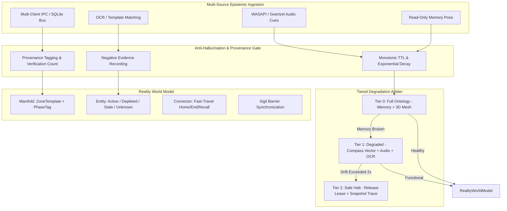
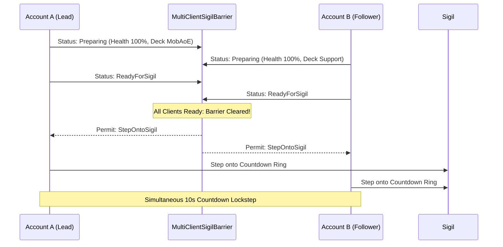
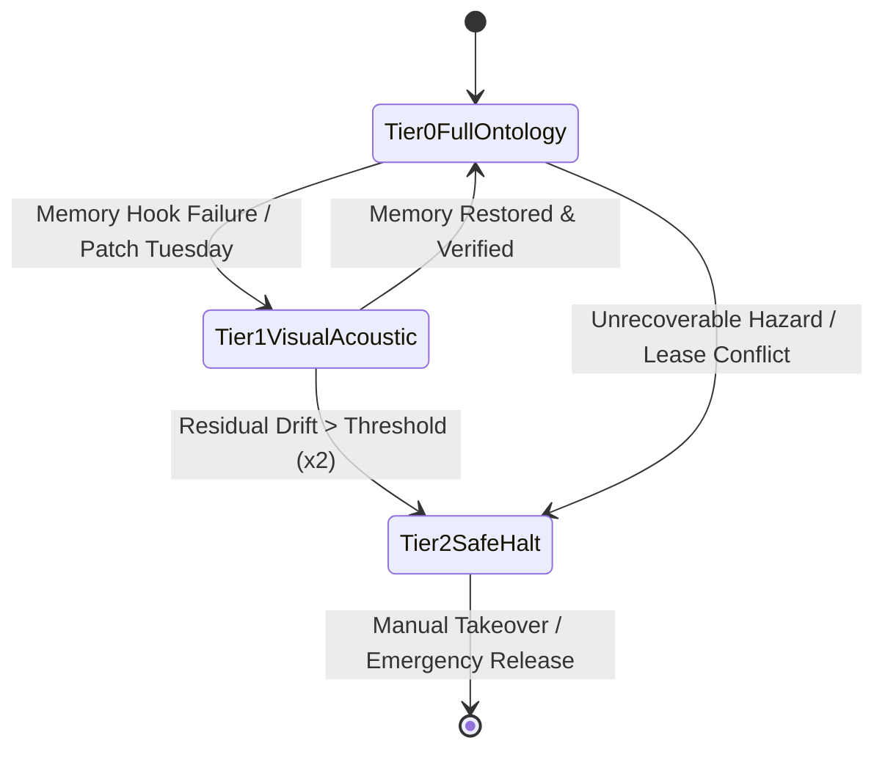

# Epistemic Reality Runtime Hardening

> **Status (audited 2026-11-20):** design specification with a small tested data model behind it. `crates/maelstrom-core/src/ontology.rs`
> implements `ProvenanceTag`, `EntityEpistemicState` with TTL decay and a negative-evidence counter, fast-travel `Connector`
> constructors, `MultiClientSigilBarrier`, `ZoneInstanceKey` and a drift counter that sets a `DegradationTier`, covered by 14 tests in
> `tests/ontology_tests.rs`. Nothing outside those tests calls any of these features: no planner, actuator or host reads an entity's
> state, a connector, the barrier or the world model's tier, and no `RealityWorldModel` query looks at entities. There is no half-life or Bayesian arithmetic,
> no IPC or SQLite bus, no countdown or timing rule, no safe halt and no code that reads provenance. The shortcut keys `Home`, `End`,
> `Page Down`, `Page Up`, `Ctrl+O`, `Ctrl+T` and `Ctrl+Shift+Q` are documented game defaults (see
> [WIZARD101_GAME_KNOWLEDGE.md](WIZARD101_GAME_KNOWLEDGE.md)), but the mana and potion figures, `N`, `Ctrl+K` and `Ctrl+M` have no
> source in the repository. Notes marked **Today** say what the code does. Evidence:
> [W101-EPISTEMIC-HARDENING-CORE-02](coordination/results/W101-EPISTEMIC-HARDENING-CORE-02.md), audit note.

## 1. Operational Rationale & Systems-Level Failure Modes

When Maelstrom operates as a **reality environment runtime** governed by a formal primitive ontology (`Manifold`, `Entity`, `Affordance`, `Connector`, `Hazard`, `Resource`, `Predicate`), the critical operational bottlenecks shift from game-specific scripting to **epistemic failure modes**:
- External reality drifts, stalls, or mutates non-deterministically.
- Sensor inputs drop frames, memory offsets break after game client patches, or environmental occlusions distort screen space.
- Stale world facts persist past their expiration date, causing autonomous agents to plan paths around "ghost" obstacles or detour toward already-harvested reagent anchors.

This specification formalizes the systems-level architecture required to guarantee deterministic operation, anti-hallucination discipline, multi-client lockstep, and tiered graceful degradation.

**Today:** the diagram is intended architecture, not data flow in code. None of the four ingestion sources is connected to anything,
and the arrows into the tiers do not exist: the only input to a tier is the drift counter in `record_drift_observation`.

---

## 2. Native Client Affordances as First-Class Ontology Shortcuts

Rather than computing expensive, high-risk 3D walking trajectories across multi-zone corridors, Maelstrom models Wizard101's built-in keyboard navigation shortcuts directly as **$O(1)$ low-cost Connector edges and Affordance primitives**:

### Fast-Travel Topological Connectors
| Shortcut Key | Ontology Connector | Traversal Cost | Operational Contract |
| :--- | :--- | :--- | :--- |
| **`Home`** | `ConnectorKind::FastTravelHome` | $0.1$ | Instant zero-pathing transition from any non-combat overworld location to the player's Dorm or Castle. |
| **`End`** | `ConnectorKind::FastTravelCommons` | $0.1$ | Transport to the current world's common area. This is not always Wizard City's Commons ([W101-KNOWLEDGE-AUDIT-01](coordination/results/W101-KNOWLEDGE-AUDIT-01.md)). |
| **`Page Down`** | `AffordanceKind::SetMarker` | $0.05$ | Records a marker at the current location. Marking costs mana (amount unsourced) and the user's existing mark must be preserved ([WIZARD101_GAME_KNOWLEDGE.md](WIZARD101_GAME_KNOWLEDGE.md)). |
| **`Page Up`** | `ConnectorKind::MarkerRecall` | $0.1$ | Recalls to the recorded marker. The mana cost is unsourced (an earlier draft said 20%), as is whether recall works inside dungeons or instances. |
| **`Ctrl+O`** | `AffordanceKind::EmergencyPotion` | $0.05$ | Uses a potion outside a duel. The amounts restored are unsourced (an earlier draft said 100% Health and 50% Mana; `action_emergency_potion` models health and mana both full), and consumption needs an explicit policy. |

**Today:** the "traversal cost" column is a planner weight the author chose (0.1 and 0.05 in `ontology.rs` and in the matching GOAP
helpers in `goap.rs`), not a measured or in-game cost. "$O(1)$" describes nothing the code does: `RealityWorldModel::connectors` is a
`Vec` that nothing queries, and there is no graph search over it. The only consumers are the hand-built GOAP actions
(`action_fast_travel_home`, `action_fast_travel_commons`, `action_set_marker`, `action_recall_marker`, `action_emergency_potion`).
They are not generated from the connectors, their only common precondition is `in_combat == false`, and nothing sends the key.
Two hard-code destinations: `Connector::fast_travel_commons` sets `to_manifold = "Commons"` for every world and
`action_fast_travel_commons` assumes `"Commons"` too (and `action_fast_travel_home` assumes `"Dorm"`), which contradicts the `End`
behavior in the table. Marker mana cost, recall cost and potion amounts are not modelled.

### Zero-Click UI Navigation Toggles
- **`Ctrl+Shift+Q`**: Selects the nearest quest (an official default). Quest guidance is approximate and is not a collision-free path, so this is an orientation hint, not a route; no code reads the arrow.
- **`N`**: Toggles 3D in-world navigation bubbles on/off. *Unsourced:* `N` is not in the shortcut table in [WIZARD101_GAME_KNOWLEDGE.md](WIZARD101_GAME_KNOWLEDGE.md); the route-demonstration recorder only lists it as a key to observe.
- **`Ctrl+T`**: Toggles the active quest tracker HUD window.
- **`Ctrl+K`**: Toggles out-of-combat deck switching, exposing pre-configured deck profiles (MobAoE, BossFeint) without menu tree navigation. *Unsourced:* it traces only to a Gemini onboarding note and this document, not to an observation of the game ([W101-DECK-SWITCH-CORE-02](coordination/results/W101-DECK-SWITCH-CORE-02.md), audit note).
- **`Ctrl+M`**: Opens the Realm Switcher dialog directly, enabling $O(1)$ realm-hopping for reagent farming and quiet realms. *Unsourced:* the repository's own shortcut table lists plain `M` as the map and has no `Ctrl+M`.

**Today:** nothing in `ontology.rs` or `goap.rs` sends any of these keys, and [WIZARD101_GAME_KNOWLEDGE.md](WIZARD101_GAME_KNOWLEDGE.md)
states that listing a default does not qualify Maelstrom to send it.

---

## 3. Epistemic Decay, Staleness & Anti-Hallucination TTLs

A reality runtime that trusts stale facts is prone to catastrophic hallucinations.

### Temporal Decay Half-Life Formulation
Every dynamic `Entity` and grounded `Predicate` carries a monotonic timestamp $t_0$ and a half-life parameter $\lambda$:

$$C(t) = C_0 \cdot \exp\left(-\lambda (t - t_0)\right)$$

| Entity / Predicate Kind | Target observation TTL | Target decay half-life $\lambda^{-1}$ | Expiration State |
| :--- | :--- | :--- | :--- |
| **Static Geometry / Manifold** | $\infty$ (Immutable) | $\infty$ | Static Baseline |
| **Dynamic Roaming Mob** | $500\text{ ms}$ | $150\text{ ms}$ | `EntityEpistemicState::Unknown` |
| **Active Reagent / Chest** | $45\text{ s}$ | $10\text{ s}$ | `EntityEpistemicState::Stale` |
| **Harvested Reagent Node** | Node Cooldown (e.g. 60s) | $\infty$ until cooldown | `EntityEpistemicState::Depleted(cooldown_until)` |
| **InCombat Predicate** | $2000\text{ ms}$ | $500\text{ ms}$ | Re-verified via Combat Fanfare or HUD check |

**Today:** the TTL and half-life columns are targets that no code applies, and the unsourced figures in them are the author's choices.
- Every `Entity` defaults to `ttl_ms = 60_000` whatever its kind. Probe: an unobserved `DynamicMob` was still `Active` at 50 s and
  `Unknown` at 61 s; reagents and chests were `Stale` at 61 s, not 45 s. A 500 ms mob TTL exists only where the caller passes
  `with_ttl_ms(500)`, as the test does (`with_ttl_ms` has a 50 ms floor).
- Decay is a hard cut-off, strictly greater than the TTL, with no half-life and no confidence curve. `update_decay` does nothing when
  the clock reads earlier than the last observation. `Stale` and `Unknown` are left only by a new observation (or `mark_depleted`).
- `Predicate::confidence` is stored as asserted. `to_goap_world_state` admits a predicate whole while it is within one caller-supplied
  TTL (the same value for every key) and its confidence is at least 0.75, so there is no per-predicate "InCombat 2000 ms" and no
  re-verification step.

### Negative Evidence Recording
When the path planner routes to an anticipated reagent or chest anchor and sensory inspection (visual bounding box or memory occupancy) confirms **nothing is present**, the runtime records **negative evidence**:

$$P(\text{spawn}) \leftarrow \frac{\alpha}{\alpha + \beta + N_{\text{negative}}}$$

This updates local Bayesian spawn-rate priors, halts futile detour evaluations, and prevents the planner from ping-ponging back and forth between empty spawn coordinates.

**Today:** the formula is not implemented. `Entity::record_negative_evidence` is a counter: the second negative check sets the entity
`Unknown` and a positive `record_observation` resets it. There are no priors, spawn rates or detour logic, and no caller outside the
tests, so nothing is halted or prevented. Two behaviors the formula would not have: a negative check refreshes `last_observed_ms`, so a
mob last seen long ago and checked once as empty stays `Active` if `update_decay` has not run first and becomes `Unknown` if it has
(probe, TTL 500 ms); and two negative checks on a `Depleted` entity replace its cooldown with `Unknown`.

---

## 4. Multi-Client Synchronization & Hivemind Sigil Lockstep

When multiple accounts or observer nodes operate concurrently on a single workstation or network cluster, they share an overlapping reality plane:

### Shared Spatial Blackboard
Observations made by Client A are broadcast via an IPC/SQLite pub-sub ring to Client B:
- **Discovered Reagents**: Broadcasts exact $(X, Y, Z)$ coordinates and spawn timestamps.
- **Dynamic Threat Field**: Broadcasts roaming boss/mob vectors, updating all local costmaps to avoid aggro corridors.
- **Depletion Broadcasts**: When Client A harvests a node, Client B immediately marks it `Depleted`, avoiding duplicate routing.

**Today:** design only. The workspace has no IPC bus, no SQLite dependency, no publish/subscribe code and no cross-client state;
`RealityWorldModel` is a single-process struct.

### Sigil Barrier Synchronization Protocol
Stepping onto an instanced dungeon sigil initiates a **10-second countdown**. To ensure dual-boxed or multi-account teams enter together:

1. **Phase 1 (Preparation)**: Both clients hold outside the sigil radius, replenishing mana, verifying deck profiles, and ensuring `GameInputLease` is idle.
2. **Phase 2 (Barrier Assertion)**: Once all participating clients publish `ReadyForSigil`, the barrier unlocks.
3. **Phase 3 (Simultaneous Step)**: Both clients step forward onto the sigil pedestals within $\le 200\text{ms}$ of each other, guaranteeing joint instance admission.

**Today:** `MultiClientSigilBarrier` is a status gate over values that something else must report. It has no clock, no countdown and no
200 ms comparison, so "simultaneous 10 s countdown lockstep" and "guaranteeing joint instance admission" are not implemented.
- `can_step_onto_sigil` is true when every required client is `ReadyForSigil`, `SteppedOnSigil` or `InCombat`, so a client in combat
  counts as ready. `countdown_remaining_s` is stored and never read (probe: `-5.0` still passes), and the `Preparing` health, mana and
  `deck_verified` fields are never read, so Phase 1's deck verification is not checked.
- A status reported under a mistyped client id is stored and leaves the real client in `Preparing`, with no error; an update for an
  unregistered sigil is silently ignored.
- Nothing calls the barrier, and `GameInputLease` is a C# type under `ProjectMaelstrom/ProjectMaelstrom/Utilities` that Rust does not
  reference.

---

## 5. Dynamic Zone Instancing, Phasing & Non-Euclidean Interiors

Dungeons, housing instances, and phased quest towers generate private world instances whose process pointers and entity tables reset on entry.

### Decoupled Zone Keys
Manifolds are keyed by a composite tuple:
$$\text{ZoneKey} = (\text{zone\_template\_id}, \text{phase\_tag})$$
- `zone_template_id`: Sourced from `.WAD` static asset identifiers (e.g., `WC_GolemTower_F1`).
- `phase_tag`: Dynamic session phase tag.
- By decoupling learned geometry, door connectors, and navigation meshes from raw runtime memory addresses, static spatial priors survive re-entry indefinitely.

**Today:** `ZoneInstanceKey` is a stored `Option` on `Manifold` (`with_zone_key`). `RealityWorldModel::manifolds` is keyed by
`Manifold::id`, nothing looks a manifold up by its zone key, and nothing in the crate refers to process addresses, so "survive
re-entry indefinitely" is a design goal, not behavior. `Manifold::increment_epoch` is called only from tests.

### Canonical Camera Calibration Reset
Third-person camera collisions against narrow staircases or dungeon pillars cause pitch/yaw distortions, corrupting 2D screen-space template matches and OCR bounding boxes.
- A canonical camera reset before visual prompt scans or dialogue clicks is proposed and not implemented. **Do not use the `Home` key
  for it:** `Home` is the Dorm/Castle fast-travel key (section 2), so it would travel instead of resetting the camera. A mouse-wheel
  reset is unsourced and would be game input outside this document's scope.

---

## 6. Deterministic Failure Recovery & Graceful Degradation Tiers

When external reality breaks assumptions, Maelstrom degrades predictably across three explicit operating tiers:

1. **Tier 0: Full Ontology**:
   - Primary high-efficiency mode.
   - Read-only process memory reads + 3D `.BCD` navmesh + visual validation.
2. **Tier 1: Degraded Pose / Visual-Acoustic Fallback**:
   - Triggered when process memory hooks fail or offsets shift on patch days.
   - Navigation relies on Quest Helper compass bearing vectors + pure OCR HUD extraction (`ocrs`) + WASAPI loopback audio cues (`audio_cue`).
   - Slower execution. The claim of 100% resilience to memory offset breakage is unsupported.
3. **Tier 2: Safe Halt & Evidence Snapshot**:
   - Triggered when spatial drift exceeds acceptable limits twice consecutively or unhandled game state occurs.
   - Instantly releases `GameInputLease`.
   - Moves player character to the nearest safe sidewalk or wall zone.
   - Emits a complete frozen session trace (`.json`) in `maelstrom-replay` format for post-mortem analysis.

**Today:** only the drift counter exists (`RealityWorldModel::record_drift_observation`), and nothing reads the tier it sets:
`predictive_rollout` has its own `ShadowWorldState::degradation_tier` that the caller must set by hand. The code differs from the
diagram (probe, 2026-11-20):
- The only trigger is `drift > tolerance`. There is no memory-hook, patch-day, lease-conflict or hazard input, so the
  `Tier0 -> Tier2` edge and the "memory restored and verified" condition do not exist; one clean observation leaves Tier 1.
- Tier 2 is not a halt state. A clean observation leaves it at Tier 2 with the fault count back at 0, the next single fault sets
  Tier 1 (a downgrade), and one clean observation after that returns to Tier 0, with no takeover or release in between. The test
  reaches "Tier 2 -> Tier 0" only by assigning `degradation_tier = Tier1VisualAcoustic` by hand.
- A `NaN` drift or a `NaN` tolerance compares false and counts as a clean observation, which resets the fault count and restores
  Tier 0 from Tier 1. Even a drift of 1e9 only reaches Tier 1 on the first fault.
- Nothing implements the Tier 1 sources (the compass bearing, OCR HUD and audio cues feed no tier logic; there is no `ocrs`
  dependency in the Rust workspace), the lease release, the move to a safe wall, or the replay-trace snapshot. Moving the character
  after a halt would be live game input and needs its own scoped authorization.

---

## 7. Schema Versioning & Provenance Tagging

Every record in the spatial and semantic database is meant to carry a formal `ProvenanceTag`. **Today** only `Manifold` and `Entity` have
an optional `provenance` field, the other primitives have none, and there is no database:
- `origin`: `StaticWadExtract`, `EmpiricalLiveObservation`, `ManualSeed`, or `SyntheticTestFixture`.
- `build_hash`: Git commit or binary hash that authored the entry.
- `verification_count`: Number of times `record_verification` ran. `Entity::record_observation` calls it on every observation, so
  100 observations in one session gave a count of 101; it does not count independent sessions.
- `last_verified_epoch_ms`: Verification timestamp as passed by the caller. It is not checked for monotonicity
  (`record_verification(500)` after 1000 stored 500). The tag also carries `first_observed_epoch_ms`.

The intent is that the batch replay benchmark suite could distinguish algorithmic planner regressions from poisoned or out-of-date
empirical anchors. **Today:** `maelstrom-replay` is a real binary in `maelstrom-fallback`, but its batch flag is `--batch-dir <DIR>`,
not `--batch`, and no code in the workspace reads a `ProvenanceTag`, so replay cannot make that distinction; no production code sets
a tag either.
