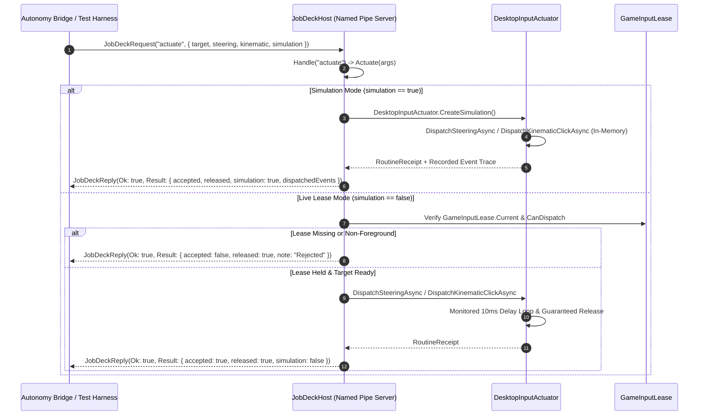

# JobDeckHost Actuation Event Loop & Simulated Playback

## 1. Overview & Architecture

The Aaroneous Automation Suite architecture separates perception, decision, and actuation into distinct layers adhering to the golden invariant:
$$\mathbf{Facts \neq Authority \neq Actions}$$

1. **Facts**: Qualified telemetry from the UI tree or memory (`NativeHostState`).
2. **Authority**: GOAP macro planning and Behavior Tree reactive arbitration emitting parameterized intents (`SteeringCommandSummary`, `KinematicPlanSummary`).
3. **Actions**: Single-owner physical input dispatch executed by `DesktopInputActuator` under `GameInputLease`.

To close the loop between the native Rust autonomy bridge (`MaelstromAutonomyBridge`) and the native C# deck host (`JobDeckHost`), the host exposes an explicit **`actuate`** command over the named pipe (`\\.\pipe\maelstrom-deck-<HASH>`).



---

## 2. Command Specification (`"actuate"`)

### 2.1. Request Schema
```json
{
  "command": "actuate",
  "arguments": {
    "target": "pid-123-start-456",
    "simulation": true,
    "steering": {
      "forwardPulseMs": 150,
      "turnLeftPulseMs": 0,
      "turnRightPulseMs": 0,
      "reversePulseMs": 0,
      "curvature": 0.05,
      "angleErrorRad": 0.0,
      "isArrived": false
    },
    "kinematic": {
      "pointCount": 20,
      "totalDurationMs": 250.0,
      "dwellMs": 65.0,
      "targetX": 640.0,
      "targetY": 360.0
    }
  },
  "requestId": "optional-uuid"
}
```

### 2.2. Reply Schema
```json
{
  "ok": true,
  "result": {
    "accepted": true,
    "released": true,
    "proposalId": "steering.dispatch",
    "actionId": "game.move-forward",
    "timeMs": 1795041000.0,
    "simulation": true,
    "dispatchedEvents": [
      { "type": "key", "target": "W", "up": false },
      { "type": "key", "target": "W", "up": true }
    ]
  },
  "error": null,
  "schemaVersion": 1
}
```

---

## 3. Simulated Playback Mode

When `simulation: true`:
1. **Zero OS Disturbance**: No Windows virtual keys or mouse events are emitted to any window or cursor.
2. **Event Verification**: The actuator uses an in-memory transport recording every key/mouse down and up event into an audit trail (`dispatchedEvents`).
3. **Safety Assertions**:
   - Out-of-bounds coordinates ($X < 0, X > 1280, Y < 0, Y > 720$) are rejected.
   - Pulses are clamped to safe durations ($\le 500\text{ms}$ forward/reverse, $\le 300\text{ms}$ turns).
   - Arrival commands (`isArrived: true`) immediately return success with zero dispatched events.

---

## 4. Live Lease Mode

When `simulation: false`:
1. Requires `GameInputLease.Current` held in the active async context.
2. Validates target identity: `pid-<PID>-start-<TICKS>` with process name `WizardGraphicalClient`.
3. Verifies readiness: window foreground focus, pre-resume countdown completed, no active user takeover.
4. Executes continuous mid-pulse monitoring every 10 ms.
5. Guarantees key/mouse release in `finally`; failure to confirm release within 5,000 ms automatically trips `RequireRecovery`.
