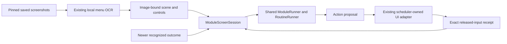

# Screen recognition, module execution and scheduler integration

Checkpoint: 2026-11-10. This completes the source/offline integration slice after
[module standardization](MODULE_STANDARDIZATION_20261110.md). It does not install
a new application or establish live gameplay success. Three parallel agents
handled recognition, execution integration and evidence/reuse review; the
coordinator integrated their contracts and serialized all native checks.

## Connected path



The offline reviewer replaces the UI adapter with **explicitly supplied rehearsal
receipts**. It contains no window handle, input transport or lease acquisition.
Separate tests exercise the actual scheduler-owned lock with a fake transport.
The existing Pet Dance live-cleanup source now consumes these same modules under
its inherited scheduler lease; that path was compiled, not launched.

| Component | Implemented responsibility |
| --- | --- |
| `ModuleRecognition` | Image hash, capture time, geometry, binding, OCR provenance, bounded controls and facts; stale/future evidence grants no controls. |
| `W101MenuRecognition` | Reuse existing local OCR and classifiers for reward, snack, settings, Idle and recognizable Dance instructions. A generic outside prompt remains only a candidate. |
| `ModuleScreenSession` | Two consistent fresh observations, monotonic capture/observation clocks, explicit context facts and registered newer screen-change outcomes tied to released receipts. |
| `W101ModulePrograms` | Trusted W101 bindings for Reward → Next → Snack → Finish without feeding → Outside → Menu → Idle, and a standalone native-Idle bundle. |
| `ModuleScreenReviewSnapshot` | Freeze manifest, bundle, events and every image with source hashes before queueing. |
| `ModuleOperation` | Submit review or trusted owned work to the existing `OperationScheduler`, with its ordinary cancellation, limits and durable run receipts. |
| `ModuleOwnedInput` | Map the four exact W101 action bindings to the existing `PetDanceMenuInput`, under the exact scheduler lease, target, geometry and current readiness guard. |
| `PetDanceNativeIdle` | Existing cleanup continuation now uses the module session and guarded adapter; it retains capture admission, cadence, activity baseline, permission and cleanup checks. |

No new input owner, queue service, model or production dependency was introduced.
The older postgame class remains for compatibility/tests; the active cleanup
source no longer invokes its private planner. The live-trial request version is
`postgame-modules-v7`, distinguishing this source from prior runtime reports.

## Evidence and input contracts

`ModuleVisualFrame` binds recognition to encoded-image SHA-256, original capture
time, geometry, target/visit and text origin. `ReadPngAsync` snapshots and verifies
the bytes/geometry before using existing local OCR. The recorded reviewer reads
only frozen source bytes; the live continuation hashes the same captured bitmap
it analyzes, with no second OCR pass. Its action screenshot is written after
input release so disk writes do not consume the pre-dispatch freshness budget.

The module session keeps the trusted observation clock separate from capture
time. A stale or future image cannot reset deadlines or advance outcomes. Capture
timestamps have a high-water mark: replaying an older frame cannot make the next
copy of an already-seen frame count as fresh. Repeated/backward observation times
cannot contribute stability. When a receipt is pending, **both** confirming
outcome observations must postdate its release and differ from the proposal's
source image; hash comparisons ignore letter case.

Only registered changed-screen transitions can produce an outcome binding.
Changing pixels is not movement or arrival evidence. The outside prompt becomes
`OutsideReady` only after this visit's accepted/released Finish action and the
newer recognized outside observations. It cannot open menus at initial entry.
Blank loading artwork stays `Unknown` without a qualified loading detector.

`ModuleScreenAuthority.VerifiedFacts` is explicit. A generic context Boolean
does not automatically grant postgame eligibility. The existing live callsite
enters cleanup only after `MayContinuePostGame`, confirmed worker cleanup and
released gameplay input; that trusted continuation supplies the separate
postgame/Idle facts. Offline reports label those facts as rehearsal assumptions.
Neither path infers a world, home, route or clear movement area from these menus.

The input adapter checks the scheduler admission's exact target against its
binding and the held ambient lease. The production factory also checks the
selected process instance, foreground/client geometry through the existing key
sink, current readiness and a 300-ms evidence age. OCR from a saved annotation
cannot enter this input adapter. Exact action kind/key/duration/control bindings
are closed in code; a game pack cannot add arbitrary clicks or keys.

One adapter permits one in-flight dispatch and rejects duplicate proposals.
It delegates to the existing bounded UI input code, which releases keys/buttons.
An exception without a release receipt remains unconfirmed and sets the existing
input-recovery barrier; it is not relabeled successful cleanup. Cancellation or
desktop takeover never triggers a cleanup attempt outside the retained owner.

## Saved-image workflow

```text
ProjectMaelstrom.exe --review-module-screens <session.json> <new-run-directory>
```

This command is handled before normal application/plugin startup. It runs the
existing scheduler in a new isolated output directory and writes its ordinary
`operations/<job-id>/receipt.json`, `module-operation.json` and
`module-screen-review.json`. Exit 0 means the offline contract completed; exit 2
means an incomplete/stopped job; exit 1 means invalid input/startup failure.
Output directories/reports are never reused automatically.

The manifest uses schema 1 and names `session_id`, `clock_origin`,
`evidence_mode: saved-images-synthetic-rehearsal`, `bundle_file`, `bundle_sha256`,
`events_file`, `routine_binding` and `geometry`. Events use the existing session
envelope. Observation/outcome payloads carry
`module_image: {file, sha256, captured_ms}`; receipt payloads carry
`routine_receipt`. The event timestamp is the review execution clock. Receipt
origin remains supplied/synthetic; repeated frame times are not original video
capture timestamps.

Limits: 128 events, 64 image observations, 16 unique PNGs, 8 MiB per image,
64 MiB image bytes, 4 megapixels per decoded image, bounded source files and a
default 60-second scheduled review. Source pins include every dependency and
remain within the existing scheduler's 32-pin cap. Local OCR uses one serialized
engine with a five-second read limit. The live menu cadence remains at most 2 Hz;
this workflow is not the high-speed gameplay reaction loop.

Real source images and cached OCR are preserved in
`ProjectMaelstrom/ProjectMaelstrom.Tests/TestData/Modules/W101Menus/`.
See [the evidence audit](MODULE_SCREEN_EVIDENCE_20261110.md). These six original
PNG copies total 5,557,420 bytes and have 1282×760 outer-window geometry. Capture
times and exact input alignment are unavailable. The loading and outside images
were distinguished from their actual contents rather than relying on frame order.

## Verification results

- Full native suite: **1,316 passed, zero failed/skipped**, about eight seconds of
  test execution. This includes 86 new recognition/session/input/scheduler cases,
  with actual saved-pixel OCR and separate fake-input ownership tests.
- Scoped whitespace and analyzer checks pass. Native build uses warnings as
  errors, one build worker, two reported processors and no restore.
- Actual built-app scheduled CLI: **Completed**, **2 modules**, **11 image
  observations**, **4 proposals**, **4 supplied rehearsal receipts**,
  **0 desktop dispatches**, **1.127 seconds** wall time.
- A combined test runs saved PNGs through fresh OCR, the module session, the
  real scheduler/temporary lease and the guarded input adapter with a fake sink.
  Four fake receipts complete the contract without calling Windows input.
- Negative cases cover altered queued inputs, malformed hashes/paths/geometry,
  stale/future/repeated captures, missing receipts, wrong controls/target/lease,
  concurrent input attempts, cancellation and uncertain cleanup.

Evidence is under `.local/module-screen-integration-20261110/`:
`screen-integration-full.trx`, `style-validation.json`, `cli-validation.json`,
the pinned `full-postgame-fixture/`, the scheduled run's reports and
`validation.json` source fingerprints. The tested assembly SHA-256 is
`f6fbe9ccaccaa7e044b76fac9be5232fb159908eb40f996ee3b561bac09e1935`.
The first partial check found two test nullability warnings; they were fixed
before the clean warnings-as-errors full run. No game capture, input, installation,
network access or model was used during this work.

## Guild and Steward contribution

[The local-source review](GUILD_STEWARD_SCHEDULER_REUSE_20261110.md) maps Guild's
work allocation and dependency concepts and Steward's immutable request/attempt,
claim and result contracts to Maelstrom. The reviewed local copies predate the
user's latest work, so this is inspiration from pinned snapshots, not a current
cross-repository compatibility claim.

One concrete repair is integrated and tested: scheduler startup and history now
share the same immediate GUID job-receipt boundary. Nested artifact receipts
stay untouched, owning IDs must match their folders, invalid/link-backed jobs
are rejected, and interrupted work never auto-resumes. The 18 recovery cases
pass in the full suite. Maelstrom retains its existing C# scheduler and sole
input owner. Advisory task leases must not become timeout-based input takeover.

## Remaining gates

The supported screen-to-operation source path is integrated, but **not installed
or live-qualified**. A subsequent bounded test must check capture/OCR latency,
real command delivery, observed transitions and automatic native Idle through the
new source, while preserving user takeover. No desktop reservation is active.

Navigation landmarks, motion/obstruction verification and initial sigil identity
remain unsupported by this menu policy. A recognized instruction menu does not
qualify approach, sigil interaction, level selection or Play. Those require their
own saved-screen evidence and trusted action/transition bindings. No full-visit
or arbitrary-resolution reliability claim follows from this single saved layout.
Workspace module clip editing and queue/dependency visibility are still separate
product work; this checkpoint provides the functional scheduled offline command
and migrates the existing cleanup source, not a new routine editor.
