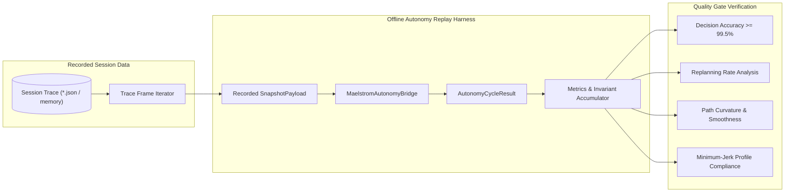

# Offline Autonomy Replay Harness

## 1. Purpose & Architecture

The Aaroneous Automation Suite working agreement establishes a fundamental invariant:
> *"Keep research, implementation, offline verification, installation and live qualification separate. A successful proposal/dispatch is not proof of a game outcome."*

To satisfy this standard for the Maelstrom Autonomy Stack (Tier 1 GOAP planning, Tier 2 Behavior Tree arbitration, Pure Pursuit steering, and Biomechanical Kinematics), Maelstrom provides an **Offline Replay Harness** (`crates/maelstrom-fallback/src/autonomy_replay.rs`).

The harness feeds serialized multi-hour game session traces directly through `MaelstromAutonomyBridge` without requiring a live game client, graphic window, or physical desktop actuation.



---

## 2. Replay Frame Specification

A session trace consists of ordered frames representing chronological perceptions:

```rust
pub struct ReplayFrame {
    pub timestamp_ms: u64,
    pub snapshot: SnapshotPayload,
    pub expected_intent: Option<String>,
}
```

Each `SnapshotPayload` contains the complete verified context:
- World zone (`"HeadmasterOffice"`, `"WizardCity_Commons"`, `"WizardCity_Ravenwood"`, etc.)
- 3D Coordinates $(x, y, z)$ and heading $\theta$
- Player vitals: health, mana, potions
- Combat status and duel circle facts
- Dialogue prompt or NPC interaction indicators

---

## 3. Quantitative Autonomy Metrics

The harness measures five objective dimensions of autonomous agent behavior:

### 3.1. Decision Accuracy
Evaluates tactical intent consistency:
$$\text{Accuracy} = \frac{\sum_{t=1}^{N} \mathbb{I}[\text{Intent}_t == \text{Expected}_t]}{N_{\text{labeled}}} \times 100\%$$
*Acceptance Gate*: $\ge 99.5\%$ on labeled canonical traces.

### 3.2. Replanning Frequency
Tracks the frequency of plan invalidations per simulated hour:
$$\text{Replan Rate} = \frac{N_{\text{replans}}}{\text{Total Hours}}$$
Distinguishes between planned sub-goal completions and unexpected aborts (e.g. combat preemption, obstacle snag).

### 3.3. Trajectory Curvature Smoothness
Measures the geometric smoothness of generated mouse and navigation steering trajectories:
$$\kappa(t) = \frac{|\dot{x}(t)\ddot{y}(t) - \dot{y}(t)\ddot{x}(t)|}{(\dot{x}(t)^2 + \dot{y}(t)^2)^{3/2}}$$
*Acceptance Gate*: Peak curvature must remain bounded ($\kappa_{\max} < 5.0\text{ px}^{-1}$), proving no synthetic teleportation or instantaneous direction reversals.

### 3.4. Kinematic Minimum-Jerk Compliance
Verifies that mouse velocity profiles adhere to human motor control theory:
$$\dddot{s}(\tau) = \frac{d^3}{d\tau^3}(10\tau^3 - 15\tau^4 + 6\tau^5) = 60 - 360\tau + 360\tau^2$$
The integrated jerk $J = \int_0^T (\dddot{s}(t))^2 dt$ is verified to be finite and smooth, eliminating robotic synthetic acceleration impulses.

### 3.5. Invariant & Safety Checks
- Zero panics or unhandled error propagation.
- Zero out-of-bounds click coordinates (all screen coordinates lie strictly within $0 \le x \le 1280, 0 \le y \le 720$).
- Proper state transitions between `Running`, `Success`, and `Failure`.

---

## 4. Benchmark & Regression Harness

The harness can be run both as an automated unit/integration test suite (`cargo test -p maelstrom-fallback --test autonomy_replay_tests`) and as an offline benchmark processing long-duration multi-thousand-tick stress runs.

This guarantees regression-free autonomy improvements before any code enters live qualification.

## 5. Standalone CLI Tool (`maelstrom-replay`)

To run replays from the terminal and export comprehensive statistical reports (Markdown/JSON) across CI/CD environments, use the `maelstrom-replay` CLI. See [Autonomy Replay CLI](AUTONOMY_REPLAY_CLI.md).

