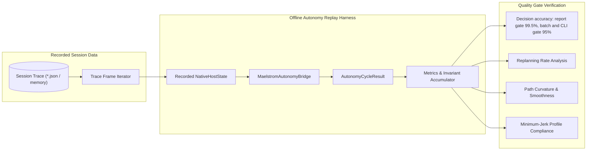

# Offline Autonomy Replay Harness

> **Status (audit 2026-11-20, Claude):** library code plus offline tests (3 integration tests in `autonomy_replay_tests.rs`). The harness replays frames
> through `MaelstromAutonomyBridge::process_state` and reports label agreement, an intent-change counter and two proxy numbers. It is not a
> calibrated quality gate: an unlabeled session scores 100%, the accuracy threshold differs between the report (99.5) and the batch runner
> and CLI (95.0), the curvature threshold cannot be exceeded, and the replan status is a constant PASS. No recorded multi-hour trace is
> committed. Notes marked **Today** say what the code does. Evidence:
> [W101-REPLAY-HARNESS-CORE-02](coordination/results/W101-REPLAY-HARNESS-CORE-02.md) and
> [W101-REPLAY-HARNESS-DOCS-01](coordination/results/W101-REPLAY-HARNESS-DOCS-01.md), audit notes.

## 1. Purpose & Architecture

The Aaroneous Automation Suite working agreement establishes a fundamental invariant:
> *"Keep research, implementation, offline verification, installation and live qualification separate. A successful proposal/dispatch is not proof of a game outcome."*

To satisfy this standard for the Maelstrom Autonomy Stack (Tier 2 Behavior Tree arbitration, Pure Pursuit steering and the click-plan summary; the replay does not run GOAP), Maelstrom provides an **Offline Replay Harness** (`crates/maelstrom-fallback/src/autonomy_replay.rs`).

The harness feeds serialized session traces (synthetic frames, or frames ingested from event and UI logs) directly through `MaelstromAutonomyBridge` without requiring a live game client, graphic window, or physical desktop actuation.

**Today:** no recorded autonomy trace is committed. The longest test trace is 1000 hand-written frames spanning 99.9 s of synthetic time, and the
checked-in benchmark matrix result lists 1094 short sessions totalling 1269.71 s (74 distinct ids; 1085 of the rows are UI captures with no labelled tick, so they pass vacuously: see the banner on that file). The ingesters (`from_w101_events_jsonl`,
`from_ui_observations_jsonl`) take only a scene or combat-planning flag from the log and fabricate the rest: zone, health, mana and potions are
constants, the position is a constant or derived from the event time, and `is_simulation` is set. Each frame is one `process_state` call; nothing is
paced against a clock.



---

## 2. Replay Frame Specification

A session trace consists of ordered frames representing chronological perceptions:

```rust
pub struct ReplayFrame {
    pub timestamp_ms: u64,
    pub state: NativeHostState,
    pub expected_intent: Option<String>,
}
```

`NativeHostState` (built from a host snapshot with `from_snapshot_json_at`) carries:
- Connection status, game and target ids, and the wizard subject fields
- Health, mana and energy (current and maximum) and potions
- `native_idle`, and the qualified aliases `combat_active`, `zone_name` and `position` (x, y, z)

**Today:** there is no `SnapshotPayload` type, and the state has no heading, no duel-circle facts and no dialogue or NPC-interaction indicators. The
live host publishes no combat, zone or position alias, so those three values are fixtures in every replay.

---

## 3. Quantitative Autonomy Metrics

The harness computes four numbers and its Markdown report prints a threshold beside each. Only the first is a direct measurement; the other three
are proxies, and the fifth heading lists checks the harness does not perform:

### 3.1. Decision Accuracy
Evaluates tactical intent consistency:
$$\text{Accuracy} = \frac{\sum_{t=1}^{N} \mathbb{I}[\text{Intent}_t == \text{Expected}_t]}{N_{\text{labeled}}} \times 100\%$$
*Acceptance Gate*: $\ge 99.5\%$ on labeled canonical traces.

**Today:** `replay_session` scores only frames that carry an `expected_intent`. It compares it with `proposed_intent`, or with `bt_status` when there
is none, so a `Withheld` frame always mismatches a label. A session with no labels reports 100% (the default) and the report prints PASS (probe: 5
unlabeled frames gave 100.00%, PASS). The 99.5 threshold is in the report text and in the 1000-frame test; `run_batch` and the `maelstrom-replay`
exit code use 95.0 (probe: 96% printed FAIL in the report and PASS in the batch matrix). The test's labels are hand-written, and in ingested traces
the label and the bridge's answer both follow from inputs the harness supplies (its own initial goal and waypoints, or the same combat flag), so the
number shows agreement with those labels, not with a recorded game. `run_batch` starts a fresh bridge per session, so a session without
`initial_goal` and `initial_waypoints` answers `YieldIdle` throughout (probe: the same labels scored 0%).

### 3.2. Replanning Frequency
Tracks the frequency of plan invalidations per simulated hour:
$$\text{Replan Rate} = \frac{N_{\text{replans}}}{\text{Total Hours}}$$
Intended to distinguish planned sub-goal completions from unexpected aborts (e.g. combat preemption, obstacle snag); the code does not.

**Today:** `replan_count` goes up whenever `proposed_intent` differs from the previous frame's intent; frames with no intent (`Withheld`) are skipped.
It cannot tell a planned completion from an abort and has nothing to do with GOAP, which the replay does not run. Probe: Step, Combat, Step gave 2;
Step, Withheld, Step gave 0; a combat flag flipping every frame gave 9 for 10 frames. The report prints the rate beside `<= 30.0 /hr` and its
status is a constant PASS (probe: 1e9 replans/hr printed PASS). The 30.0 has no source and nothing enforces it.

### 3.3. Trajectory Curvature Smoothness
Intended to measure the geometric smoothness of generated mouse and navigation steering trajectories:
$$\kappa(t) = \frac{|\dot{x}(t)\ddot{y}(t) - \dot{y}(t)\ddot{x}(t)|}{(\dot{x}(t)^2 + \dot{y}(t)^2)^{3/2}}$$
*Acceptance Gate* (as configured): peak curvature below $5.0$; the intended reading is no synthetic teleportation or instantaneous direction reversals.

**Today:** the harness does not differentiate any trajectory. It reads `SteeringCommand.curvature` from the Pure Pursuit controller, which is
$\kappa = 2\sin\alpha / d$ with $d$ the distance to the lookahead point clamped to at least 1.0, in world-coordinate units (the pose comes from the
`position` alias), not pixels. Mouse trajectories are not included: the plan summary keeps only a point count, a duration, a dwell and the end
point. Because $d \ge 1.0$, $|\kappa| \le 2.0$ for any input, so the 5.0 threshold cannot be exceeded and its warning cannot fire (probe: the largest
$|\kappa|$ over 2,000,000 random poses with the bridge's controller settings was 0.08). The gate therefore supports no claim about teleportation or
direction reversals. Only values above 0.0001 enter the mean. The heading given to the controller is the world z coordinate (`Pose2D::new(x, y, z)`, see
[AUTONOMY_REPLAY_CLI.md](AUTONOMY_REPLAY_CLI.md) Section 3.2), so the figure does not describe a real heading.

### 3.4. Kinematic Minimum-Jerk Compliance
Intended to verify that mouse velocity profiles adhere to minimum-jerk motor control theory:
$$\dddot{s}(\tau) = \frac{d^3}{d\tau^3}(10\tau^3 - 15\tau^4 + 6\tau^5) = 60 - 360\tau + 360\tau^2$$
The intended check is that the integrated jerk $J = \int_0^T (\dddot{s}(t))^2 dt$ is finite and smooth. (The polynomial and its third derivative above are
correct mathematics; the harness does not use them.)

**Today:** the harness sees only the `KinematicPlanSummary` (point count, duration, dwell, end point), so it cannot integrate anything.
`compute_trajectory_peak_jerk` returns 0 for plans with fewer than 4 points or a duration of 0.01 s or less, and otherwise `dist / T^3 * 0.001`, where
`dist` is measured from a fixed screen centre (640, 360) to the plan's end point, not from the real start (the bridge starts plans at the player's world
position). The code comment cites `60 * dist / T^3` and the code has no factor 60. It is a scale-dependent proxy, and the `< 10.0 px/ms^3` threshold
has no human-motion source. Nothing is verified smooth.

### 3.5. Invariant & Safety Checks (intended; not implemented in the harness)
- Zero panics or unhandled error propagation.
- Zero out-of-bounds click coordinates (all screen coordinates lie strictly within $0 \le x \le 1280, 0 \le y \le 720$).
- Proper state transitions between `Running`, `Success`, and `Failure`.

**Today:** the harness performs none of these three checks. A panic would abort the test run, not be counted; there is no `0 <= x <= 1280`, `0 <= y <= 720`
check on the plan's `target_x` and `target_y` (the module never mentions 1280 or 720; the click bounds the code does enforce are the actuator's, see
[DESKTOP_INPUT_ACTUATOR.md](DESKTOP_INPUT_ACTUATOR.md)); and no state transition is validated.

---

## 4. Benchmark & Regression Harness

The harness runs as an automated integration test (`cargo test -p maelstrom-fallback --test autonomy_replay_tests`, 3 tests) and, through
`maelstrom-replay`, over trace files and directories. The longest test trace is 1000 hand-written frames spanning 99.9 s of synthetic time; nothing
committed is a recorded multi-hour trace or a multi-thousand-tick stress run.

A green run shows that the bridge still answers the author's labels and that the proxies stay under thresholds that are partly unreachable (see the
notes above). It does not guarantee regression-free autonomy and says nothing about live play, which stays a separate, explicitly authorized step.

## 5. Standalone CLI Tool (`maelstrom-replay`)

To run replays from the terminal and export comprehensive statistical reports (Markdown/JSON) across CI/CD environments, use the `maelstrom-replay` CLI. See [Autonomy Replay CLI](AUTONOMY_REPLAY_CLI.md).

