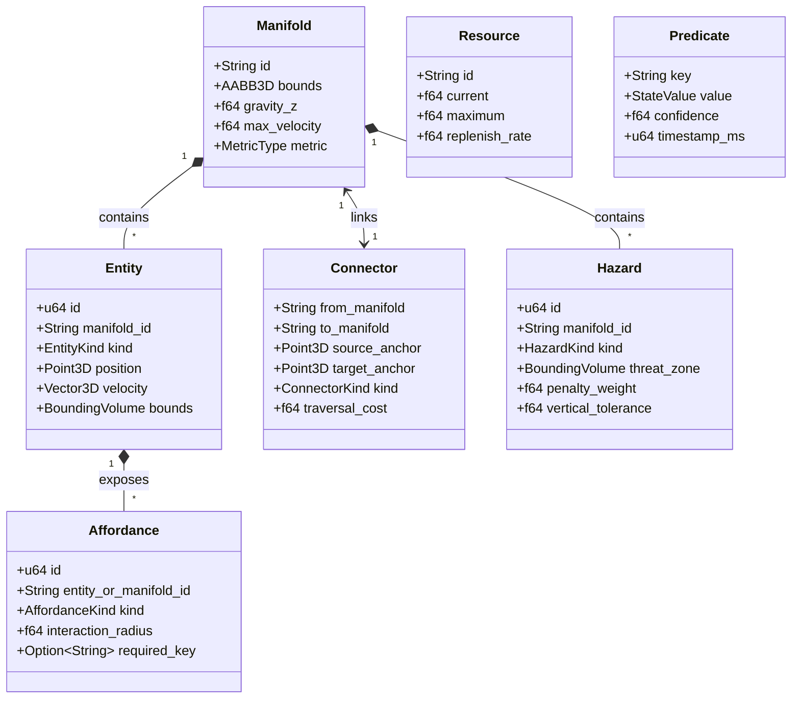

# Reality Runtime Primitive Ontology

## 1. Executive Vision: The Epistemic Control Loop

Maelstrom is not an ad-hoc game bot or screen-scraping macro runner; it is a **Reality Environment Runtime**. Rather than hardcoding bespoke control logic for specific games or screens, Maelstrom operates on an **irreducible grammar of existence**:

$$\text{Observations} \xrightarrow{\text{Grounding}} \text{Reality Grammar} \xrightarrow{\text{Epistemic Validation}} \text{World Model} \xrightarrow{\text{Teleology}} \text{Actions}$$

1. **Observation**: Multimodal telemetry arrives via read-only process memory, DXGI/GDI frame captures, and WASAPI audio loopback.
2. **Grounding**: Raw observations are mapped directly into the **7 Irreducible Primitives**.
3. **Epistemic Validation**: The runtime verifies whether its internal world model matches external physical reality (e.g., verifying Z-floor validity, mob proximity, and window focus) through confidence gating.
4. **Teleology & Action**: GOAP planners and Behavior Trees synthesize goals and emit verified intents executed strictly through the single `GameInputLease`.

---

## 2. The Seven Irreducible Primitives of Existence

Every entity, zone, constraint, and interaction across any game workspace or desktop application maps cleanly into seven universal types:

### 1. `Manifold` (Space)
A bounded, continuous or topological coordinate frame $(X, Y, Z, \text{yaw})$ with defined metric rules, gravity, vertical floor tolerances, and traversal constraints (e.g., a loaded 3D Gamebryo zone instance, an arena interior, or a desktop client viewport).

### 2. `Entity` (Occupant)
Any identifiable physical occupant in a `Manifold`, carrying a persistent identity, semantic kind (`Player`, `DynamicMob`, `Reagent`, `Chest`, `NpcAnchor`), bounding volume (cylinder/sphere/AABB), and kinematic state $(\mathbf{p}, \mathbf{v}, \mathbf{a})$.

### 3. `Affordance` (Interaction Surface)
A localized geometric region or UI element that exposes a valid state transition under proximity, focus, or orientation constraints (e.g. a dialogue trigger prompt, a reagent harvest prompt, a sigil countdown circle, a spell card, or a button widget).

### 4. `Connector` (Topology Jump)
A directed topological edge linking two disjoint `Manifold` frames where standard Euclidean distance breaks down (e.g., zone doors, world spiral teleporters, dungeon sigil transitions, realm hops, or window focus switches).

### 5. `Hazard` / `Field` (Cost & Threat)
A continuous scalar or vector potential field over a `Manifold` that penalizes or strictly forbids occupancy (e.g., roaming dynamic mob aggro cylinders, impassable collision triangle soup, lethal boundaries, or combat initiation radiuses).

### 6. `Resource` / `Budget` (Capacity)
A quantified internal reservoir governing action feasibility and survival (e.g., mana, health, energy, potion counts, combat pips, gold, detour budget, or input lease time remaining).

### 7. `Predicate` (Observable Truth)
A typed, timestamped assertion about reality accompanied by confidence metrics (`InCombat(true)`, `ZFloorValid(true)`, `SafeFromMobs(true)`, `QuestProgress(2, 3)`).

---

## 3. Mapping Wizard101 Gamebryo Telemetry into the Ontology

| Wizard101 Domain Specifics | Reality Primitive Equivalent | Concrete Rust Representation |
| :--- | :--- | :--- |
| `ZoneNavMesh` / Zone Instance | **`Manifold`** | `Manifold::new("OldeTown", bounds, MetricType::NavMesh3D)` |
| `DynamicMobActor` | **`Entity`** + **`Hazard`** | `Entity::new(id, DynamicMob, pos, vel)` + `Hazard::threat_cylinder(...)` |
| `SpatialEntity3D` (Reagents, Chests) | **`Entity`** + **`Affordance`** | `Entity::new(id, Reagent, pos)` + `Affordance::interact("X", 3.5)` |
| `DoorPortal` / Sigil Entry | **`Connector`** | `Connector::new("Commons", "GolemCourt", p1, p2, TraversalKind::Door)` |
| Roaming Mob Aggro Radius | **`Hazard`** | `Hazard::dynamic_repulsion(id, pos, vel, aggro_r, rep_r, weight)` |
| Mana, Health, Potions, Pips | **`Resource`** | `Resource::new("mana", 80.0, 100.0)` |
| Combat State, Safe Zone, Quest Steps | **`Predicate`** | `Predicate::new("in_combat", StateValue::Bool(false), 0.99)` |

---

## 4. Invariant Contracts & Epistemic Boundaries

1. **Facts $\neq$ Authority $\neq$ Actions**:
   Primitives represent *facts* about the world. They do not possess the *authority* to issue operating system input dispatches. Actions are synthesized only when predicates satisfy goal preconditions and are approved under an active `GameInputLease`.
2. **Metric Independence**:
   `Manifold` coordinates can be Euclidean 3D $(x, y, z)$, screen-space pixels $(u, v)$, or graph topological nodes. Pathfinding across manifolds invokes `Connector` traversal costs rather than false geometric assumptions.
3. **Continuous Epistemic Gating**:
   Any action in progress is immediately aborted if the grounded `Predicate` state contradicts expected preconditions (e.g. focus lost, health critical, mob intruding upon an affordance).
