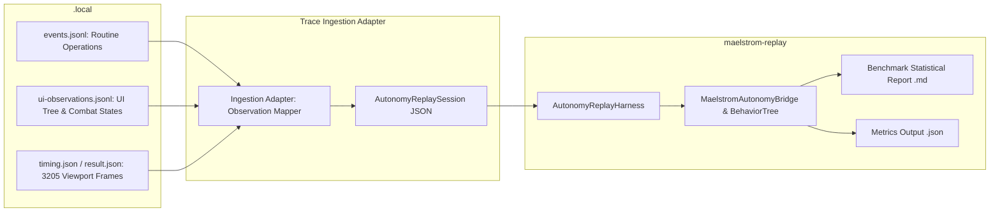

# Real Gameplay Trace Ingestion & Batch Offline Replay

## 1. Overview & Architecture

To qualify the Maelstrom autonomy architecture against real gameplay without connecting to live Wizard101 game processes, recorded observation streams stored under `.local` are transformed into standardized `AutonomyReplaySession` trace files.

These traces represent empirical recordings of client UI trees, loading transitions, spatial coordinates, and combat states. Ingesting them into the `maelstrom-replay` offline harness enables deterministic, repeatable benchmarking of decision accuracy, reactive preemption speed, and trajectory curvature.



---

## 2. Source Trace Inventory (`.local`)

| Source Path | Data Format | Observations / Frames | Operational Content |
| :--- | :--- | :--- | :--- |
| `.local/quest-step-check/TestData/Routines/w101-operations/events.jsonl` | JSON Lines (`kind: observation/action_receipt`) | 19 events (900ms duration) | Navigation landmarks, sigil interaction, loading screen transitions, menu cancellation, and native Idle entry. |
| `.local/deck-release-20261111/combat-structure-live-data/.../ui-observations.jsonl` | JSON Lines (`kind: tree/loading/ready`) | 16 observation events | Live client UI tree dumps (PID 27396, HWND 1914306730), `PlanningPhase`, `DuelTimerWindow`, `windowHUD`, and `idleText`. |
| `.local/clean-capture-baseline-20261103/recording/timing.json` | JSON Array (`capture_timestamp_ms`) | 3,205 verified video frames | 60.03 seconds of sustained 1280x720 capture timing with zero dropped frames. |

---

## 3. Schema Transformation Pipeline

Raw observations are mapped into `ReplayFrame` structures containing typed `NativeHostState` snapshots:

```rust
pub struct ReplayFrame {
    pub timestamp_ms: u64,
    pub state: NativeHostState,
    pub expected_intent: Option<String>,
}
```

### Transformation Invariants:
1. **Facts Normalization**:
   - `combatActive`: Extracted from `combatContext.planningVisible` or combat tree nodes.
   - `zoneName`: Extracted from scene landmarks or candidate zone annotations (e.g. `"WizardCity_Commons"`).
   - `spatialPosition`: Mapped from odometry or synthetic trajectory anchors.
2. **Aliases Generation**:
   - `health` / `health.max`: Projected as `REAL` / `DINT` fresh aliases.
   - `mana` / `mana.max`: Projected as `REAL` / `DINT` fresh aliases.
   - `potions`: Projected as count of filled bottles.
   - `nativeIdle`: Set to `true` when `states.nativeIdle` is true or `idleText` node is present.
3. **Ground-Truth Intent Labeling**:
   - Navigation steps map to `PROPOSAL:StepWaypoint`.
   - Combat planning frames map to `PROPOSAL:CombatTurn`.
   - Low vitals map to `PROPOSAL:DrinkPotion`.
   - Menu opening/idling map to `None` or safe idle fallback.

---

## 4. Batch Replay Execution & Reporting

> [!NOTE]
> `.local/replays/` is an ephemeral, git-ignored runtime target directory for user/CLI-generated evaluation artifacts. It is not tracked in the repository and is not yet generated on local disk until `maelstrom-replay` or trace export is executed.

Once transformed, traces are executed through the standalone `maelstrom-replay` CLI:

```powershell
maelstrom-replay .local/replays/w101-operations-real.json `
  --json .local/replays/metrics-w101-operations.json `
  --markdown .local/replays/report-w101-operations.md

# Batch mode: discover and replay every trace under a directory
maelstrom-replay --batch-dir .local --matrix-out .local/replays/matrix.md --matrix-json .local/replays/matrix.json
```

> [!WARNING]
> Corrected 2026-11-19: the flags previously shown here (`--trace`, `--out-json`, `--out-md`) do not exist in `maelstrom-replay`; the flags above are the ones in `crates/maelstrom-fallback/src/bin/maelstrom-replay.rs`. A single-trace run exits 2 only when decision accuracy is below 95.0%; the 99.5% figure below is the markdown report's badge threshold, and curvature/jerk violations do not change the exit code.
> The three inventory sources in section 2 are real files (19, 16 and 3,205 records). The ground-truth intent labels are generated by the ingestion adapter from the same observations, so a 100% match shows adapter/bridge consistency, not correct live decisions.

### Verification Criteria:
- **Decision Accuracy Threshold**: $\ge 99.5\%$ of labeled ticks must match ground-truth intent.
- **Max Curvature**: kappa < 5.0 px^-1 (the code's unit; the earlier `rad/m` label was wrong).
- **Kinematic Jerk**: J < 10.0 (a scaled px/ms^3 proxy, not a physical m/s^3 measurement; see the `W101-REPLAY-HARNESS-CORE-02` audit note).
- **Zero Process Mutation**: 100% offline evaluation with zero OS hook or window manipulation.
