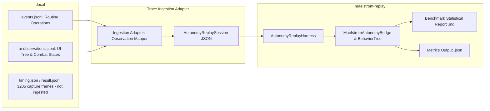

# Real Gameplay Trace Ingestion & Batch Offline Replay

> **Status (audit 2026-11-20, Claude):** the two ingesters (`from_w101_events_jsonl`, `from_ui_observations_jsonl`) are real and run offline, but the traces they build are
> not recordings of gameplay decisions: only a scene name, a few UI flags and a time offset come from the file, and position, vitals, zone and potions are
> constants or formulas. One of the two source files is a synthetic rehearsal, the other holds no combat-planning frame, and nothing ingests the third.
> The page is corrected below; notes marked **Today** say what the code does. Evidence:
> [W101-TRACE-INGEST-CORE-02](coordination/results/W101-TRACE-INGEST-CORE-02.md) and
> [W101-TRACE-INGEST-DOCS-01](coordination/results/W101-TRACE-INGEST-DOCS-01.md), audit notes.

## 1. Overview & Architecture

To exercise the autonomy bridge offline, observation streams stored under `.local` can be loaded as standardized `AutonomyReplaySession` traces without connecting to a live Wizard101 process.

**Today:** these traces are not empirical recordings of spatial coordinates, vitals or combat decisions. See sections 2 and 3 for what each source contains and what the
ingesters invent. Replaying them gives a repeatable check that the bridge answers the labels the ingesters wrote; it does not benchmark reactive preemption speed (nothing
measures it) and the curvature figure cannot fail (see [OFFLINE_AUTONOMY_REPLAY.md](OFFLINE_AUTONOMY_REPLAY.md)).



---

## 2. Source Trace Inventory (`.local`)

| Source Path | Data Format | Records in the file | What it is, and what the ingester replays |
| :--- | :--- | :--- | :--- |
| `.local/quest-step-check/TestData/Routines/w101-operations/events.jsonl` | JSON Lines | 19 lines: 11 `observation`, 7 `action_receipt`, 1 `marker`; `time_ms` 0 to 900 | A **synthetic rehearsal**: its first event states `evidence_mode: synthetic-labelled-module-scenes` ("authored facts, controls, landmarks and receipts are not perception evidence or live permission"). The ingester replays the 11 observations (800 ms); receipts and the marker are ignored. Scenes: Loading x2, Landmark.start, Progress.first, Landmark.junction, Landmark.sigil, SigilMenu.dance, OutsideReady, MenuObserved, NativeIdle, Unknown. |
| `.local/deck-release-20261111/combat-structure-live-data/operations/<run-id>/ui-observations.jsonl` | JSON Lines | 16 lines: 12 `loading`, 3 `tree`, 1 `ready`; 2.79 s | A live UI watch (operation `w101-ui-tree-v1`; the PID 27396 and HWND the page cited are in the sibling `ui-request.json`, `ui-result.json` and `receipt.json`, not in this file). The 3 `tree` lines carry `PlanningPhase`, `DuelTimerWindow`, `windowHUD` and `idleText`. The ingester replays the 12 `loading` and 3 `tree` lines (2,715 ms); `ready` is ignored. In all 3 `tree` lines `planningVisible` is false. |
| `.local/clean-capture-baseline-20261103/recording/timing.json` | JSON object (`capture_timestamp_ms` list and summary fields) | 3,205 frames; video 60.03 s at 1280x720 | A screen-capture timing report, unrelated to decisions. **No code reads it.** `queue_rejected` is 0 and captured, submitted and verified are all 3,205, but the delivered rate was 53.39 fps against a 60 fps target and the largest gap was 55.6 ms, so "sustained, zero dropped frames" is only true in the sense that the queue rejected none. |

**Today:** on the two JSONL files the ingesters give: events, 11 frames of which 4 are labelled (`Landmark.*` and `Progress.*` scenes); UI, 15 frames of which **0 are labelled**,
so its 100.0% accuracy covers no tick at all.

---

## 3. Schema Transformation Pipeline

Raw observations are mapped into `ReplayFrame` structures containing typed `NativeHostState` snapshots:

```rust
pub struct ReplayFrame {
    pub timestamp_ms: u64,
    pub state: NativeHostState,
    pub expected_intent: Option<String>,
}
```

### What the ingesters actually do
Both are in `crates/maelstrom-fallback/src/autonomy_replay.rs` and return `Ok` even when no usable line is found (an empty session, which batch mode then drops). Lines that
do not parse are skipped silently.

| Frame field | `from_w101_events_jsonl` (`kind: observation` only) | `from_ui_observations_jsonl` (`kind` `tree` or `loading`) |
| :--- | :--- | :--- |
| `timestamp_ms` | the line's `time_ms`, unchanged (no baseline subtraction) | `(observedUtcTicks - first line's ticks) / 10,000` |
| `expected_intent` | `PROPOSAL:StepWaypoint` when the scene starts with `Landmark.` or `Progress.`, else none | `PROPOSAL:CombatTurn` when `combatContext.planningVisible` is true, else none |
| `combat.active` | constant false | `planningVisible` (false when absent) |
| `zone.name` | constant `WizardCity_Commons` | constant `WizardCity_Commons` |
| `position.x`, `.y`, `.z` | `100 + 0.1 * time_ms`, 100, 0 | constants 100, 100, 0 |
| `health`, `mana`, `potions` | constants 500/500, 100/100, 2.0 | constants 500/500, 100/100, 2.0 |
| idle and loading facts | `nativeIdle` for scenes `NativeIdle` and `MenuObserved`; `loading` for scene `Loading` | `states.nativeIdle` and `loading` |
| session start | goal `W101RoutineReplay`, waypoint (200, 100, 0) | no goal, no waypoints |

Every alias carries the fixed observation time 2026-11-18T22:30:00Z, and each frame is marked `is_simulation`. The aliases are built with `autonomy_replay::simulated_alias`;
the bridge reads only these typed aliases, so the alias names matter.

**Today:**
- Only the scene name, `nativeIdle`, `loading`, `planningVisible` and the time offset come from the file. Everything else, including position and every vital, is invented.
- The earlier text on this page said `combat.active` was taken from "combat tree nodes", `zone.name` from "scene landmarks or candidate zone annotations", position from
  "odometry", `nativeIdle` from an "`idleText` node", `potions` as a "count of filled bottles", and that low vitals map to `PROPOSAL:DrinkPotion`. None of that is in the code:
  no ingester reads those nodes, and no ingested frame can have low vitals, so nothing ingested is ever labelled `DrinkPotion`.
- Menu and idle frames are unlabelled, not labelled "safe idle". A source that renames or drops `planningVisible` or the scene names loses its labels without any
  error, and the accuracy then reads 100.0% on fewer (or zero) labelled ticks.

---

## 4. Batch Replay Execution & Reporting

> [!NOTE]
> `.local/replays/` is an ephemeral, git-ignored runtime target directory for user/CLI-generated evaluation artifacts. It is not tracked in the repository and is not yet generated on local disk until `maelstrom-replay` or trace export is executed.

Once transformed, traces are executed through the standalone `maelstrom-replay` CLI:

```powershell
maelstrom-replay .local/replays/w101-operations-real.json `
  --json .local/replays/metrics-w101-operations.json `
  --markdown .local/replays/report-w101-operations.md

# Batch mode: discover and replay every trace under a directory
maelstrom-replay --batch-dir .local --matrix-out .local/replays/matrix.md --matrix-json .local/replays/matrix.json
```

**Today:** nothing writes `.local/replays/w101-operations-real.json`: `to_file` is called only by tests, and no CLI option exports an ingested session. The batch form loads the
JSONL files directly. Run offline on 2026-11-20 (no game, no input): `--batch-dir .local/quest-step-check/TestData/Routines/w101-operations` gave one session
`events_w101-operations` with 11 frames over 800 ms and 100.0%; `--batch-dir` on the UI run directory gave `ui_<run-id>` with 15 frames over 2,715 ms and 100.0% on zero labelled
ticks. Both exited 0.

> [!WARNING]
> Corrected 2026-11-19: the flags previously shown here (`--trace`, `--out-json`, `--out-md`) do not exist in `maelstrom-replay`; the flags above are the ones in `crates/maelstrom-fallback/src/bin/maelstrom-replay.rs`. A single-trace run exits 2 only when decision accuracy is below 95.0%; the 99.5% figure below is the markdown report's badge threshold, and curvature/jerk violations do not change the exit code.
> The three inventory sources in section 2 exist (19, 16 and 3,205 records), but only the UI file is a live capture, the events file is a synthetic rehearsal and nothing ingests the third. The ground-truth intent labels are generated by the ingestion adapter from the same observations, so a 100% match shows adapter/bridge consistency, not correct live decisions.

### Verification Criteria:
- **Decision Accuracy**: the single-trace run exits 2 below 95.0% and the batch run fails a session below 95.0%; the report's own badge uses 99.5% and nothing enforces it. A trace
  with no labelled tick scores 100.0%.
- **Max Curvature**: kappa < 5.0 (world-coordinate units; the earlier `px^-1` label is also loose). Pure Pursuit bounds |kappa| at 2.0, so this gate cannot fail, and the
  heading it uses is the z coordinate (see [AUTONOMY_REPLAY_CLI.md](AUTONOMY_REPLAY_CLI.md) Section 3.2).
- **Kinematic Jerk**: J < 10.0, a scaled px/ms^3 proxy, not a physical m/s^3 measurement (see the `W101-REPLAY-HARNESS-CORE-02` audit note). It does not change the exit code.
- **Zero Process Mutation**: checked by reading the code: the replay path does no hook, window or input call and no socket I/O.
