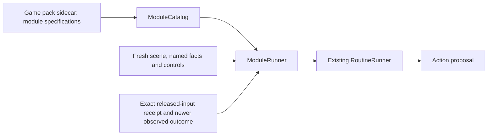

# Reusable operation modules

Navigation, sigils, menus and Auto-Idle now share a versioned specification,
catalog, composition runner and offline replay interface. The four implementations
live under `ProjectMaelstrom/ProjectMaelstrom/Utilities/Modules/`. W101 supplies
configuration through `W101SharedOperations`; it no longer constructs a private
navigation/menu graph. No model, service, production dependency or second input
controller is required.

## Parts and responsibilities

| Module kind | Configuration supplied by a game | Observed completion | Detail |
| --- | --- | --- | --- |
| `navigation` | Contiguous landmarks, progress labels, bounded movement actions | Final landmark after the relevant action receipt and bound outcome | [Navigation](modules/NAVIGATION.md) |
| `sigil` | Entry scene, interaction binding, expected menu scene | Correct menu observed after interaction | [Sigils and menus](modules/SIGILS_AND_MENUS.md) |
| `menu` | Explicit ordered menu steps, controls and entry policies | Last step's outcome, or an explicitly allowed already-complete state | [Sigils and menus](modules/SIGILS_AND_MENUS.md) |
| `auto-idle` | Native menu path, or one finite spin/step/routine cycle | Native idle observed, or the final motion outcome | [Auto-Idle](modules/AUTO_IDLE.md) |

Each factory returns an `OperationModuleDefinition`: the validated specification,
its existing `RoutineGraph`, and a set of `ModuleAction` bindings. These are data.
The factories do not recognize pixels, dispatch input, acquire a lease, sleep or
run a repeating timer. Native idle delegates its menu handling to `MenuModule`.



## Saved specification contract

`OperationModuleSpec` schema 1, implementation version `1.0.0` contains:

- `id`, `kind`, `game_id`: stable module instance, known factory and game identity.
- `required_facts`: named conditions the observation adapter must establish now,
  such as a particular world, configured movement bindings or confirmed home.
- `configuration`: the typed data for that module kind. Unknown configuration
  fields, duplicate JSON properties and unsupported versions are rejected.

`OperationModuleBundle` schema 1 contains `id`, `game_id`, `context_id`, an overall
`timeout_ms`, shared `max_actions`, and 1–16 module specifications in order. All
modules must match the game. IDs are unique within the bundle. Repeated action
IDs must retain identical bindings across modules. Modules retain their own time
and action limits inside the bundle limits; changing modules never resets the
bundle budget. The overall limit is five minutes, not an indefinite session.

Use `OperationModules.Spec(...)` to construct a specification;
`ModuleCatalog.Compile(...)` validates a specification or complete bundle.
`ModuleCatalog.Save(bundle, newPath)` validates before creating a new file and
never overwrites an existing pack. `ReadBundle(json)` validates and loads it.
Files are limited to 1 MiB, configurations to 64 KiB, and JSON nesting to 16.
Malformed/unsupported data raises `InvalidDataException` or a JSON parsing error;
there is no fallback to partially interpreted configuration.

The current game-pack schema remains unchanged. Store a bundle as an explicitly
loaded `*.modules.json` sidecar next to a pack; do not place it in an ignored pack
field. The Workshop does not yet provide module clip editing or automatic sidecar
discovery. Loading a sidecar grants no live input authority. `live_qualified` is
not an accepted input field.

## Action and observation contract

`ModuleAction` contains `action_id`, `kind`, optional `key`, `duration_ms` and
`control_id`. Supported kinds are `keyboard-pulse` and `verified-control-click`.
There are no shell commands, embedded code, callbacks or plugin paths. A click
names the control; the qualified live adapter must locate its current geometry.
Keys and controls belong to game configuration, not module source. The current
bindings represent short bounded actions, not arbitrary long key holds.

Bind each run using `bundle.Bind(targetId, geometryId, visitId)` and construct
`ModuleRunner(bundle, binding)`. A fresh run gets a unique nonce. The runner takes
a deep snapshot, so editing a pack cannot alter a running attempt.

`Observe(ModuleObservation)` consumes the existing `RoutineObservation` plus
`verified_facts` and `verified_controls`:

1. Target, geometry and visit must remain bound. Input ownership and target
   readiness must still hold. Cancellation or user activity ends the attempt.
2. Time is monotonic. Frames must be fresh and context verified. All required
   facts must be present for the current module; a general Boolean is insufficient.
3. Before proposing an action, the matching `control_id` must be verified on that
   observation. When a frame acknowledges one action and triggers the next, the
   runner checks the **next** control, including across module boundaries.
4. `RecordReceipt(RoutineReceipt)` accepts only the exact proposal/action identity,
   accepted dispatch and released input. A receipt is not outcome evidence.
5. A newer expected scene must name `outcome_for_proposal_id` before advancing.
   Every module edge opts into this requirement. Held progress labels and another
   module's receipts cannot acknowledge a new action.

`ModuleDecision` reports module/node identity, reason, optional proposal/action
and its binding, and completed/stopped state. `CompletedModules` and
`ProposedActions` expose bundle progress. Modules may hand the same fresh scene to
the next module; that module rechecks its own facts and named control. At most 16
modules can be considered from one observation. Completion remains historical;
later frames cannot restart the bundle.

Unknown/loading states produce no action. They do not reset finite deadlines.
Motion idle also pauses on the game's configured native-idle scene and contains
no wake operation. Recurrence belongs to the existing scheduler, not an embedded
timer. A stopped bundle needs a newly authorized attempt, not an automatic retry.

### Optional client loading observations

`ModuleRunner` and `ModuleScreenSession` accept a trusted, optional
`ModuleLoadingRequirement` at construction and a `ModuleLoadingObservation` per
observation. The sample carries the exact target/geometry/visit binding, adapter
source, monotonic sampling time and nullable loading flag. This is an additional
condition, not scene recognition. The visual-only default does not require it.
When enabled, missing, unavailable, wrong-source, wrong-visit, future or stale
samples withhold all actions/outcomes. A true flag pauses; false only permits the
ordinary recognition checks. Deadlines and pending receipts remain unchanged.

The screen bridge discards pre-loading stability, aliases and actionable controls.
After clear, it requires two new visual observations; a clear reading cannot grant
dialogue, nearby interaction range, a waypoint, resource availability or native
Idle. `ModuleOwnedInput` rechecks freshness at dispatch as well as capture age and
the current owner's ability to dispatch. A recovery warning still blocks input.

`WizwalkerModuleLoading` supplies W101's optional condition through the existing
scheduler owner and the unchanged reviewed one-shot worker. It binds the same
target and visit, verifies admitted adapter pins, bounds reads and conservatively
includes startup/disconnect time in the one-second freshness budget. The existing
Dance postgame continuation can opt in via its trial launcher. This source wiring
is tested offline; it has not yet run an autonomous live postgame visit.

### Reusing interaction and composing loops

W101's X key is the shared `game.interact` action, not a special Dance input.
The current sigil module compiles one observed nearby-object interaction into a
receipt-bound expected result; the same contract can describe NPC dialogue,
reagent collection or a quest object by supplying different observed entry/result
scenes and named controls. Being near an object must be established by its prompt
or a separately qualified client reading; sending X does not establish success.
Native Idle is already an Auto-Idle/menu module. Their live recognition and input
bindings must be qualified per operation; neither is a general CLI input command.

Longer loops belong above these finite attempts: choose an eligible task from
fresh resource/context facts, execute registered modules under one owner, verify
the result, account for resources, then select the next task or rest. Around-the-
clock quests, reagent collection and cross-game scheduling remain roadmap work;
this checkpoint does not claim those routines are implemented.

`RoutineRunner` remains the single transition engine. Direct factory/graph tests
exercise individual pieces; composed consumers must use `ModuleRunner` to enforce
named facts, exact controls and bundle-wide budgets.

## Offline replay

The native application accepts this command before normal UI/plugin startup:

```text
ProjectMaelstrom.exe --replay-modules <bundle.json> <session.json> <new-report.json>
```

A complete saved example is in
`ProjectMaelstrom/ProjectMaelstrom.Tests/TestData/Routines/w101-operations/`:
`bundle.json`, `session.json`, `events.jsonl`. It rehearses a synthetic two-segment
route, sigil interaction, menu cancellation and native Idle. These are authored
scene labels, not a calibrated Commons route or recorded game outcomes.

Use the existing `tools/game_session.py` schema-1 envelope. The manifest supplies
`session_id`, `clock_origin`, local `events_file` and `routine_binding`.
Observation/outcome events place `ModuleObservation` under
`payload.module_observation`; receipt events use `payload.routine_receipt`.
The envelope `time_ms` is authoritative. Unsupported payloads are counted and
ignored; they cannot advance the run. Receipts are supplied, never invented.

Offline proposal IDs are
`<session_id>.m<zero-based-module-index>/<module-id>/<one-based-action-ordinal>`.
The session ID must be a bounded identifier. Reports preserve SHA-256 hashes of
the exact bundle, manifest and events, module progress, decisions and counts.
They always state `desktop_dispatch_count: 0` and `live_qualified: false`.
Exit codes: 0 completed contract; 2 stopped/incomplete with report; 1 invalid
input/error. Reports use create-new semantics and cannot overwrite evidence.

When running from a checkout, ask MSBuild for `TargetPath` and invoke that build.
The old `win-x64` sibling may be stale; [build retention](BUILD_ARTIFACT_RETENTION.md)
records the distinction. Replay has no game, capture, OCR, model or desktop job.

## Integration and qualification

[W101's adapter](W101_SHARED_OPERATIONS.md) supplies existing A/D/W/S primitives,
sigil/menu controls, world/route facts and all existing Auto-Idle preferences.
`ModuleRunnerTests` supplies an independent `offline-lab` profile using different
keys, scenes, controls and a `Resting` terminal state through the same four modules.
This tests game independence without pretending another live game is qualified.

The [screen/scheduler integration](MODULE_SCREEN_INTEGRATION_20261110.md) now
connects saved PNGs through existing local OCR, image-bound facts/controls and
`ModuleScreenSession` to this runner. `ModuleOperation` uses the existing
scheduler, and the existing Pet Dance native-Idle continuation source consumes
these modules through the guarded existing input adapter. That source is not
installed or live-qualified. Navigation, other home-movement and Dodge adapters
still need their own qualified bindings; module clip editing remains pending.
Do not add parallel controllers or treat caller-authored facts as visual proof.
Navigation still needs actual landmark/obstruction detectors; a finite route
module is not automatic pathfinding. Saved-image and live qualification stay
separate from these contract tests.

See [the foundation checkpoint](MODULE_STANDARDIZATION_20261110.md),
[screen/scheduler results](MODULE_SCREEN_INTEGRATION_20261110.md) and
[the workstream board](coordination/workstreams.json) for results and next gates.
