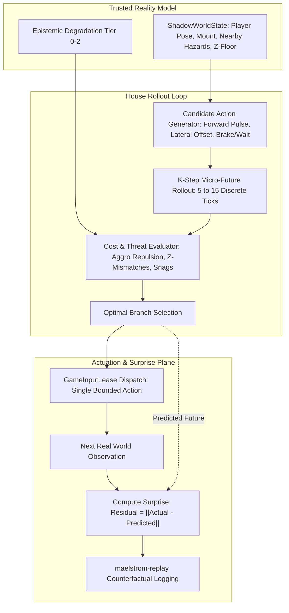

# Short-Horizon "Mr. House" Prediction & Rollout Engine

> **Status (audited 2026-11-20):** design document. `crates/maelstrom-core/src/predictive_rollout.rs` implements a deterministic,
> constant-velocity rollout of three action kinds (forward, steer-and-forward, brake) with a hazard clearance test, a threat-cost
> score and a residual check, covered by 7 tests. Nothing calls it: it is not connected to the bridge, the actuator,
> `maelstrom-replay` or any trace log, and there is no learned predictor, compute-budget enforcement or candidate generator.
> Notes marked **Today** say what the code does. Evidence: [W101-ROLLOUT-CORE-02](coordination/results/W101-ROLLOUT-CORE-02.md),
> audit note.

## 1. Operational Rationale: Anticipation vs. Reaction

In server-authoritative virtual worlds like Wizard101, reactive agents—those that act only *after* observing a state transition—suffer from fatal systemic vulnerabilities:
- Stepping across a roaming mob's invisible aggro perimeter triggers an instant, uncancelable transition into a 4-player dueling circle.
- Navigating narrow street corridors without projecting dynamic mob paths causes sudden collisions around corners.
- Continuing to hold movement keys against a geometry snag or loading wall wastes valuable time and inflates kinematic drift.

Because teleportation, speedhacking, and memory injection are strictly forbidden under Maelstrom's working agreement, the runtime cannot rewrite physics or force server state. Instead, it must operate like **Mr. House's predictive mainframe**: continuously rolling out short-horizon micro-futures from its trusted world model, evaluating feasibility and risk across candidate actions, and dispatching only the single trajectory that maximizes objective progress while guaranteeing non-intersection with dynamic hazard envelopes.

---

## 2. Two-Layer Kinetic Reflex Architecture

To prevent over-engineering and retain deterministic auditability, Maelstrom splits actuation into two distinct layers:

### Layer 1: Deterministic / Analytical Reflexes (No Training Required)
- **Kinematic Steering**: Pure Pursuit waypoint tracking, heading alignment ($\Delta \theta = \text{target\_yaw} - \text{current\_yaw}$), and bounded `W` key pulse durations.
- **Turn Arbitration**: Dueling circle countdown windows (30-second timers), pedestal target arbitration, and deck profile switching.
- **Safety Interrupts**: Instantaneous `GameInputLease` release upon loading screens, window focus loss, or human mouse intervention ($\ge 3\text{s}$ quiet period required before resumption).
- **Rule**: Never replace exact mathematical solutions with opaque neural weights where analytical models are provably optimal.

### Layer 2: Learned Short-Horizon Local Predictors (Compact / Replay-Trained) (design only: none implemented)
Where environmental dynamics are messy, non-linear, or subject to client latency:
1. **Dynamic Patrol & Aggro Rollouts (1–4 seconds ahead)**: Projects non-linear mob patrolling trajectories along sidewalk vs. street corridors when mob spacing is tight.
2. **Kinematic Execution & Snag Prediction**: Predicts actual net displacement for a key-hold pulse given mount speed, local frame rate, and incline angles, detecting snags *before* spending seconds colliding against walls.
3. **Combat Outcome Estimator**: Forecasts multi-turn combat outcomes, scoring whether a damage line clears the duel circle cleanly vs. risking health depletion or a flee spiral.

---

## 3. The Short-Horizon Micro-Future Rollout Loop

Every planning cycle (50ms–100ms), the engine executes a rapid four-stage rollout:

### Step 1: Capture Fast Shadow World State
Extracts a lightweight snapshot of the current manifold state:
- Player pose: $\mathbf{p} = (x, y, z, \text{yaw})$.
- Kinematic attributes: mount velocity multiplier $v_{\text{mount}}$ (e.g. $1.0\times$ walking, $1.4\times$ equipped mount).
- Local dynamic hazards: positions, velocities, and aggro radii of mobs within a 150-unit sensory perimeter.
- Elevation constraints: surveyed floor height $Z_{\text{floor}}$ and water plane $Z_{\text{water}}$.

**Today:** `ShadowWorldState` holds the pose, a mount multiplier (only clamped from below, at 0.5), the caller's list of hazards,
a degradation tier and a timestamp. There is no 150-unit filter (the caller decides which hazards are "nearby"), no floor or
water height, and `z` never changes during a rollout.

### Step 2: Branching Micro-Future Simulation
From the shadow state, simulates $K$ discrete steps (default $K = 10$ steps at $\Delta t = 0.1\text{s}$, spanning a $1.0\text{s}$ horizon) across candidate action primitives:
1. **Kinetic Forward Pulse**: Maintain heading, pulse `W` for duration $\tau$.
2. **Lateral Offset Arc**: Apply yaw steering rate $\omega$ while pulsing `W` to veer around an obstacle.
3. **Brake and Hold**: Issue zero input, holding current coordinate to allow a roaming mob patrol to clear a street crossing.

**Today:** the caller supplies the candidates; the engine has no generator. `with_horizon` clamps to 1-30 steps of 0.01-0.5 s (so
a horizon can be 0.01 s to 15 s), not the 5-15 ticks drawn above. Hazards move in straight lines at constant velocity, frozen
after 3 s, and there is no wall or terrain model. A pulse is applied for whole steps only, rounded down: 450 ms acts for 400 ms and a
pulse under one step (100 ms) does not move at all. A forward pulse of 51-99 ms is therefore scored with the 500-point snag
penalty because it moves nothing; that is a quantization artifact, not a snag prediction. **Known defect (measured; fixed 2026-11-20):** a pulse that
ends on the third, sixth or seventh step boundary (300, 600, 700 ms) loses that step to floating-point rounding: a 300 ms pulse
moves 5.0 units instead of 7.5 and scores like a 200 ms pulse. The existing tests use 400, 500, 800 and 1,000 ms, which are not
affected. Fixed with a regression test in commit 1e02f69, merged as `12b22fd` on 2026-11-20 (the defect text above describes the code before that merge).

### Step 3: Feasibility & Risk Scoring
Each simulated trajectory branch $B_i$ is evaluated against an objective cost function:

$$S(B_i) = w_{\text{progress}} \cdot \Delta d_{\text{goal}} - w_{\text{threat}} \cdot C_{\text{threat}} - w_{\text{snag}} \cdot C_{\text{snag}} - w_{\text{unc}} \cdot \sigma_{\text{uncertainty}}$$

Where:
- $\Delta d_{\text{goal}} = \|\mathbf{p}_0 - \mathbf{p}_{\text{goal}}\| - \|\mathbf{p}_K - \mathbf{p}_{\text{goal}}\|$ (progress toward waypoint).
- $C_{\text{threat}}$: Sum of inverse-square repulsion penalties from projected mob aggro cylinders ($Cost \propto \frac{1}{(d - r_{\text{aggro}})^2}$). If any tick enters $d \le r_{\text{aggro}}$, the branch is marked **lethal** and pruned.
- $C_{\text{snag}}$: Penalty applied if predicted displacement is near zero despite positive pulse input.
- $\sigma_{\text{uncertainty}}$: Epistemic penalty widened under degraded sensory tiers.

**Today:** `S = 2 * progress - 0.1 * (sum of per-step threat costs) - snag penalty (500, forward pulse only)`, or -1,000,000 when
the branch is unsafe. There is no $\sigma_{\text{uncertainty}}$ term and no Z-mismatch term. The per-step threat cost comes from
`Hazard::evaluate_threat_cost`: 254 inside the aggro radius, otherwise `penalty_weight / (clearance + 1)^2` clamped to 1-253 inside
the repulsion radius, which is the inverse-square form described here. A branch is unsafe when any step's clearance to a hazard
within vertical tolerance is zero or less.

### Step 4: Bounded Dispatch via `GameInputLease`
The highest-scoring non-lethal candidate trajectory is selected. If none is safe, the engine returns a fixed 500 ms
`BrakeAndHold`, **without checking that the brake is itself safe**: with the player already inside an aggro radius it returns that
brake with `is_safe = false` and a score of -1,000,000. The engine returns a `CandidateEvaluation` and emits no proposal;
`PROPOSAL:Kinematics:PulseKey` appears nowhere in the code. Nothing connects the engine to the Rust bridge or to
`DesktopInputActuator`, whose live `actuate` branch is itself a stub (see [JobDeckHost Actuation Loop](JOB_DECK_ACTUATION_LOOP.md)).

---

## 4. Counterfactual & Model Surprise Logging (`maelstrom-replay`)

At the instant an action is dispatched, the rollout engine records its **expected future state** $\hat{\mathbf{p}}_{t + \Delta t}$.

When the next real sensory observation arrives at $t + \Delta t$, the engine computes the **spatial prediction residual**:

$$\mathbf{r} = \|\mathbf{p}_{\text{actual}} - \hat{\mathbf{p}}_{t + \Delta t}\|$$

- **Normal Tracking ($\mathbf{r} \le \text{tolerance}$)**: Model expectations verified; execution confidence reinforced.
- **Model Surprise ($\mathbf{r} > \text{tolerance}$ or Unexpected Combat)**:
  - Automatically logged as a counterfactual event in the session trace.
  - Classified by the **Prediction Failure Taxonomy**:
    1. `StaleEntityTTL`: Mob moved differently because cached entity observation was stale.
    2. `TerrainZFloorMismatch`: Character stalled on a curb or staircase height transition.
    3. `PatrolTrajectoryCurvatureChange`: Roaming mob turned at a patrol waypoint unexpectedly.
    4. `InputLatencyJitter`: Window message dispatch stutter caused key release delay.
    5. `ObstacleSnag`: Undocumented static geometry collision stopped forward motion.
  - These labeled surprise events form the exact empirical training corpus for local offline models.

**Today:** `calculate_surprise` returns an observation to its caller; nothing records, logs or consumes it. The residual is
measured against the horizon's final pose, whenever the caller observes: the per-step poses and the timestamp are not used to align
them (measured: the exact step-1 pose of a 1 s forward pulse gives a residual of 22.5, a surprise, cause `ObstacleSnag`). Only three of the
five causes are ever assigned: `PatrolTrajectoryCurvatureChange` (combat while the prediction was safe), `TerrainZFloorMismatch`
(vertical difference over 10) and `ObstacleSnag` (any other residual over the tolerance, including a late key release or an overshoot).
`StaleEntityTTL` and `InputLatencyJitter` are never produced.

---

## 5. Compute & Latency Budgets ("House's Clock")

A prediction that arrives too late is worse than no prediction. The rollout loop adheres to strict computational budgets:
- **Maximum Per-Tick Budget**: $\le 10\text{ ms}$.
- **Pruning Discipline**: If $K$-step branch expansion exceeds $8\text{ ms}$, the engine truncates remaining branches and defaults to the safest known analytical trajectory (or `BrakeAndHold`).
- **Separation of Concerns**: Heavy batch training, dataset clustering, and multi-hour trace regressions run offline in `maelstrom-replay --batch`, never inside the real-time sensory-motor loop.

**Today:** not implemented. `max_compute_budget_ms` (10.0) is a field that nothing reads; there is no timer, no 8 ms truncation and
no measurement of how long a rollout takes.

---

## 6. Epistemic Humility & Calibration Under Uncertainty

When sensory trust degrades (e.g. `RealityWorldModel` demotes to `Tier1VisualAcoustic` due to memory hook failure or camera occlusion):
- The aggro radius used in the lethal-clearance test is expanded: by 1.5 under `Tier1VisualAcoustic` and by 2.0 under
  `Tier2SafeHalt` (this document used to list only the first). The repulsion radius and the threat cost are not widened (measured:
  the same threat penalty under all three tiers for a hazard in the repulsion band), so the effect is a larger lethal margin only.
- Nothing else changes with the tier. There is no candidate generator, so pausing at sidewalk edges, wider turning radii and larger
  patrol gaps are not implemented.
