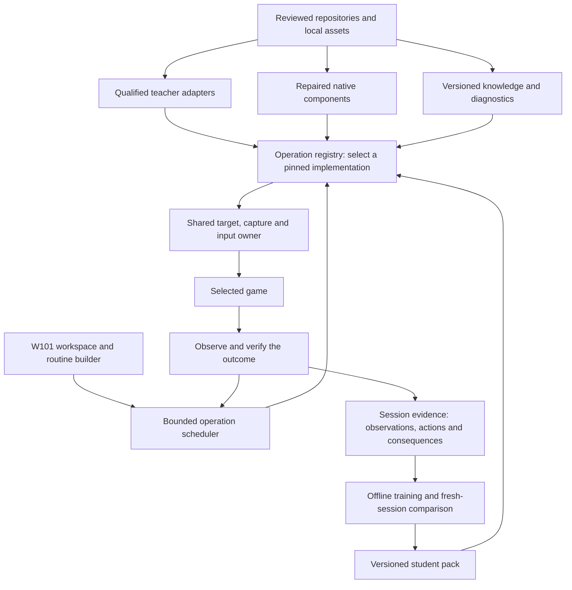

# Wizard101 integration map: established tools, native operations and learning

**2026-11-10 policy update:** the owner authorizes actual functional reuse of
reviewed W101 client-side components, including necessary hooks, injection and
memory reads/writes. [The expanded exception](W101_CLIENT_SIDE_EXCEPTION_20261110.md)
replaces the narrower read-only interpretation; network manipulation remains
excluded. This map is still a plan, and existing launcher guards remain until
reviewed adapter/session integration is implemented. Capability eligibility,
implementation and current-client qualification must be tracked separately.

Decision and code review: 2026-11-08. This is the implementation map for the
legacy-to-native W101 work, subordinate to the [product charter](PRODUCT.md).
It extends the [routine design](W101_ROUTINES.md), rather than creating another
application or a new handoff. **This document describes the target architecture;
it does not enable the proposed scheduler operations.**

The [structured map](../research/w101-integration-map.json) contains all 25
supplied archive entries, four additional connected tools, 12 shared capabilities,
17 proposed operations and nine dependency-gated work packages. It is a planning
artifact, deliberately not an executable manifest. Source integrity and component
findings remain in the [qualification matrix](W101_LEGACY_QUALIFICATION.md).

Implementation follow-up: [shared operations](SHARED_OPERATIONS.md) now supplies
the bounded scheduler, common native/Python ownership and recorded Pet Dance
teacher job. The baseline and gates below remain the planning record; consult
that implementation note for the completed slice and remaining live boundaries.

## The decision

Maelstrom should own the game workspace, operation contracts, scheduling,
recording, verification and pack versions. Established software supplies optional
teachers, reusable algorithms and data. Small repaired functions should become
native components when that removes duplication or improves control; complex
client-dependent tools can remain isolated adapters until a replacement proves
better. We do not need to rewrite every repository or run every program.

One operation can have several implementations. For example, **Play Pet Dance**
can eventually offer a qualified legacy teacher and a native visual student.
Both report the same kinds of actions and outcomes. The teacher can perform useful
work while recording demonstrations; the student can watch and propose actions
without simultaneously controlling the game. Selection remains explicit until
comparison evidence supports a default.

The scheduler coordinates jobs; the running specialist reacts to fresh game
events. Neither a timer queue nor a fixed sequence of keys defines gameplay.
Alternative matchers and policies remain useful experimental baselines.

## What exists, and what still needs connecting

| Area | Existing implementation | Required connection or repair |
| --- | --- | --- |
| W101 workspace | Routine builder, Auto-Idle methods, Observe entry, legacy library | Present operations and their qualified implementations within this workspace. Category names alone are not implemented players. |
| Native Pet Dance | Image import, cue calibration, sequence reconstruction, offline proposal packs | Current-game phase/cadence calibration, controlled input and observed round results. Installed offline tests do not establish live play. |
| Guided legacy activities | Managed Deimos questing, farming and pet adapters with progress/stop controls | Instrument actual actions and outcomes; qualify the current client; use the same ownership and job lifecycle as native operations. |
| Capture and learning | Observe, recordings, input timelines, replay, experiments and pack comparison | Shared capture, bounded consumers and causal action/outcome alignment. Reuse these instead of building another training application. |
| Context | Companion database export and native WizWiki cache loader | Normalize records, handle refresh/conflicts, and expose source/version coverage. Missing data remains missing. |
| Assets and diagnostics | WAD script bridge, saved-packet decoder, type and patch comparison adapters | Repair reader limits and process timeouts; produce compatibility reports that can invalidate affected qualifications. |
| Scheduler | Older SmartPlay queue; separate external-tool lifecycle; separate Auto-Idle runner | Unify contracts and input ownership before adding scheduled live routines. |

The scheduler audit found specific reasons to start with that last row:

- `SmartPlayManager` runs a 750 ms pump. Retain orchestration concepts, but do not
  use this as the timing clock for visual reactions. It can also report completion
  when a command list is empty or a script session disappears; neither verifies
  the requested game outcome.
- Its external JSON queue deletes the input file after processing, including a
  parse failure, and `RepeatCount = 0` means endless repetition. Replace that
  boundary with persisted job receipts, explicit limits and recoverable errors.
- Its script path calls `ScriptLibraryService.StartScript` directly while
  `BridgeCoordinator.TryStartScript` has additional preflight checks. All starts
  need one admission boundary, with current policy checked again during dispatch.
- `HomeMovementLease` and the Python hub use different lock files. They do not
  yet establish one owner across Auto-Idle, native specialists, old scripts and
  installed/portable instances. `SharedLease<T>` is object lifetime management,
  not an input lock.
- The WAD bridge reads process output before its timed exit wait. A hung reader
  can therefore defeat the intended timeout. Move it to the bounded worker path
  before scheduling unattended asset imports.

Code anchors: [SmartPlayManager](../ProjectMaelstrom/ProjectMaelstrom/Utilities/SmartPlayManager.cs),
[task model](../ProjectMaelstrom/ProjectMaelstrom/Models/SmartPlayTaskDefinition.cs),
[BridgeCoordinator](../ProjectMaelstrom/ProjectMaelstrom/Utilities/BridgeCoordinator.cs),
[HomeMovementLease](../ProjectMaelstrom/ProjectMaelstrom/Utilities/HomeMovementLease.cs),
[hub](../tools/wizard101_hub.py), and
[WadIndexService](../ProjectMaelstrom/ProjectMaelstrom/Utilities/WadIndexService.cs).

## Source-by-source disposition

“Teacher” below means a candidate implementation to qualify, unless explicitly
described as implemented offline. Owning a working historical program does not
prove it works with the current client. Preserve source hashes and attribution;
record asset redistribution permissions separately from local-use availability.

| Source | Maximize its useful contribution | Destination and prerequisite |
| --- | --- | --- |
| Pet Dance / DanceBot | Keep templates and sequence concepts; native offline review already exists | Pets teacher/student; qualify scales, Watch/Go timing, actual dispatch and round result. |
| Deimos main | Retain managed teacher; adapt routine language, navigation and combat decisions | Quest/farm/pet operations; repair geometry/deck defects and instrument callbacks. |
| Deimos master | Preserve as a separately versioned alternative | Compare after coordinate-sign and dependency repairs; do not silently merge forks. |
| wizwalker | Optional client state teacher; reuse asset parsing and state vocabulary | Explicit privileged adapter, separately patch-qualified; memory-derived labels never masquerade as visual recognition. |
| wizSDK | Reuse matching and common utility concepts; retain optional client bridge | Shared matching/waits, then movement utilities; avoid another duplicate client environment. |
| wizAPI | Redevelop small visual spell/menu functions | Shared perception and combat; fix rectangular-template centers, screen coordinates and indefinite waits. |
| Wizard101 Farming | Adapt card/enchant recognition and attack selection | Combat teacher/native turn operation; remove fixed deck assumptions and endless loops. |
| gardening-bot | Reuse visual waits and plant-care steps | Home gardening; repair interrupted key release, then verify plant/energy changes. |
| Bazaar TC Farming | Reuse item/page matching and search flow | Search first; purchasing is a separate bounded operation. Repair missing matches and color-channel handling. |
| Damage Calculator | Repair as a small pure consequence evaluator | Combat estimates; fix mutation, enchant, resist and boost errors against independent fixtures. |
| Automatus v2 | Reuse route records, editing concepts and run statistics | Destination navigation; fix missing imports and verify arrival instead of elapsed motion. |
| afk-wizard | Salvage HUD/battle cues as an alternative detector | State recognition; missing or obscured UI must be unknown, not proof of battle. |
| Raid utility tools | Preserve four specialist variants and useful location/workflow data | Later teachers after solo contracts; qualify each fork independently. |
| WizWikiAPI | Extend the existing native cache import and world/quest schemas | Context and route hypotheses; verify refresh, dates and schema without requiring its old service. |
| Wizard101 Utilities | Import useful gear/pet/research schemas and cached records | Knowledge library; validate freshness and conflicting facts. |
| WizGallery | Reuse screenshot/location indexing and provenance patterns | Recording library; no need to host its separate website/database. |
| GrubNinja | Extract map, UI and state vocabulary | Grub Guardian reference material; generated reward submissions are not gameplay demonstrations. |
| wizwad | Repair reader and use as an independent parsing baseline | Local asset index; enforce signatures, sizes, decompression limits and worker deadlines. Writer deferred. |
| libkiwad | Keep a native reader alternative for differential checks | Repair unsafe header comparison and compressed reads before selecting it. |
| Aurorium | Reuse manifest/version/download provenance concepts | Optional asset tooling only if it fills a gap; defer the server stack and unresolved dependencies. |
| wiz-packet-map | Separate useful schema/WAD utilities from old injection machinery | Optional offline asset/protocol tools; not a default gameplay dependency. |
| w101-proto-go | Import message/type vocabulary | Diagnostics reference; missing module blocks its build, and schema names do not recognize pixels. |
| On-Wiz | Keep dated documentation and client/protocol hypotheses | Research/context; verify claims against the relevant revision. |
| Cheat Engine | Borrow target inspection and watch-value UX | Diagnostic design reference; no driver or whole application prerequisite. |
| Historical Maelstrom portable | Preserve earlier UX/behavior comparison | Reference build, not a nested runtime or source of unquestioned training labels. |
| wizard101-companion | Use existing boss export; optional OCR/guide worker | Sourced context and reviewed labels; normalize duplicates and distinguish guide claims from observations. |
| moonlight | Keep existing saved-capture decoding adapter | Optional diagnostics with processing limits, outside the default player loop. |
| wiztype | Keep type dump/comparison adapters | Patch compatibility reports; live attachment remains a separate qualified activity. |
| wizdiff | Reuse current offline patch-XML comparison | Mark affected packs/adapters for requalification; do not automatically patch offsets. |

The first 25 rows cover the supplied archive catalog. The final four are existing
connected tools from the earlier integration work. Other recursively discovered
archives include releases, dependencies and reference copies; they are not 88
independent gameplay teachers.

## Operation contracts and user-facing routines

Keep **operation**, **implementation**, **purpose** and **schedule** separate:

| Concept | Example | Meaning |
| --- | --- | --- |
| Operation | `w101.pet-dance-play` | Stable request and independently checked result. |
| Implementation | Native visual pack or qualified legacy adapter | How the request is performed; exact version pinned for a run. |
| Purpose | Perform, demonstrate-and-record, or shadow evaluation | Whether an implementation controls the game, teaches, or only proposes. |
| Schedule | Run once, after a successful prerequisite, or bounded recurring job | When work is eligible, subject to target, resource and user-activity checks. |

Each operation needs a documented parameter/result schema, target identity,
supported observations/actions, required capabilities, preconditions, resource
budget, timeout, stop behavior, postconditions and recovery rules. Packs supply
declarative policies and assets; loading a pack does not execute arbitrary code.
Trusted adapters implement the contract. Initial runtime interfaces should use
the existing .NET application and Python worker boundary, without requiring MCP,
another server, or a language model.

An admitted job records job ID, operation ID, implementation version, pack hash,
target/process identity, configuration, maximum duration/repeats/resources,
evidence destination and cleanup policy. Keep proposed actions, dispatch receipts,
observed results and derived labels separate. Persist checkpoints and terminal
states: completed, failed, cancelled, interrupted, unknown, cleanup-failed.
“Process exited” is an execution fact; successful gameplay requires its result.

| Proposed operation | Main inputs | Result | Gate |
| --- | --- | --- | --- |
| Observe and record | Selected target, duration, capture/input options | Finalized session with timing/loss report | W02 |
| Auto-Idle / native Idle | Selected method and limits | Selected method state or visibly verified native Idle | W03 |
| Review Pet Dance | Recording and calibration | Proposal pack and review report, original labels intact | W02 |
| Play Pet Dance | Qualified implementation, finite rounds/energy | Verified round results and demonstration evidence | W04 |
| Wait for state | Detector, freshness and timeout | Fresh positive evidence or timeout/unknown | W02 |
| Home gardening | Selected plants and energy budget | Observed need/energy changes | W06 |
| Bazaar search | Item filter and page limit | Item/price evidence or bounded not-found | W06 |
| Bazaar purchase | Item, quantity and spending limits | Reconciled inventory/currency changes | W07 |
| Combat turn | Recognized hand/turn/target and policy | Selection and resulting turn evidence | W07 |
| Entrance farming | Qualified route/combat and repeat limit | Entrance/battle/return outcomes | W08 |
| Navigate | Destination and route/context | Observed arrival, or bounded stuck/unknown result | W08 |
| Follow quest | Tracked objective and subgoal budget | Verified progress with checkpoints | W08 |
| Refresh context | Selected sources and import scope | Versioned validated records and conflicts | W05 |
| Index assets | Selected local assets and limits | Hashed index with explicit parse failures | W05 |
| Estimate damage | Combat context and formula version | Repeatable estimate, not observed reward | W07 |
| Patch check | Saved patch/type/protocol inputs | Affected capabilities and qualification report | W05 |
| Build student | Curated demonstrations and held-out sessions | New candidate pack and comparison evidence | W04 |

All 17 are **proposed scheduler registrations**. Existing manual/offline pieces
are identified in the structured map; no scheduler registration is claimed ready.

In W101's workspace, preserve **Auto-Idle [checkbox] — [method]** and the Farming,
Pets, Potions and Quests categories. A routine step selects an operation, method,
parameters and visual completion condition. The schedule view shows eligibility,
limits, current run and readable outcomes. Unsupported methods show their missing
prerequisite rather than a misleading enabled Start button.

Example future routine: verify selected home context → care for configured plants
within an energy budget → save results → enter native Idle and verify the banner.
Pet Dance demonstration and student comparison use the same lifecycle. A failed
prerequisite does not fall through to the next game action.

## Scheduler, desktop and resource rules

1. One game-input owner across all frontends, adapters and app instances. Offline
   work needs no game-input lease. A shadow student cannot dispatch alongside its
   teacher. A client-memory teacher declares that capability explicitly.
2. One capture source per selected target feeds bounded consumers. The reactive
   consumer takes the newest frame; recordings preserve timestamps and declare
   drops. Log latency and backpressure rather than allowing a growing backlog.
3. Default to one analysis worker, no loaded model and no training during live
   play. A proposed 32-job queue cap is an initial bound, not a performance claim.
   Measure CPU, memory, capture loss and decision age before raising limits.
4. A job has finite time, action, repetition and game-resource limits. Recurrence
   creates new bounded jobs; missed triggers do not produce catch-up bursts.
   Duplicate delivery must not replay an irreversible or unverified action.
5. Stop/manual desktop activity releases held input, pauses live work and does
   not repeatedly reclaim focus. Jobs cannot assume a Windows virtual desktop
   grants independent input focus. Use a genuinely isolated game environment
   where available; otherwise coordinate access to the shared desktop.
6. Between live W101 tests, use the screen menu to return to native Idle and
   verify its banner. If the user takes over or the target becomes uncertain,
   release input first; mark cleanup pending/failed instead of stealing control
   to finish it. Dependent live jobs remain paused until cleanup is verified.
7. Persist intent, receipts and results atomically. After crash, update or restart,
   show interrupted jobs and require a fresh preflight and explicit resume;
   never replay the last game input just because a receipt is missing.
8. Pin versions for active runs. Editing a pack creates a new candidate. A patch,
   calibration change or backend update invalidates only affected qualifications;
   a previous successful run is not permanent compatibility proof.

## Learn from software without copying its mistakes

Start with direct reuse where a deterministic function can be repaired and tested.
Learning is useful where recorded experience can improve perception or decisions;
it should not approximate a reliable parser, key map or finite-state transition.

For a teacher episode, preserve synchronized observations, context, proposed
actions, actual dispatch, decision timestamps, post-action observations, observed
outcomes, failures and source/pack versions. A privileged teacher can provide
reference state, but it must be marked separately and excluded from the visual
student's inputs and evaluation. Teacher labels are hypotheses until checked.

The first training path is compact: calibrate templates/regions, reconstruct
transitions, then fit thresholds, a state machine, small classifier or compact
policy where measurements justify it. Start with recorded replay; add fresh
shadow sessions; then compare bounded live trials. A large review model remains
an optional offline helper, not a requirement for real-time reaction.

Split training and evaluation by entire recording/round and source, not adjacent
frames from the same recording. Include failures, repeated directions, variable
cue order, scaling, occlusion, stale frames and ambiguous states. Video alone can
teach visual states and likely transitions; unknown human inputs must not become
ground-truth action labels. Hold out fresh sessions and retain rejected candidates.

Promote a candidate only against a rubric declared before the comparison: valid
completion rate, false actions, action timing, unknown-state handling, cleanup,
resource use and variability across independent runs. Native and legacy methods
must receive comparable starting conditions and budgets. Report sample counts
and uncertainty; one perfect sequence is insufficient. Keep the previous qualified
pack available for rollback. The existing Dodge average-50 gate remains separate
and open; its outcome learning/evidence tools are reusable infrastructure.

## Build order and acceptance gates

| Work | Depends on | Deliverable and proof |
| --- | --- | --- |
| W01 — operation contracts and ownership | None | Typed finite jobs; shared cross-process lease; concurrent-start, stop, crash, duplicate and restart tests. Migrate every live entry point. |
| W02 — capture, conditions and evidence | W01 | Shared bounded frames, coordinate/freshness checks, replay/live condition parity, distinct action and outcome records. |
| W03 — native Idle and desktop handback | W01–W02 | Screen-menu Idle verification, input release on takeover, cleanup failure blocks dependent work. |
| W04 — first teacher/student operation | W01–W03 | Calibrated Pet Dance teacher, synchronized demonstrations, fresh-session comparisons and selectable qualified implementations. |
| W05 — context, assets and patch tools | W01 | Bounded readers/workers, sourced knowledge and affected-pack requalification. Can proceed alongside W02–W04. |
| W06 — gardening and Bazaar search | W02, W03, W05 | Repaired matching/waits/release; observed plant/search outcomes; no purchase implied. |
| W07 — combat evaluator and transactions | W02, W03, W05, W06 | Pure damage fixtures, event-driven turn verification, bounded purchases with uncertain-result reconciliation. |
| W08 — routes, quests and farming | W02, W03, W05, W07 | Location/progress/arrival checks, stuck recovery, reactive avoidance and composed verified subgoals. |
| W09 — scheduler UX and delivery | W04, W05 | Accessible operation choices, queue/recovery/version tests and installed end-to-end offline plus live jobs. |

W09 is the first complete vertical release, not a requirement to finish every
later gameplay feature before shipping. W06–W08 can follow incrementally and
repeat its delivery checks. Safe home route research can begin earlier; enabling
full composed navigation/quest/farming operations still requires their gates.
Conjuration and other minigames later plug into the same contracts. Their names in
a menu or protocol schema do not supply a qualified teacher automatically.

The next implementation is **W01**: define the operation request/result contract,
unify ownership, and migrate existing entry points behind it. Then register the
already working offline Pet Dance review as the first job, and qualify live Pet
Dance through W02–W04. Avoid adding another standalone bot launcher.

## Reuse from the owner's other repositories

The [peer repository review](REPOSITORY_REUSE_REVIEW.md) and
[Aaroneous/Devtools review](AARONEOUS_MAELSTROM_REUSE_REVIEW.md) supply supporting
patterns, not extra required services:

| Peer | Adopt selectively | Keep out of the default runtime |
| --- | --- | --- |
| WorkBench | Artifact hashes and verification; fixture integrity checking already adapted | A second orchestration product |
| Devtools | Attempt identity, request/result binding, stale-result rejection and explicit recovery | Hosted signing/deployment infrastructure unrelated to local runs |
| Guild | Observe/decide/execute/health boundaries with stricter lifecycle transitions | An entire parallel controller framework |
| Library | Searchable evidence and artifact provenance | A mandatory database server |
| Merlin | Optional offline model routing and metadata | Language inference on every gameplay frame |
| Aaroneous / .si | Context, constraints, resource governance and versioned policy artifacts | A new handoff, compulsory language/runtime rewrite or cross-app dependency |

MaaFramework and Airtest remain matching/workflow comparison references. Existing
native vision should be the first implementation; add an external engine only
for a measured gap. No production dependency is required by this map.

## Keeping the map honest

Run `python tools/check_w101_integration_map.py` from the repository root. It
checks catalog coverage, references, dependency ordering, live-operation gates
and the plan-only boundary. It does not run any legacy code, attach to the game,
schedule tasks or claim runtime qualification. Update the structured map and
this document together when evidence or scope changes.

This review adds planning and consistency checks only. The installed Pet Dance
build and user schedules are unchanged.

Validation for this revision: all 25 catalog entries mapped exactly once; 29
source references, 17 operation definitions and nine work packages passed the
checker. The nine new consistency tests and eight existing legacy-review tests
passed (17 total). Black and Pyflakes passed for the two new Python files;
document file links resolved. These checks establish plan consistency, not game
compatibility or scheduler implementation.
