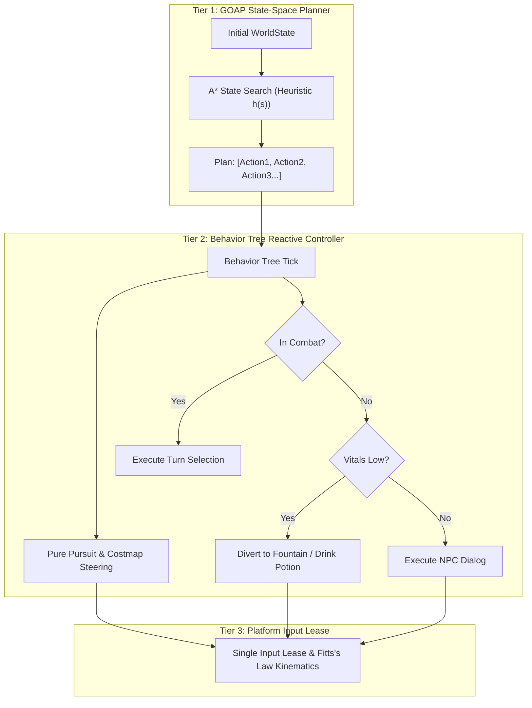
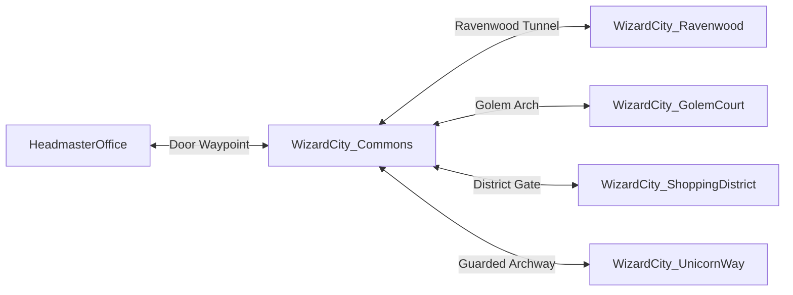

# Wizard101 Quest Domain Action Repertoire

> **Status (audit 2026-11-20, Claude):** the planning domain is real library code (`crates/maelstrom-core/src/quest_domain.rs`, 41 actions) with offline tests, and the quest, zone and cost tables below match it.
> The vitals model (section 5), the NPC rectangles (section 6) and some of section 7 did not; they are corrected. Nothing calls the repertoire outside tests, and the planner that
> would run it has no caller either. Game-rule facts (quest order, NPC names, which professor teaches which school) are taken from the code and were not re-verified against the game.
> Notes marked **Today** say what the code does. Evidence: [W101-QUEST-REPERTOIRE-CORE-02](coordination/results/W101-QUEST-REPERTOIRE-CORE-02.md) and
> [W101-QUEST-REPERTOIRE-DOCS-01](coordination/results/W101-QUEST-REPERTOIRE-DOCS-01.md), audit notes.

## 1. Overview & Architectural Role

Goal-Oriented Action Planning (GOAP) operates at **Tier 1 (Macro Planning)** of the Maelstrom autonomy architecture, synthesizing multi-step prerequisite action sequences across game zones. While Tier 2 (Behavior Trees) evaluates instantaneous perceptual ticks and reactively steers around dynamic obstacles or arbitrates combat, the GOAP planner formulates the long-horizon roadmap to satisfy higher-level quest objectives.

This document formalizes the canonical **Wizard City Starter Questline Action Repertoire**, grounding the abstract state-space planner (`crates/maelstrom-core/src/goap.rs`) into the concrete topology, NPC interactions, and quest prerequisites of early Wizard101 gameplay:
1. *"The Lore of Magic"* (Headmaster Merle Ambrose $\rightarrow$ Bartleby the Grandfather Tree).
2. *"Enrollment"* (Visiting and registering with the Ravenwood School professors).
3. *"A Good Impression"* / *"Golem Court"* (Visiting Mr. Lincoln $\rightarrow$ Golem Court).
4. *"Vital Replenishment & Potion Fountain Checkpoints"* (Commons potion vendor and health/mana recovery).
5. *"Unicorn Way & Combat Encounters"* (Private O'Ryan $\rightarrow$ Lost Souls $\rightarrow$ Private Stillson $\rightarrow$ Skeletal Pirates $\rightarrow$ Lady Oriel; see [W101_QUEST_UNICORN_WAY.md](W101_QUEST_UNICORN_WAY.md)).

**Today:** the diagram is the intended architecture. `GoapPlanner::plan` has no caller outside tests, nothing hands a plan to the Behavior Tree, and the costmap is not wired to steering
(see [DESTINATION_NAVIGATION.md](DESTINATION_NAVIGATION.md)). The repertoire is only ever planned over by its own tests.

---

## 2. World State Ontology & State Atoms

The world state $s \in \mathcal{S}$ is represented as an immutable mapping of typed keys (`StateValue::Bool`, `StateValue::Int`, `StateValue::Str`) managed by `WorldState`:

| State Atom Key | Type | Description |
| :--- | :--- | :--- |
| `zone` | `Str` | Current topological zone: `"HeadmasterOffice"`, `"WizardCity_Commons"`, `"WizardCity_Ravenwood"`, `"WizardCity_GolemCourt"`, `"WizardCity_ShoppingDistrict"`, `"WizardCity_UnicornWay"` and, for the interpreter anchors, `"WizardCity_OldeTown"`, `"WizardCity_TritonAvenue"`, `"WizardCity_FirecatAlley"`, `"WizardCity_CyclopsLane"`. |
| `has_quest_lore_of_magic` | `Bool` | Whether *"The Lore of Magic"* quest is accepted in the quest log. |
| `talked_to_bartleby` | `Bool` | Whether player has interacted with Bartleby in Ravenwood. |
| `completed_lore_of_magic` | `Bool` | Quest completion status for *"The Lore of Magic"*. |
| `has_quest_enrollment` | `Bool` | Whether *"Enrollment"* quest is active. |
| `enrolled_fire` | `Bool` | Visited Professor Dalia Falmea (School of Pyromancy). |
| `enrolled_ice` | `Bool` | Visited Professor Lydia Greyrose (School of Thaumaturgy). |
| `enrolled_storm` | `Bool` | Visited Professor Halston Balestrom (School of Divination). |
| `enrolled_myth` | `Bool` | Visited Professor Cyrus Drake (School of Conjuration). |
| `enrolled_life` | `Bool` | Visited Professor Moolinda Wu (School of Theurgy). |
| `enrolled_death` | `Bool` | Visited Malorn Ashthorn (School of Necromancy substitute). |
| `completed_enrollment` | `Bool` | Turned in *"Enrollment"* to Headmaster Ambrose. |
| `has_quest_good_impression`| `Bool` | Whether *"A Good Impression"* quest is active. |
| `talked_to_lincoln` | `Bool` | Visited Mr. Lincoln in Golem Court. |
| `completed_good_impression`| `Bool` | Turned in *"A Good Impression"*. |
| `vitals_low` | `Bool` | Whether vitals are low enough to need recovery (the combat actions require it false). |
| `has_potions` | `Bool` | Whether at least one potion is available. |

**Today:** the vitals model is two booleans. An earlier version of this table listed `potions` (Int 0..=3), `health_pct`, `mana` and `in_combat`; none of them exists in `quest_domain.rs`.
The Unicorn Way atoms (`has_quest_unicorn_way`, `talked_to_oryan`, `lost_souls_defeated`, `skeletal_pirates_defeated`, `completed_unicorn_way` and the rest) are in
[W101_QUEST_UNICORN_WAY.md](W101_QUEST_UNICORN_WAY.md).

---

## 3. Topological Zone Transitions

Zones are connected via directional transition actions. Each transition requires the player to be in the source zone and applies an effect moving the player to the destination zone:

### Transition Specifications:
1. `travel_office_to_commons`:
   - Preconditions: `zone == "HeadmasterOffice"`
   - Effects: `zone = "WizardCity_Commons"`
   - Cost: 5
2. `travel_commons_to_office`:
   - Preconditions: `zone == "WizardCity_Commons"`
   - Effects: `zone = "HeadmasterOffice"`
   - Cost: 5
3. `travel_commons_to_ravenwood`:
   - Preconditions: `zone == "WizardCity_Commons"`
   - Effects: `zone = "WizardCity_Ravenwood"`
   - Cost: 8
4. `travel_ravenwood_to_commons`:
   - Preconditions: `zone == "WizardCity_Ravenwood"`
   - Effects: `zone = "WizardCity_Commons"`
   - Cost: 8
5. `travel_commons_to_golem_court`:
   - Preconditions: `zone == "WizardCity_Commons"`
   - Effects: `zone = "WizardCity_GolemCourt"`
   - Cost: 4
6. `travel_golem_court_to_commons`:
   - Preconditions: `zone == "WizardCity_GolemCourt"`
   - Effects: `zone = "WizardCity_Commons"`
   - Cost: 4
7. `travel_commons_to_unicorn_way`:
   - Preconditions: `zone == "WizardCity_Commons"`
   - Effects: `zone = "WizardCity_UnicornWay"`
   - Cost: 6
8. `travel_unicorn_way_to_commons`:
   - Preconditions: `zone == "WizardCity_UnicornWay"`
   - Effects: `zone = "WizardCity_Commons"`
   - Cost: 6
9. `travel_commons_to_shopping_district` and `travel_shopping_district_to_commons`: preconditions `zone` is the source, effect `zone` is the destination, cost 6 each (the diagram shows this edge; the list above omitted it).
10. Eight more edges for the interpreter's Olde Town area (`travel_commons_to_olde_town`, `travel_olde_town_to_triton`, `travel_olde_town_to_firecat`, `travel_olde_town_to_cyclops` and their returns), cost 5 each. The code has 18 travel actions in all.

**Today:** the costs are unitless planner weights. The earlier text called 5 a "tunnel walk duration of about 5 s" and 8 a "longer bridge transition"; no duration was measured and the code states none.

---

## 4. Quest Action Specifications

### 4.1. "The Lore of Magic"
- **Acceptance** (`ambrose_accept_lore_of_magic`):
  - Preconditions: `zone == "HeadmasterOffice"`, `has_quest_lore_of_magic == false`, `completed_lore_of_magic == false`.
  - Effects: `has_quest_lore_of_magic = true`.
  - Cost: 3.
- **Bartleby Interaction** (`talk_to_bartleby`):
  - Preconditions: `zone == "WizardCity_Ravenwood"`, `has_quest_lore_of_magic == true`, `talked_to_bartleby == false`.
  - Effects: `talked_to_bartleby = true`.
  - Cost: 4.
- **Turn-in** (`ambrose_turnin_lore_of_magic`):
  - Preconditions: `zone == "HeadmasterOffice"`, `has_quest_lore_of_magic == true`, `talked_to_bartleby == true`.
  - Effects: `has_quest_lore_of_magic = false`, `completed_lore_of_magic = true`, `has_quest_enrollment = true`.
  - Cost: 3.

### 4.2. "Enrollment"
The *"Enrollment"* quest requires visiting the 6 school professors located around the Ravenwood ring:
- **Visit Fire School** (`visit_school_fire`):
  - Preconditions: `zone == "WizardCity_Ravenwood"`, `has_quest_enrollment == true`, `enrolled_fire == false`.
  - Effects: `enrolled_fire = true`.
  - Cost: 3.
- **Visit Ice School** (`visit_school_ice`):
  - Preconditions: `zone == "WizardCity_Ravenwood"`, `has_quest_enrollment == true`, `enrolled_ice == false`.
  - Effects: `enrolled_ice = true`.
  - Cost: 3.
- **Visit Storm School** (`visit_school_storm`):
  - Preconditions: `zone == "WizardCity_Ravenwood"`, `has_quest_enrollment == true`, `enrolled_storm == false`.
  - Effects: `enrolled_storm = true`.
  - Cost: 3.
- **Visit Myth School** (`visit_school_myth`):
  - Preconditions: `zone == "WizardCity_Ravenwood"`, `has_quest_enrollment == true`, `enrolled_myth == false`.
  - Effects: `enrolled_myth = true`.
  - Cost: 3.
- **Visit Life School** (`visit_school_life`):
  - Preconditions: `zone == "WizardCity_Ravenwood"`, `has_quest_enrollment == true`, `enrolled_life == false`.
  - Effects: `enrolled_life = true`.
  - Cost: 3.
- **Visit Death School** (`visit_school_death`):
  - Preconditions: `zone == "WizardCity_Ravenwood"`, `has_quest_enrollment == true`, `enrolled_death == false`.
  - Effects: `enrolled_death = true`.
  - Cost: 3.
- **Turn-in Enrollment** (`ambrose_turnin_enrollment`):
  - Preconditions:
    - `zone == "HeadmasterOffice"`
    - `has_quest_enrollment == true`
    - `enrolled_fire == true`
    - `enrolled_ice == true`
    - `enrolled_storm == true`
    - `enrolled_myth == true`
    - `enrolled_life == true`
    - `enrolled_death == true`
  - Effects: `has_quest_enrollment = false`, `completed_enrollment = true`, `has_quest_good_impression = true`.
  - Cost: 4.

### 4.3. "A Good Impression" (Golem Court)
- **Visit Lincoln** (`talk_to_mr_lincoln`):
  - Preconditions: `zone == "WizardCity_GolemCourt"`, `has_quest_good_impression == true`, `talked_to_lincoln == false`.
  - Effects: `talked_to_lincoln = true`.
  - Cost: 3.
- **Turn-in Good Impression** (`ambrose_turnin_good_impression`):
  - Preconditions: `zone == "HeadmasterOffice"`, `has_quest_good_impression == true`, `talked_to_lincoln == true`.
  - Effects: `has_quest_good_impression = false`, `completed_good_impression = true`.
  - Cost: 4.

---

## 5. Vital Replenishment Checkpoints

Vitals are two booleans, `vitals_low` and `has_potions`:
- **Refill at Commons Fountain** (`refill_potions_at_fountain`):
  - Preconditions: `zone == "WizardCity_Commons"`.
  - Effects: `has_potions = true`, `vitals_low = false`.
  - Cost: 6.
- **Drink Potion** (`drink_potion_recovery`):
  - Preconditions: `has_potions == true`, `vitals_low == true`.
  - Effects: `vitals_low = false`.
  - Cost: 1.

**Today:** drinking does not consume a potion: `has_potions` stays true (probe: after `drink_potion_recovery`, `has_potions = true`, `vitals_low = false`), so a plan can drink forever. An
earlier version of this section gave integer effects (`potions = 3`, `health_pct = 100`, `mana = 100`, `potions = potions - 1`), a precondition `potions > 0` and the action name
`drink_potion_vital_recovery`; none of that is in the code. The only thresholds (health below 40%) existed in the text, not in the planner. The two combat actions
(`engage_and_defeat_lost_soul`, `engage_and_defeat_skeletal_pirate`) require `vitals_low == false`, so low vitals force a recovery action first.

---

## 6. NPC Interaction Anchors & Bounding Geometry

`get_npc_interaction_target(name)` returns, for 13 named NPCs, a zone, a prompt rectangle, an advance-button rectangle and a dialogue-step count, all in 1280x720 screen pixels:

| Rectangle | (min x, min y, max x, max y) | Used by |
| :--- | :--- | :--- |
| default prompt | (580, 520, 700, 560) | Merle Ambrose, the six professors (Falmea, Greyrose, Balestrom, Drake, Wu, Ashthorn), Mr. Lincoln, and Private Stillson (a literal copy of the same four numbers) |
| default advance button | (590, 640, 690, 680) | every NPC |
| Bartleby prompt | (560, 480, 720, 540) | Bartleby |
| Commons Potion Vendor prompt | (600, 500, 680, 550) | Commons Potion Vendor |
| Private O'Ryan prompt | (570, 510, 690, 550) | Private O'Ryan |
| Lady Oriel prompt | (560, 490, 710, 540) | Lady Oriel |

**Today:**
- These are placeholders, not calibrated measurements: the code comments call the defaults "centered near character feet/overhead in 720p" and "bottom-center in 720p", and nothing in the
  repository records where the numbers came from. Nine of the thirteen NPCs have the same prompt rectangle.
- An earlier version of this section also showed a "Quest Accept Button" rectangle (480..580 x 580..620). No such rectangle exists in the code.
- Nothing calls `get_npc_interaction_target` outside tests, so no click is resolved from these rectangles. The Gaussian rectangle sampling (`sample_target_in_rect`) is used by the bridge's
  combat click plan, not by this module, and the claim that interaction "uses Fitts's Law duration modeling and log-normal dwell jitter before key/mouse dispatch" describes no code path here.

---

## 7. Verification Standards & Acceptance Criteria

1. **Deterministic Solution Existence**: Every canonical quest goal must yield an optimal, acyclic action plan from any valid starting zone.
2. **Zone Transition Minimization**: The $A^*$ admissible heuristic must prevent spurious back-and-forth travel between zones.
3. **Preemption Resiliency**: If an external disturbance alters state atoms (e.g., combat drags player out of transit, or potion count drops), replanning from the new state must seamlessly splice in recovery actions without human intervention.

**Today:** these are criteria, not results. What the tests check: plans from a fresh wizard in the Office to each of the four goals (`test_plan_*`, `test_end_to_end_*`), one start in the Shopping District
(`test_recovery_from_unexpected_displacement`), and the potion-versus-fountain choice. There is no test from "any valid starting zone", no check that plans are acyclic beyond reaching the goal, and
nothing detects a disturbance or re-runs the planner. Measured offline with a throwaway probe from the fresh state (release build, one machine):

| Goal | Plan length | Plan cost | Smallest `max_iterations` that finds it |
| :--- | :--- | :--- | :--- |
| `goal_complete_lore_of_magic` | 7 | 36 | 28 |
| `goal_complete_enrollment` | 18 | 84 | 797 |
| `goal_complete_good_impression` | 24 | 109 | 816 |
| `goal_complete_unicorn_way` | 37 | 184 | 906 |

Each goal plans in about 25 ms or less with a budget of 10,000, and each also plans with the planner's default budget of 2,000. The tests use budgets of 10,000 and 20,000, and the comment that
the Unicorn Way plan "requires expanding state search" is not true.

---

## 8. Generalization to Canonical Objective Archetypes

To scale beyond hardcoded starter quests across all 16+ worlds, the system abstracts quest progression into a Data-Driven Quest Interpreter (`crates/maelstrom-core/src/quest_interpreter.rs`). Rather than defining one-off GOAP actions for each individual quest ID, quests map into **six canonical archetypes**:
1. `Talk / Turn-In`
2. `Explore / Approach`
3. `Defeat (Count)`
4. `Defeat & Collect`
5. `Interact / Gather`
6. `Boss / Sigil Instance`

The underlying spatial navigation, portal transitions, and named NPC/landmark anchors remain decoupled within `quest_domain.rs`, allowing any quest in Olde Town, Triton Avenue, or beyond to be executed dynamically through the shared template engine. See [QUEST_INTERPRETER_ENGINE.md](QUEST_INTERPRETER_ENGINE.md).

> **Audit note (2026-11-19, Claude).** This section states intended scope. The interpreter classifies five English
> phrasings into the six archetypes and has a dialogue state machine; it does not execute quests, and nothing outside its
> tests calls it. Named anchors exist for eight entities in Olde Town and Triton Avenue only, and no quest beyond the
> starter quests listed above has been planned or run. Details: `docs/coordination/results/W101-QUEST-INTERPRETER-CORE-02.md`.
