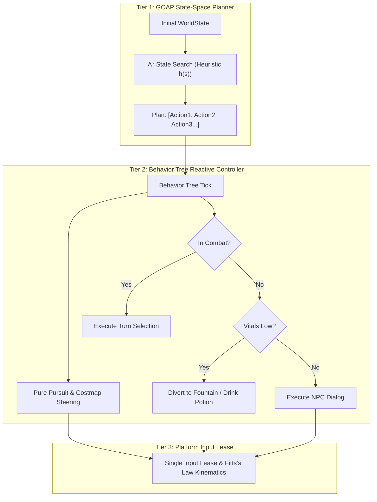
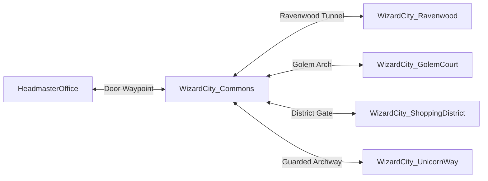

# Wizard101 Quest Domain Action Repertoire

## 1. Overview & Architectural Role

Goal-Oriented Action Planning (GOAP) operates at **Tier 1 (Macro Planning)** of the Maelstrom autonomy architecture, synthesizing multi-step prerequisite action sequences across game zones. While Tier 2 (Behavior Trees) evaluates instantaneous perceptual ticks and reactively steers around dynamic obstacles or arbitrates combat, the GOAP planner formulates the long-horizon roadmap to satisfy higher-level quest objectives.

This document formalizes the canonical **Wizard City Starter Questline Action Repertoire**, grounding the abstract state-space planner (`crates/maelstrom-core/src/goap.rs`) into the concrete topology, NPC interactions, and quest prerequisites of early Wizard101 gameplay:
1. *"The Lore of Magic"* (Headmaster Merle Ambrose $\rightarrow$ Bartleby the Grandfather Tree).
2. *"Enrollment"* (Visiting and registering with the Ravenwood School professors).
3. *"A Good Impression"* / *"Golem Court"* (Visiting Mr. Lincoln $\rightarrow$ Golem Court).
4. *"Vital Replenishment & Potion Fountain Checkpoints"* (Commons potion vendor and health/mana recovery).
5. *"Unicorn Way & Combat Encounters"* (Private O'Ryan $\rightarrow$ Lost Souls $\rightarrow$ Private Stillson $\rightarrow$ Skeletal Pirates $\rightarrow$ Lady Oriel; see [W101_QUEST_UNICORN_WAY.md](file:///f:/Modlists/AutoWizard101/docs/W101_QUEST_UNICORN_WAY.md)).



---

## 2. World State Ontology & State Atoms

The world state $s \in \mathcal{S}$ is represented as an immutable mapping of typed keys (`StateValue::Bool`, `StateValue::Int`, `StateValue::Str`) managed by `WorldState`:

| State Atom Key | Type | Description |
| :--- | :--- | :--- |
| `zone` | `Str` | Current topological zone: `"HeadmasterOffice"`, `"WizardCity_Commons"`, `"WizardCity_Ravenwood"`, `"WizardCity_GolemCourt"`, `"WizardCity_ShoppingDistrict"`. |
| `has_quest_lore_of_magic` | `Bool` | Whether *"The Lore of Magic"* quest is accepted in the quest log. |
| `talked_to_bartleby` | `Bool` | Whether player has interacted with Bartleby in Ravenwood. |
| `completed_lore_of_magic` | `Bool` | Quest completion status for *"The Lore of Magic"*. |
| `has_quest_enrollment` | `Bool` | Whether *"Enrollment"* quest is active. |
| `enrolled_fire` | `Bool` | Visited Professor Dalia Falmea (School of Pyromancy). |
| `enrolled_ice` | `Bool` | Visited Professor Lydia Greyrose (School of Thaumaturgy). |
| `enrolled_storm` | `Bool` | Visited Professor Halston Balestrom (School of Divination). |
| `enrolled_myth` | `Bool` | Visited Professor Cyrus Drake (School of Conjuration). |
| `enrolled_life` | `Bool` | Visited Professor Moolinda Wu (School of Theurgy). |
| `enrolled_death` | `Bool` | Visited Malorn Ashthorn (School of Necromancy substitute). |
| `completed_enrollment` | `Bool` | Turned in *"Enrollment"* to Headmaster Ambrose. |
| `has_quest_good_impression`| `Bool` | Whether *"A Good Impression"* quest is active. |
| `talked_to_lincoln` | `Bool` | Visited Mr. Lincoln in Golem Court. |
| `completed_good_impression`| `Bool` | Turned in *"A Good Impression"*. |
| `potions` | `Int` | Count of filled health/mana potions (0..=3). |
| `health_pct` | `Int` | Health percentage (0..=100). |
| `mana` | `Int` | Current player mana points. |
| `in_combat` | `Bool` | True if engaged in an active dueling ring. |

---

## 3. Topological Zone Transitions

Zones are connected via directional transition actions. Each transition requires the player to be in the source zone and applies an effect moving the player to the destination zone:



### Transition Specifications:
1. `travel_office_to_commons`:
   - Preconditions: `zone == "HeadmasterOffice"`
   - Effects: `zone = "WizardCity_Commons"`
   - Cost: 5 (tunnel walk duration $\approx 5\text{s}$)
2. `travel_commons_to_office`:
   - Preconditions: `zone == "WizardCity_Commons"`
   - Effects: `zone = "HeadmasterOffice"`
   - Cost: 5
3. `travel_commons_to_ravenwood`:
   - Preconditions: `zone == "WizardCity_Commons"`
   - Effects: `zone = "WizardCity_Ravenwood"`
   - Cost: 8 (longer bridge transition)
4. `travel_ravenwood_to_commons`:
   - Preconditions: `zone == "WizardCity_Ravenwood"`
   - Effects: `zone = "WizardCity_Commons"`
   - Cost: 8
5. `travel_commons_to_golem_court`:
   - Preconditions: `zone == "WizardCity_Commons"`
   - Effects: `zone = "WizardCity_GolemCourt"`
   - Cost: 4
6. `travel_golem_court_to_commons`:
   - Preconditions: `zone == "WizardCity_GolemCourt"`
   - Effects: `zone = "WizardCity_Commons"`
   - Cost: 4
7. `travel_commons_to_unicorn_way`:
   - Preconditions: `zone == "WizardCity_Commons"`
   - Effects: `zone = "WizardCity_UnicornWay"`
   - Cost: 6
8. `travel_unicorn_way_to_commons`:
   - Preconditions: `zone == "WizardCity_UnicornWay"`
   - Effects: `zone = "WizardCity_Commons"`
   - Cost: 6

---

## 4. Quest Action Specifications

### 4.1. "The Lore of Magic"
- **Acceptance** (`ambrose_accept_lore_of_magic`):
  - Preconditions: `zone == "HeadmasterOffice"`, `has_quest_lore_of_magic == false`, `completed_lore_of_magic == false`.
  - Effects: `has_quest_lore_of_magic = true`.
  - Cost: 3.
- **Bartleby Interaction** (`talk_to_bartleby`):
  - Preconditions: `zone == "WizardCity_Ravenwood"`, `has_quest_lore_of_magic == true`, `talked_to_bartleby == false`.
  - Effects: `talked_to_bartleby = true`.
  - Cost: 4.
- **Turn-in** (`ambrose_turnin_lore_of_magic`):
  - Preconditions: `zone == "HeadmasterOffice"`, `has_quest_lore_of_magic == true`, `talked_to_bartleby == true`.
  - Effects: `has_quest_lore_of_magic = false`, `completed_lore_of_magic = true`, `has_quest_enrollment = true`.
  - Cost: 3.

### 4.2. "Enrollment"
The *"Enrollment"* quest requires visiting the 6 school professors located around the Ravenwood ring:
- **Visit Fire School** (`visit_school_fire`):
  - Preconditions: `zone == "WizardCity_Ravenwood"`, `has_quest_enrollment == true`, `enrolled_fire == false`.
  - Effects: `enrolled_fire = true`.
  - Cost: 3.
- **Visit Ice School** (`visit_school_ice`):
  - Preconditions: `zone == "WizardCity_Ravenwood"`, `has_quest_enrollment == true`, `enrolled_ice == false`.
  - Effects: `enrolled_ice = true`.
  - Cost: 3.
- **Visit Storm School** (`visit_school_storm`):
  - Preconditions: `zone == "WizardCity_Ravenwood"`, `has_quest_enrollment == true`, `enrolled_storm == false`.
  - Effects: `enrolled_storm = true`.
  - Cost: 3.
- **Visit Myth School** (`visit_school_myth`):
  - Preconditions: `zone == "WizardCity_Ravenwood"`, `has_quest_enrollment == true`, `enrolled_myth == false`.
  - Effects: `enrolled_myth = true`.
  - Cost: 3.
- **Visit Life School** (`visit_school_life`):
  - Preconditions: `zone == "WizardCity_Ravenwood"`, `has_quest_enrollment == true`, `enrolled_life == false`.
  - Effects: `enrolled_life = true`.
  - Cost: 3.
- **Visit Death School** (`visit_school_death`):
  - Preconditions: `zone == "WizardCity_Ravenwood"`, `has_quest_enrollment == true`, `enrolled_death == false`.
  - Effects: `enrolled_death = true`.
  - Cost: 3.
- **Turn-in Enrollment** (`ambrose_turnin_enrollment`):
  - Preconditions:
    - `zone == "HeadmasterOffice"`
    - `has_quest_enrollment == true`
    - `enrolled_fire == true`
    - `enrolled_ice == true`
    - `enrolled_storm == true`
    - `enrolled_myth == true`
    - `enrolled_life == true`
    - `enrolled_death == true`
  - Effects: `has_quest_enrollment = false`, `completed_enrollment = true`, `has_quest_good_impression = true`.
  - Cost: 4.

### 4.3. "A Good Impression" (Golem Court)
- **Visit Lincoln** (`talk_to_mr_lincoln`):
  - Preconditions: `zone == "WizardCity_GolemCourt"`, `has_quest_good_impression == true`, `talked_to_lincoln == false`.
  - Effects: `talked_to_lincoln = true`.
  - Cost: 3.
- **Turn-in Good Impression** (`ambrose_turnin_good_impression`):
  - Preconditions: `zone == "HeadmasterOffice"`, `has_quest_good_impression == true`, `talked_to_lincoln == true`.
  - Effects: `has_quest_good_impression = false`, `completed_good_impression = true`.
  - Cost: 4.

---

## 5. Vital Replenishment Checkpoints

When health falls below safety margins (e.g., $health\_pct < 40$) or potions are exhausted ($potions == 0$):
- **Refill at Commons Fountain** (`refill_potions_at_fountain`):
  - Preconditions: `zone == "WizardCity_Commons"`.
  - Effects: `potions = 3`, `health_pct = 100`, `mana = 100`.
  - Cost: 6.
- **Drink Potion** (`drink_potion_vital_recovery`):
  - Preconditions: `potions > 0`.
  - Effects: `health_pct = 100`, `potions = potions - 1` (modeled via state mutation).
  - Cost: 1.

---

## 6. NPC Interaction Anchors & Bounding Geometry

When an action node dispatches an NPC dialogue step, physical coordinates are resolved via non-centered Gaussian targeting within calibrated interaction screen rectangles:

```
+--------------------------------------------------------------+
| Wizard City Dialogue Bounds (1280x720 Base Calibration)      |
|                                                              |
| [NPC Interaction 'X' Prompt]                                |
|   Target Bounding Box: (x: 580..700, y: 520..560)            |
|                                                              |
| [Dialogue Advance 'Continue' Button]                         |
|   Target Bounding Box: (x: 590..690, y: 640..680)            |
|                                                              |
| [Quest Accept Button]                                        |
|   Target Bounding Box: (x: 480..580, y: 580..620)            |
+--------------------------------------------------------------+
```

Interaction execution uses Fitts's Law duration modeling and log-normal dwell jitter before key/mouse dispatch, ensuring fully humanized actuation profiles under the active input lease.

---

## 7. Verification Standards & Acceptance Criteria

1. **Deterministic Solution Existence**: Every canonical quest goal must yield an optimal, acyclic action plan from any valid starting zone.
2. **Zone Transition Minimization**: The $A^*$ admissible heuristic must prevent spurious back-and-forth travel between zones.
3. **Preemption Resiliency**: If an external disturbance alters state atoms (e.g., combat drags player out of transit, or potion count drops), replanning from the new state must seamlessly splice in recovery actions without human intervention.

---

## 8. Generalization to Canonical Objective Archetypes

To scale beyond hardcoded starter quests across all 16+ worlds, the system abstracts quest progression into a Data-Driven Quest Interpreter (`crates/maelstrom-core/src/quest_interpreter.rs`). Rather than defining one-off GOAP actions for each individual quest ID, quests map into **six canonical archetypes**:
1. `Talk / Turn-In`
2. `Explore / Approach`
3. `Defeat (Count)`
4. `Defeat & Collect`
5. `Interact / Gather`
6. `Boss / Sigil Instance`

The underlying spatial navigation, portal transitions, and named NPC/landmark anchors remain decoupled within `quest_domain.rs`, allowing any quest in Olde Town, Triton Avenue, or beyond to be executed dynamically through the shared template engine. See [QUEST_INTERPRETER_ENGINE.md](file:///f:/Modlists/AutoWizard101/docs/QUEST_INTERPRETER_ENGINE.md).

> **Audit note (2026-11-19, Claude).** This section states intended scope. The interpreter classifies five English
> phrasings into the six archetypes and has a dialogue state machine; it does not execute quests, and nothing outside its
> tests calls it. Named anchors exist for eight entities in Olde Town and Triton Avenue only, and no quest beyond the
> starter quests listed above has been planned or run. Details: `docs/coordination/results/W101-QUEST-INTERPRETER-CORE-02.md`.
