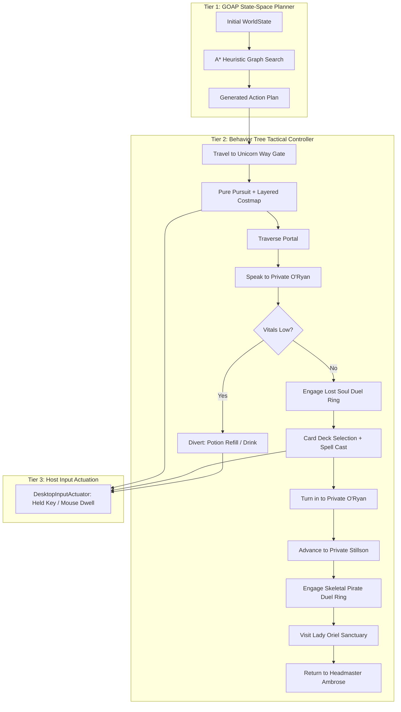
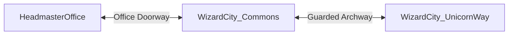

# Wizard101 Unicorn Way Quest Domain & Combat Repertoire

## 1. Overview & Operational Hierarchy

Following graduation from the Ravenwood School orientation (*"Enrollment"*) and the introductory tour (*"A Good Impression"*), the canonical Wizard101 main storyline transitions to **Unicorn Way**—the first combat-active thoroughfare in Wizard City.

This document formalizes the **Unicorn Way Quest Domain & Combat Action Repertoire**, bridging macro Goal-Oriented Action Planning (GOAP) with tactical combat arbitration and reactive costmap traversal:
1. **Gate Ingress & Perimeter Defense**: Commons gate transition to Unicorn Way and reporting to **Private O'Ryan**.
2. **First Hostile Combat Engagement**: Defeating **Lost Souls** (Rank 1 Undead / Death mobs roaming the central avenue).
3. **Deep Sector Infiltration (*"Grim Tales"*)**: Advancing past the hedge barrier to report to **Private Stillson**.
4. **Second Hostile Combat Engagement**: Defeating **Skeletal Pirates** (Rank 1 Undead / Death mobs).
5. **Sanctuary Restoration & Ambrose Report**: Accessing **Lady Oriel** in the Hedge Sanctuary and returning to Headmaster Ambrose.



---

## 2. World State Ontology & State Atoms

The world state $s \in \mathcal{S}$ is expanded to support combat readiness and the Unicorn Way progression chain:

| State Atom Key | Type | Description |
| :--- | :--- | :--- |
| `zone` | `Str` | Current topological zone: `"HeadmasterOffice"`, `"WizardCity_Commons"`, `"WizardCity_UnicornWay"`, etc. |
| `has_quest_unicorn_way` | `Bool` | Whether *"Finding Out"* / *"Investigate Unicorn Way"* is active. |
| `talked_to_oryan` | `Bool` | Whether player has interacted with Private O'Ryan at the Unicorn Way entrance. |
| `has_quest_defeat_lost_souls` | `Bool` | Whether the objective to defeat Lost Souls is active. |
| `lost_souls_defeated` | `Bool` | Whether sufficient Lost Souls have been defeated in combat. |
| `has_quest_grim_tales` | `Bool` | Whether *"Grim Tales"* (Private Stillson) is active. |
| `talked_to_stillson` | `Bool` | Whether player has interacted with Private Stillson near the park. |
| `has_quest_defeat_skeletal_pirates` | `Bool` | Objective to defeat roaming Skeletal Pirates. |
| `skeletal_pirates_defeated` | `Bool` | Whether Skeletal Pirates have been defeated in combat. |
| `has_quest_lady_oriel` | `Bool` | Objective to seek Lady Oriel in the hedge sanctuary. |
| `talked_to_lady_oriel` | `Bool` | Interacted with Lady Oriel. |
| `completed_unicorn_way` | `Bool` | Turned in the full Unicorn Way resolution to Merle Ambrose. |
| `vitals_low` | `Bool` | Flag indicating health $< 40\%$ or depleted mana requiring replenishment. |
| `has_potions` | `Bool` | Flag indicating the player possesses at least one charged potion. |

---

## 3. Topological Zone Transitions

Unicorn Way connects directly to the Wizard City Commons through the monumental guarded archway:



### Transition Specifications:
1. `travel_commons_to_unicorn_way`:
   - Preconditions: `zone == "WizardCity_Commons"`
   - Effects: `zone = "WizardCity_UnicornWay"`
   - Cost: 6.0 (gate approach and loading zone traversal $\approx 6\text{s}$)
2. `travel_unicorn_way_to_commons`:
   - Preconditions: `zone == "WizardCity_UnicornWay"`
   - Effects: `zone = "WizardCity_Commons"`
   - Cost: 6.0

---

## 4. Unicorn Way Quest Action Specifications

### 4.1. Gate Ingress & Private O'Ryan
- **Acceptance from Ambrose** (`ambrose_accept_unicorn_way`):
  - Preconditions: `zone == "HeadmasterOffice"`, `completed_good_impression == true`, `has_quest_unicorn_way == false`, `completed_unicorn_way == false`.
  - Effects: `has_quest_unicorn_way = true`.
  - Cost: 3.0.
- **Reporting to Private O'Ryan** (`talk_to_private_oryan`):
  - Preconditions: `zone == "WizardCity_UnicornWay"`, `has_quest_unicorn_way == true`, `talked_to_oryan == false`.
  - Effects: `talked_to_oryan = true`, `has_quest_defeat_lost_souls = true`.
  - Cost: 4.0.

### 4.2. Lost Soul Combat Encounter
Unlike non-combat NPC interactions, combat actions enforce strict safety prerequisites: the player must **not** have low vitals (`vitals_low == false`). If vitals are depleted, the GOAP planner automatically plans potion recovery or return to the Commons fountain before entering the duel circle.
- **Defeat Lost Souls** (`engage_and_defeat_lost_soul`):
  - Preconditions:
    - `zone == "WizardCity_UnicornWay"`
    - `has_quest_defeat_lost_souls == true`
    - `vitals_low == false`
    - `lost_souls_defeated == false`
  - Effects: `lost_souls_defeated = true`.
  - Cost: 12.0 (duel ring entry, round countdown, card draw, animation resolution).
- **Turn in to Private O'Ryan** (`oryan_turnin_lost_souls`):
  - Preconditions: `zone == "WizardCity_UnicornWay"`, `has_quest_defeat_lost_souls == true`, `lost_souls_defeated == true`.
  - Effects: `has_quest_defeat_lost_souls = false`, `has_quest_grim_tales = true`, `talked_to_stillson = false`.
  - Cost: 3.0.

### 4.3. Private Stillson & Skeletal Pirates (*"Grim Tales"*)
- **Report to Private Stillson** (`talk_to_private_stillson`):
  - Preconditions: `zone == "WizardCity_UnicornWay"`, `has_quest_grim_tales == true`, `talked_to_stillson == false`.
  - Effects: `talked_to_stillson = true`, `has_quest_defeat_skeletal_pirates = true`.
  - Cost: 4.0.
- **Defeat Skeletal Pirates** (`engage_and_defeat_skeletal_pirate`):
  - Preconditions:
    - `zone == "WizardCity_UnicornWay"`
    - `has_quest_defeat_skeletal_pirates == true`
    - `vitals_low == false`
    - `skeletal_pirates_defeated == false`
  - Effects: `skeletal_pirates_defeated = true`.
  - Cost: 15.0 (higher mob HP and multi-turn combat resolution).
- **Turn in Skeletal Pirates to Stillson** (`stillson_turnin_skeletal_pirates`):
  - Preconditions: `zone == "WizardCity_UnicornWay"`, `has_quest_defeat_skeletal_pirates == true`, `skeletal_pirates_defeated == true`.
  - Effects: `has_quest_defeat_skeletal_pirates = false`, `has_quest_lady_oriel = true`, `talked_to_lady_oriel = false`.
  - Cost: 3.0.

### 4.4. Lady Oriel Sanctuary & Final Turn-in
- **Consult Lady Oriel** (`talk_to_lady_oriel`):
  - Preconditions: `zone == "WizardCity_UnicornWay"`, `has_quest_lady_oriel == true`, `talked_to_lady_oriel == false`.
  - Effects: `talked_to_lady_oriel = true`.
  - Cost: 5.0 (sanctuary hedge maze navigation and dialogue).
- **Turn in Unicorn Way to Ambrose** (`ambrose_turnin_unicorn_way`):
  - Preconditions: `zone == "HeadmasterOffice"`, `has_quest_unicorn_way == true`, `talked_to_lady_oriel == true`.
  - Effects: `has_quest_unicorn_way = false`, `completed_unicorn_way = true`.
  - Cost: 4.0.

---

## 5. Calibrated NPC Interaction Anchors (1280x720 Base Viewport)

Dialogue prompts for Unicorn Way characters are mapped into calibrated sub-screen bounding boxes:

| NPC Target | Zone | Screen Rect (`[min_x, min_y, max_x, max_y]`) | Dialogue Steps |
| :--- | :--- | :--- | :--- |
| **Private O'Ryan** | `WizardCity_UnicornWay` | `[570.0, 510.0, 690.0, 550.0]` | 2 |
| **Private Stillson** | `WizardCity_UnicornWay` | `[580.0, 520.0, 700.0, 560.0]` | 2 |
| **Lady Oriel** | `WizardCity_UnicornWay` | `[560.0, 490.0, 710.0, 540.0]` | 3 |

```
+--------------------------------------------------------------+
| Unicorn Way Dialogue Targets (1280x720 Calibration)          |
|                                                              |
| [Private O'Ryan Interaction Box]                             |
|   Target Bounding Box: (x: 570..690, y: 510..550)            |
|                                                              |
| [Private Stillson Interaction Box]                           |
|   Target Bounding Box: (x: 580..700, y: 520..560)            |
|                                                              |
| [Lady Oriel Interaction Box]                                 |
|   Target Bounding Box: (x: 560..710, y: 490..540)            |
+--------------------------------------------------------------+
```

---

## 6. Pre-Combat Health Replenishment Invariant

A central invariant of the Maelstrom autonomy model is:
$$\text{Combat Precondition} \implies \neg \text{vitals\_low}$$

If a player is in Unicorn Way with depleted health or empty mana:
1. If the player possesses filled potions (`has_potions == true`), the planner inserts `drink_potion_recovery` ($Cost = 1.0$), immediately restoring `vitals_low = false` without zone transit.
2. If potions are exhausted (`has_potions == false`), the planner formulates:
   $$\text{travel\_unicorn\_way\_to\_commons} \longrightarrow \text{refill\_potions\_at\_fountain} \longrightarrow \text{travel\_commons\_to\_unicorn\_way}$$
   restoring both `has_potions = true` and `vitals_low = false` before engaging Lost Souls or Skeletal Pirates.

This ensures zero risk of entering hostile combat with critical low health.

---

## 7. Verification & Acceptance Criteria

1. **Acyclic Plan Synthesis**: Synthesizing the plan from `goal_complete_unicorn_way()` from any starting zone must yield a strictly monotonic, finite-step progression.
2. **Combat Safety Guarantee**: In any initial state where `vitals_low == true`, all paths to combat actions must be preceded by an appropriate recovery sequence (`drink_potion_recovery` or fountain refill).
3. **Dialogue Anchoring**: All Unicorn Way NPCs must resolve non-empty interaction targets with valid positive bounding dimensions.
