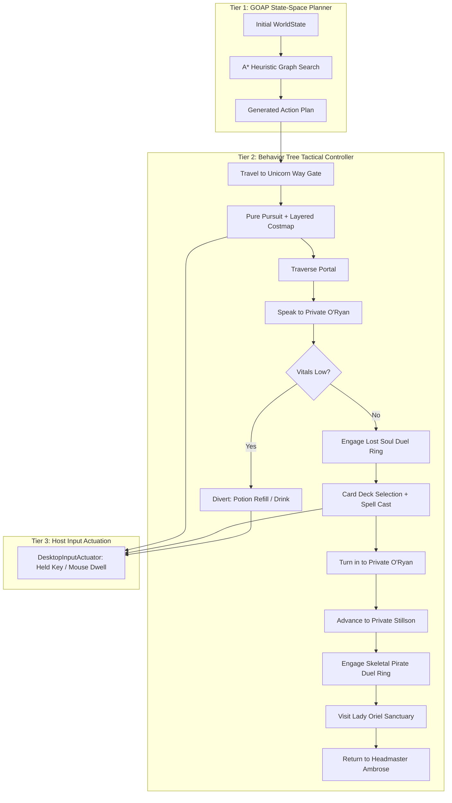
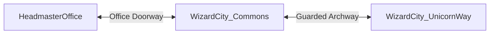

# Wizard101 Unicorn Way Quest Domain & Combat Repertoire

> **Status (audit 2026-11-20, Claude):** the planning domain is real library code (`crates/maelstrom-core/src/quest_domain.rs`) with offline tests, and the action tables in section 4 match it exactly
> (names, preconditions, effects, costs). The "calibrated" NPC rectangles (section 5), the cost glosses, the vitals thresholds and the "zero risk" claim (section 6) did not hold and are
> corrected. Nothing calls the domain outside tests, a fight is one atomic planning action that runs no combat, and nothing observes real vitals. Quest names, NPC names and mob
> descriptions ("Finding Out", "Grim Tales", Rank 1 Undead, the hedge sanctuary) are taken from the code and were not checked against the game. Notes marked **Today** say what the code does.
> Evidence: [W101-QUEST-UNICORN-CORE-02](coordination/results/W101-QUEST-UNICORN-CORE-02.md) and
> [W101-QUEST-UNICORN-DOCS-01](coordination/results/W101-QUEST-UNICORN-DOCS-01.md), audit notes.

## 1. Overview & Operational Hierarchy

Following graduation from the Ravenwood School orientation (*"Enrollment"*) and the introductory tour (*"A Good Impression"*), the canonical Wizard101 main storyline transitions to **Unicorn Way**—the first combat-active thoroughfare in Wizard City.

This document formalizes the **Unicorn Way Quest Domain & Combat Action Repertoire**, bridging macro Goal-Oriented Action Planning (GOAP) with tactical combat arbitration and reactive costmap traversal:
1. **Gate Ingress & Perimeter Defense**: Commons gate transition to Unicorn Way and reporting to **Private O'Ryan**.
2. **First Hostile Combat Engagement**: Defeating **Lost Souls** (Rank 1 Undead / Death mobs roaming the central avenue).
3. **Deep Sector Infiltration (*"Grim Tales"*)**: Advancing past the hedge barrier to report to **Private Stillson**.
4. **Second Hostile Combat Engagement**: Defeating **Skeletal Pirates** (Rank 1 Undead / Death mobs).
5. **Sanctuary Restoration & Ambrose Report**: Accessing **Lady Oriel** in the Hedge Sanctuary and returning to Headmaster Ambrose.



**Today:** the diagram is the intended architecture. `GoapPlanner::plan` has no caller outside tests, nothing hands a plan to the Behavior Tree, the costmap is not wired to steering,
and the `engage_and_defeat_*` actions are not connected to any combat code (the bridge's `CombatTurn` is separate). `DesktopInputActuator` is a C# class with no path from this domain to it.

---

## 2. World State Ontology & State Atoms

The world state $s \in \mathcal{S}$ is expanded to support combat readiness and the Unicorn Way progression chain:

| State Atom Key | Type | Description |
| :--- | :--- | :--- |
| `zone` | `Str` | Current topological zone: `"HeadmasterOffice"`, `"WizardCity_Commons"`, `"WizardCity_UnicornWay"`, etc. |
| `has_quest_unicorn_way` | `Bool` | Whether *"Finding Out"* / *"Investigate Unicorn Way"* is active. |
| `talked_to_oryan` | `Bool` | Whether player has interacted with Private O'Ryan at the Unicorn Way entrance. |
| `has_quest_defeat_lost_souls` | `Bool` | Whether the objective to defeat Lost Souls is active. |
| `lost_souls_defeated` | `Bool` | Whether sufficient Lost Souls have been defeated in combat. |
| `has_quest_grim_tales` | `Bool` | Whether *"Grim Tales"* (Private Stillson) is active. |
| `talked_to_stillson` | `Bool` | Whether player has interacted with Private Stillson near the park. |
| `has_quest_defeat_skeletal_pirates` | `Bool` | Objective to defeat roaming Skeletal Pirates. |
| `skeletal_pirates_defeated` | `Bool` | Whether Skeletal Pirates have been defeated in combat. |
| `has_quest_lady_oriel` | `Bool` | Objective to seek Lady Oriel in the hedge sanctuary. |
| `talked_to_lady_oriel` | `Bool` | Interacted with Lady Oriel. |
| `completed_unicorn_way` | `Bool` | Turned in the full Unicorn Way resolution to Merle Ambrose. |
| `vitals_low` | `Bool` | Whether vitals are low enough to need recovery; the two combat actions require it false. |
| `has_potions` | `Bool` | Whether at least one potion is available. |

**Today:** the earlier description of `vitals_low` ("health below 40% or depleted mana") has no counterpart in the code: there is no health or mana value and no threshold. No action sets
`vitals_low` to true and nothing feeds it from the game, so it is false unless a caller sets it. `lost_souls_defeated` and `skeletal_pirates_defeated` are single flags, not counts of mobs.

---

## 3. Topological Zone Transitions

Unicorn Way connects directly to the Wizard City Commons through the monumental guarded archway:



### Transition Specifications:
1. `travel_commons_to_unicorn_way`:
   - Preconditions: `zone == "WizardCity_Commons"`
   - Effects: `zone = "WizardCity_UnicornWay"`
   - Cost: 6.0
2. `travel_unicorn_way_to_commons`:
   - Preconditions: `zone == "WizardCity_UnicornWay"`
   - Effects: `zone = "WizardCity_Commons"`
   - Cost: 6.0

---

## 4. Unicorn Way Quest Action Specifications

### 4.1. Gate Ingress & Private O'Ryan
- **Acceptance from Ambrose** (`ambrose_accept_unicorn_way`):
  - Preconditions: `zone == "HeadmasterOffice"`, `completed_good_impression == true`, `has_quest_unicorn_way == false`, `completed_unicorn_way == false`.
  - Effects: `has_quest_unicorn_way = true`.
  - Cost: 3.0.
- **Reporting to Private O'Ryan** (`talk_to_private_oryan`):
  - Preconditions: `zone == "WizardCity_UnicornWay"`, `has_quest_unicorn_way == true`, `talked_to_oryan == false`.
  - Effects: `talked_to_oryan = true`, `has_quest_defeat_lost_souls = true`.
  - Cost: 4.0.

### 4.2. Lost Soul Combat Encounter
Unlike non-combat NPC interactions, combat actions enforce strict safety prerequisites: the player must **not** have low vitals (`vitals_low == false`). If `vitals_low` is true, a plan from the GOAP planner includes potion recovery or a return to the Commons fountain before the fight, as long as the search finds a plan within its iteration budget (section 7).
- **Defeat Lost Souls** (`engage_and_defeat_lost_soul`):
  - Preconditions:
    - `zone == "WizardCity_UnicornWay"`
    - `has_quest_defeat_lost_souls == true`
    - `vitals_low == false`
    - `lost_souls_defeated == false`
  - Effects: `lost_souls_defeated = true`.
  - Cost: 12.0.
- **Turn in to Private O'Ryan** (`oryan_turnin_lost_souls`):
  - Preconditions: `zone == "WizardCity_UnicornWay"`, `has_quest_defeat_lost_souls == true`, `lost_souls_defeated == true`.
  - Effects: `has_quest_defeat_lost_souls = false`, `has_quest_grim_tales = true`, `talked_to_stillson = false`.
  - Cost: 3.0.

### 4.3. Private Stillson & Skeletal Pirates (*"Grim Tales"*)
- **Report to Private Stillson** (`talk_to_private_stillson`):
  - Preconditions: `zone == "WizardCity_UnicornWay"`, `has_quest_grim_tales == true`, `talked_to_stillson == false`.
  - Effects: `talked_to_stillson = true`, `has_quest_defeat_skeletal_pirates = true`.
  - Cost: 4.0.
- **Defeat Skeletal Pirates** (`engage_and_defeat_skeletal_pirate`):
  - Preconditions:
    - `zone == "WizardCity_UnicornWay"`
    - `has_quest_defeat_skeletal_pirates == true`
    - `vitals_low == false`
    - `skeletal_pirates_defeated == false`
  - Effects: `skeletal_pirates_defeated = true`.
  - Cost: 15.0.
- **Turn in Skeletal Pirates to Stillson** (`stillson_turnin_skeletal_pirates`):
  - Preconditions: `zone == "WizardCity_UnicornWay"`, `has_quest_defeat_skeletal_pirates == true`, `skeletal_pirates_defeated == true`.
  - Effects: `has_quest_defeat_skeletal_pirates = false`, `has_quest_lady_oriel = true`, `talked_to_lady_oriel = false`.
  - Cost: 3.0.

### 4.4. Lady Oriel Sanctuary & Final Turn-in
- **Consult Lady Oriel** (`talk_to_lady_oriel`):
  - Preconditions: `zone == "WizardCity_UnicornWay"`, `has_quest_lady_oriel == true`, `talked_to_lady_oriel == false`.
  - Effects: `talked_to_lady_oriel = true`.
  - Cost: 5.0.
- **Turn in Unicorn Way to Ambrose** (`ambrose_turnin_unicorn_way`):
  - Preconditions: `zone == "HeadmasterOffice"`, `has_quest_unicorn_way == true`, `talked_to_lady_oriel == true`.
  - Effects: `has_quest_unicorn_way = false`, `completed_unicorn_way = true`.
  - Cost: 4.0.

**Today:** every action above was checked against `quest_domain.rs` and matches. The costs are unitless planner weights: the earlier glosses (6 as "about 6 s" of gate traversal, 12 as duel-ring entry and
card draw, 15 as "higher mob HP", 5 as hedge-maze navigation) have no source in the code. A fight is one atomic action; no duel is run.

---

## 5. NPC Interaction Anchors (placeholder rectangles, 1280x720 Base Viewport)

`get_npc_interaction_target` gives the Unicorn Way characters these prompt bounding boxes:

| NPC Target | Zone | Screen Rect (`[min_x, min_y, max_x, max_y]`) | Dialogue Steps |
| :--- | :--- | :--- | :--- |
| **Private O'Ryan** | `WizardCity_UnicornWay` | `[570.0, 510.0, 690.0, 550.0]` | 2 |
| **Private Stillson** | `WizardCity_UnicornWay` | `[580.0, 520.0, 700.0, 560.0]` | 2 |
| **Lady Oriel** | `WizardCity_UnicornWay` | `[560.0, 490.0, 710.0, 540.0]` | 3 |

```
+--------------------------------------------------------------+
| Unicorn Way Dialogue Targets (1280x720 placeholder)          |
|                                                              |
| [Private O'Ryan Interaction Box]                             |
|   Target Bounding Box: (x: 570..690, y: 510..550)            |
|                                                              |
| [Private Stillson Interaction Box]                           |
|   Target Bounding Box: (x: 580..700, y: 520..560)            |
|                                                              |
| [Lady Oriel Interaction Box]                                 |
|   Target Bounding Box: (x: 560..710, y: 490..540)            |
+--------------------------------------------------------------+
```

**Today:**
- These rectangles are not calibrated: nothing in the repository records where they came from. Private Stillson's is a literal copy of the shared default prompt rectangle
  (580, 520, 700, 560) used by Merle Ambrose, the six professors and Mr. Lincoln, and the advance-button rectangle for all three characters is the shared default (590, 640, 690, 680).
- Nothing calls `get_npc_interaction_target` outside tests. The test `test_unicorn_way_npc_interaction_anchors` checks the zone, the dialogue-step count, a positive width and height, and
  that the rectangle's centre lies inside the same numbers; it cannot tell a correct rectangle from a wrong one.
- The ASCII block repeats the table.

---

## 6. Pre-Combat Health Replenishment Invariant

A central invariant of the Maelstrom autonomy model is:
$$\text{Combat Precondition} \implies \neg \text{vitals\_low}$$

If `vitals_low` is true while the player is in Unicorn Way:
1. If the player possesses filled potions (`has_potions == true`), the planner inserts `drink_potion_recovery` ($Cost = 1.0$), immediately restoring `vitals_low = false` without zone transit.
2. If potions are exhausted (`has_potions == false`), the planner formulates:
   $$\text{travel\_unicorn\_way\_to\_commons} \longrightarrow \text{refill\_potions\_at\_fountain} \longrightarrow \text{travel\_commons\_to\_unicorn\_way}$$
   restoring both `has_potions = true` and `vitals_low = false` before engaging Lost Souls or Skeletal Pirates.

Every plan the planner returns respects this, because both combat actions require `vitals_low == false`. That is a property of the plan model, not a guarantee about the game.

**Today:**
- Nothing sets `vitals_low` to true or reads real health, so the invariant protects a flag, not a wizard. The earlier claim of "zero risk" is withdrawn.
- `drink_potion_recovery` does not consume a potion (`has_potions` stays true), so the planner treats potions as unlimited once it has one.
- The drink is placed before the first fight, not necessarily first: from the Office with low vitals and a potion, the plan starts with Lore of Magic actions and drinks later.
- Checked by deleting each fight's vitals precondition in a scratch copy: removing the Lost Soul one fails `test_combat_safety_precondition_forces_potion_recovery` and its fountain twin;
  removing the Skeletal Pirate one failed nothing until `test_skeletal_pirate_fight_requires_recovery_when_vitals_low` was added, because a plan from a fresh quest state fights the Lost Souls first and
  that clears low vitals.

---

## 7. Verification & Acceptance Criteria

1. **Acyclic Plan Synthesis**: Synthesizing the plan from `goal_complete_unicorn_way()` from any starting zone must yield a strictly monotonic, finite-step progression.
2. **Combat Safety Guarantee**: In any initial state where `vitals_low == true`, all paths to combat actions must be preceded by an appropriate recovery sequence (`drink_potion_recovery` or fountain refill).
3. **Dialogue Anchoring**: All Unicorn Way NPCs must resolve non-empty interaction targets with valid positive bounding dimensions.

**Today:** what the tests check, and what they do not.
- Criterion 1: `test_plan_unicorn_way_from_good_impression_completion` pins the 13-action plan from a start with the three earlier quests done, and
  `test_end_to_end_fresh_wizard_to_unicorn_way_completion` reaches the goal from the Office. Both start in the Office. `test_unicorn_way_plan_is_acyclic_and_combat_safe_from_every_zone`
  (added in this audit) plans from a healthy start in each of the ten zones and from low-vitals starts in the Office and on Unicorn Way, and checks that every action is executable, no world
  state repeats and the goal is reached. "Strictly monotonic" is not defined anywhere and is not checked.
- Criterion 2: `test_combat_safety_precondition_forces_*` (Lost Soul) and `test_skeletal_pirate_fight_requires_recovery_when_vitals_low` (Skeletal Pirate, added in this audit) check the two recovery
  paths for each fight, with exact plan equality. This follows from the action preconditions; it is not an independent proof.
- Criterion 3: checked as stated (positive width and height) and nothing more.

**The default search budget is not enough from every start.** `GoapPlanner` defaults to 2,000 iterations and returns `None` when the budget runs out, the same value as for an unreachable
goal. Measured offline with a throwaway probe (release build; the smallest `max_iterations` at which `goal_complete_unicorn_way` is found, identical in each of the ten starting zones):

| Start state | Smallest budget | Default 2,000 finds a plan? |
| :--- | :--- | :--- |
| healthy, has a potion (the fresh state) | 906 | yes |
| healthy, no potion | 1,877 | yes |
| low vitals, no potion | 1,826 | yes |
| low vitals, has a potion | 2,546 | **no: `None`** |

Plans from healthy starts are 37 to 40 actions (cost 184 to 199 across the ten zones); the low-vitals start in the Office with a potion is 38 actions (cost 185). In a 40-start grid (ten zones by four
vitals and potion combinations) at the default budget, 30 starts planned and the ten with low vitals and a potion returned `None`. The 30 plans repeated no world state and ran no fight with
`vitals_low` true; the smallest budgets above show that all 40 starts plan at 10,000, and the test added in this audit checks 14 of them step by step. Measured planning time: about 25 ms from the healthy Office start and about 150 ms from the low-vitals start with a potion (release, one machine);
in a debug build about 0.3 s and 1.6 s. The "under 0.12 seconds" figure in CORE-02 holds for the healthy start only and no test asserts a time. Reporting budget exhaustion separately from
"unreachable" is an open design item (see [GOAP_ACTION_PLANNING.md](GOAP_ACTION_PLANNING.md)); a caller that runs this domain should pass a larger budget than the default.
