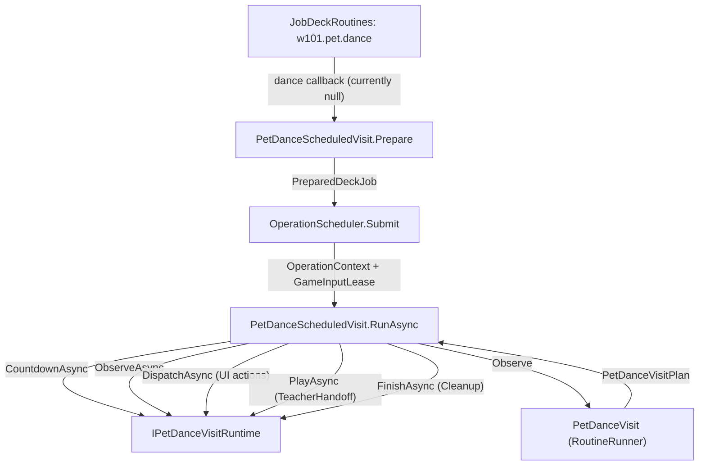

# Full Pet Dance Visit Integration Audit (GEM-DANCE-AUDIT-71)

## 1. Revision & Worktree Context
- **Evaluated Commit**: `595ef2c7b8423995de21b055e3712eef195507c8` (HEAD of `maelstrom/rust-architecture-v1`).
- **Audit Mode**: Read-only static analysis and contract inspection. No live game calls, input dispatch, builds, or subprocess launches were executed.
- **Architectural Boundary**: A successful standalone replay or an isolated game execution is **not** evidence of a qualified full visit. In accordance with the Codex Working Agreement (`AGENTS.md`) and `CODEX_WORK.md`, a qualified visit requires a verified sequence from approach/sigil through specialist execution, no-feed exit, and confirmed return to native Idle under a single shared input owner.

---

## 2. End-to-End Stage Trace

### Stage 1: Walk-Up & Approach
- **Source Paths**:
  - `ProjectMaelstrom/ProjectMaelstrom/Utilities/PetDanceLifecycle.cs` (lines 82–86)
  - `ProjectMaelstrom/ProjectMaelstrom/Resources/Macros/commons-to-pet-pavilion.macro.json`
  - `ProjectMaelstrom/ProjectMaelstrom/Modules/NavigationKnowledge.cs`
- **Current Behavior**:
  - `PetDanceLifecycle` models `PetDanceScene.OutsideNoSigil` requiring `_options.ApproachRouteQualified == true` and non-empty `ApproachRouteId`, producing proposal `PetDanceLifecycleAction.ApproachRoute`.
- **Integration Gaps & Missing Edges**:
  - **Routine Graph Disconnect**: The authoritative visit graph `ProjectMaelstrom/ProjectMaelstrom/Resources/Routines/pet-dance-visit.json` defines `start_node: "entry"`, which accepts only `DanceSigil`, `InstructionsUnselected`, and `InstructionsReady`. It contains no node for `OutsideNoSigil` or `ApproachRoute`.
  - **Adapter Omission**: `PetDanceVisit.cs` passes `OutsideNoSigil` through to `_runner.Observe`, but because `pet-dance-visit.json` has no corresponding edge from `entry`, any pre-sigil observation results in an unhandled/stopped state.
  - **Resolution**: Approach must remain an independently qualified composite routine (e.g. `commons-to-pet-pavilion.macro.json`) preceding the at-sigil visit, rather than embedding unbounded map navigation into the minigame routine graph.

### Stage 2: Sigil Interaction
- **Source Paths**:
  - `ProjectMaelstrom/ProjectMaelstrom/Resources/Routines/pet-dance-visit.json` (lines 13–27)
  - `ProjectMaelstrom/ProjectMaelstrom/Utilities/PetDanceVisit.cs` (lines 25, 73–75, 120–123)
  - `ProjectMaelstrom/ProjectMaelstrom/Utilities/PetDanceEntryVision.cs` (lines 83–87)
- **Current Behavior**:
  - `pet-dance-visit.json` `entry` node handles `scene: "DanceSigil"`, proposing `game.interact` (`PetDanceLifecycleAction.InteractX`), expecting `InstructionsUnselected` or `InstructionsReady` within a 15,000 ms timeout (`requires_control: false`).
  - `PetDanceEntryVision.Classify` identifies `PetDanceScene.DanceSigil` when the postgame classifier reports `OutsideAfterGame` and `evidence.VerifiedSigilTitleBounds` falls within $60\%\text{--}90\%$ of window height.
- **Integration Gaps & Missing Edges**:
  - **Live Observer Pipeline Missing**: `PetDanceEntryVision.Classify` is only invoked in unit tests (`PetDanceEntryVisionTests.cs`) and offline review tools. No production bridge currently captures live game frames, runs OCR, measures title bounds, and supplies `PetDanceVisitObservation` with `Scene = DanceSigil`.

### Stage 3: Loading Transition
- **Source Paths**:
  - `ProjectMaelstrom/ProjectMaelstrom/Resources/Routines/pet-dance-visit.json` (lines 8–11)
  - `ProjectMaelstrom/ProjectMaelstrom/Utilities/PetDanceLifecycle.cs` (lines 77–79)
  - `ProjectMaelstrom/ProjectMaelstrom/Utilities/PetDanceEntryVision.cs` (lines 60–63)
- **Current Behavior**:
  - `pet-dance-visit.json` declares `"pause_scenes": ["Loading", "Unknown"]`.
  - `PetDanceLifecycle.Observe` returns `PetDanceLifecycleAction.Wait` with `LoadingPaused = true`, instructing caller to pause inputs, suspend timeouts, and discard partial cue sequences.
  - `PetDanceEntryVision.Classify` maps to `PetDanceScene.Loading` if `evidence?.LoadingVerified == true`.
- **Integration Gaps & Missing Edges**:
  - **Detector Gating**: `LoadingVerified` requires a visual/memory indicator (e.g. absence of HUD/world geometry, loading spiral, or process state read). Without an active live detector supplying `evidence.LoadingVerified`, loading frames are classified as `Unknown`, pausing execution generically rather than with explicit loading lifecycle semantics.

### Stage 4: Instructions & Level Selection
- **Source Paths**:
  - `ProjectMaelstrom/ProjectMaelstrom/Resources/Routines/pet-dance-visit.json` (lines 29–94)
  - `ProjectMaelstrom/ProjectMaelstrom/Utilities/PetDanceVisit.cs` (lines 76–93)
  - `ProjectMaelstrom/ProjectMaelstrom/Utilities/PetDanceLevelSelectionVision.cs`
  - `ProjectMaelstrom/ProjectMaelstrom/Utilities/PetDanceEntryVision.cs` (lines 51–81)
- **Current Behavior**:
  - If `InstructionsUnselected`, proposes `pet-dance.choose-level` with bounds from matching `LevelControls` for configured arena (e.g. WizardCity, Krokotopia, etc.).
  - Once `InstructionsReady`, validates `entry.SelectedArena == _options.Arena`, verifies `PlayEnabledVerified`, and confirms `observation.EntryCostApproved`. Proposes `game.play` (`PetDanceLifecycleAction.Play`) targeting `entry.PlayBounds`.
- **Integration Gaps & Missing Edges**:
  - **Energy Cost Validation Gating**: `PetDanceVisit.Observe` (line 83) strictly withholds proposals with `"entry-cost-not-approved"` if `observation.EntryCostApproved` is false.
  - **Missing Producer**: Live telemetry provides `energy: 55` (verified in task 74 readiness probe), but no adapter evaluates `currentEnergy >= arenaCost` to set `EntryCostApproved = true` on the observation.

### Stage 5: Dance Playback & Response (Specialist Handoff)
- **Source Paths**:
  - `ProjectMaelstrom/ProjectMaelstrom/Resources/Routines/pet-dance-visit.json` (lines 96–109)
  - `ProjectMaelstrom/ProjectMaelstrom/Utilities/PetDanceVisit.cs` (lines 28, 94–95, 125–135)
  - `ProjectMaelstrom/ProjectMaelstrom/Utilities/PetDanceScheduledVisit.cs` (lines 16, 65–70)
  - `ProjectMaelstrom/ProjectMaelstrom/Utilities/PetDanceLiveTrial.cs`
  - `ProjectMaelstrom/ProjectMaelstrom/Utilities/PetDancePlayerLauncher.cs`
  - `crates/maelstrom-fallback/src/pet_dance.rs` (`PetDanceSequence`)
- **Current Behavior**:
  - `pet-dance-visit.json` node `teacher` enters on `scene: "Watch"`, emitting action `pet-dance.teacher` with 90,000 ms timeout.
  - `PetDanceScheduledVisit.RunAsync` intercepts `PetDanceLifecycleAction.TeacherHandoff` and delegates execution to `runtime.PlayAsync(context, plan, token)`.
  - Upon completion, `visit.RecordSpecialist(receipt)` validates matching `proposalId`, `targetId`, `geometry`, `contextId`, and `arena`.
- **Integration Gaps & Missing Edges**:
  - **CRITICAL ARCHITECTURAL GAP**: `IPetDanceVisitRuntime.PlayAsync` has **no production implementation**.
  - Existing live playback logic exists in `PetDanceLiveTrial.cs` / `PetDancePlayerLauncher.cs`, but that implementation is structured as an external subprocess (`--pet-dance-visual-trial`) managed by a Windows Forms UI (`PetDancePlayerForm.cs`), rather than a headless specialist task callable inside `IPetDanceVisitRuntime.PlayAsync` under the scheduler's existing `context.Input` lease.

### Stage 6: Result & Snack Policy
- **Source Paths**:
  - `ProjectMaelstrom/ProjectMaelstrom/Resources/Routines/pet-dance-visit.json` (lines 112–142)
  - `ProjectMaelstrom/ProjectMaelstrom/Utilities/JobDeckRoutines.cs` (lines 56–57)
  - `ProjectMaelstrom/ProjectMaelstrom/Utilities/PetDanceVisit.cs` (lines 96–99, 110)
  - `ProjectMaelstrom/ProjectMaelstrom/Utilities/PetDancePostGame.cs` (lines 32–44)
- **Current Behavior**:
  - `GameResult` proposes `pet-dance.next` (`PetDanceLifecycleAction.Next`) targeting NEXT button bounds, advancing to `SnackOffer`.
  - `SnackOffer` proposes `pet-dance.finish-without-snack` (`PetDanceLifecycleAction.FinishWithoutSnack`) targeting FINISH button bounds, advancing to `OutsideAfterGame`.
  - `JobDeckRoutines.cs` validates that `card.Settings["snacks"] == "none"`. Feeding is explicitly rejected: `"This visit supports no-feed exit only."`
  - `PetDanceVisit.Observe` enforces that `_specialistCompleted` is true and `observation.WholeGameResultVerified` is true before advancing.
- **Integration Gaps & Missing Edges**:
  - `PetDancePostGameClassifier.Classify` successfully extracts NEXT and FINISH bounds from OCR, but lacks an active scheduler loop feeding live OCR into `PetDanceVisitObservation.ControlBounds`.

### Stage 7: Leave & Return Outside
- **Source Paths**:
  - `ProjectMaelstrom/ProjectMaelstrom/Resources/Routines/pet-dance-visit.json` (lines 144–157)
  - `ProjectMaelstrom/ProjectMaelstrom/Utilities/PetDanceVisit.cs` (lines 31, 101–114)
  - `ProjectMaelstrom/ProjectMaelstrom/Utilities/PetDancePostGame.cs` (lines 53–62)
- **Current Behavior**:
  - `OutsideAfterGame` proposes `game.open-menu` (`PetDanceLifecycleAction.OpenMenu`), advancing to `MenuObserved`.
  - `PetDancePostGameClassifier` recognizes candidate outside scene via bottom interaction prompt ("PRESS ... TO PLAY"), strictly gated on a prior verified Reward $\to$ Snack $\to$ Finish transition sequence.
- **Integration Gaps & Missing Edges**:
  - Requires reliable keybinding dispatch (typically `Esc`) to open game menu without moving or disturbing character position.

### Stage 8: Native Idle Finalization
- **Source Paths**:
  - `ProjectMaelstrom/ProjectMaelstrom/Resources/Routines/pet-dance-visit.json` (lines 160–180)
  - `ProjectMaelstrom/ProjectMaelstrom/Utilities/PetDanceVisit.cs` (lines 32, 101–114)
  - `ProjectMaelstrom/ProjectMaelstrom/Utilities/PetDancePostGame.cs` (lines 28–30, 46–51)
  - `ProjectMaelstrom/ProjectMaelstrom/Utilities/PetDanceScheduledVisit.cs` (lines 89–93)
- **Current Behavior**:
  - `MenuObserved` proposes `wizard101.native-idle` (`PetDanceLifecycleAction.SelectIdle`) targeting IDLE button bounds in the Graphics menu.
  - Final scene `NativeIdle` completes the routine when the `"YOU ARE IDLE"` banner is observed.
  - `PetDanceScheduledVisit.RunAsync` checks `cleanup.IdleVerified == true` in `FinishAsync`; if not verified, job outcome is marked `OperationState.Failed`.
- **Integration Gaps & Missing Edges**:
  - Golden Rule Compliance: Idle is strictly an outcome of verified UI menu clicks, never a synthetic assertion. If user takeover occurs, cleanup must **not** force Idle by evading takeover.

---

## 3. Shared Scheduler & Input Ownership Trace

1. **Job Deck Registration (`JobDeckRoutines.cs`)**:
   - `w101.pet.dance` is currently registered with `dance = null`.
   - Routine reports `Available = false`, description `"Preparation only · live visit runtime not connected"`. Calling `Prepare` throws `InvalidOperationException("No trusted Dance visit runtime is connected.")`.
2. **Scheduler Execution (`PetDanceScheduledVisit.cs`)**:
   - Requires `context.Request.Target == options.TargetId`.
   - Requires `context.Input is { CanDispatch: true }` and `ReferenceEquals(context.Input, GameInputLease.Current)`.
   - Bounded execution: maximum 720 observation cycles (100 ms loop delay), overall timeout 180,000 ms.
3. **Takeover & Cancellation Handling**:
   - Any physical key press or loss of focus revokes input ownership.
   - `PetDanceLifecycle.Observe` immediately transitions to `Wait("visit-interrupted")` if `observation.TakenOver` is true.
   - In `PetDanceScheduledVisit`, cancellation invokes `runtime.FinishAsync(context, idle, token)` in a `finally` block to ensure input is released.

---

## 4. Prioritized Integration Table

| Priority | Stage / Capability | Current Status | Primary Source Paths | Exact Producer Contract | Exact Consumer Contract | Smallest Offline Verification Test |
| :--- | :--- | :--- | :--- | :--- | :--- | :--- |
| **P1** | **Runtime Binding Seam** | Missing (stub only) | `JobDeckRoutines.cs` `PetDanceScheduledVisit.cs` | Production `IPetDanceVisitRuntime` factory | `JobDeckRoutines.Create(dance: ...)` | Unit test verifying `Prepare` returns executable `PreparedDeckJob` when runtime is bound. |
| **P2** | **In-Process Specialist Playback** | Subprocess GUI only | `PetDanceScheduledVisit.cs` `PetDanceLiveTrial.cs` `PetDanceSequence.cs` | `IPetDanceVisitRuntime.PlayAsync` | `PetDanceScheduledVisit.RunAsync` $\to$ `PetDanceSpecialistReceipt` | Contract test verifying `PlayAsync` produces valid `PetDanceSpecialistReceipt` given simulated cue stream. |
| **P3** | **Entry Energy Gate** | Evaluated but unpopulated | `PetDanceVisit.cs` `JobDeckRoutines.cs` | Native telemetry reader (`facts.energy`) | `PetDanceVisitObservation.EntryCostApproved` | Test verifying proposal is withheld if `energy < arenaCost` and permitted if `energy >= arenaCost`. |
| **P4** | **Live Observation Adapter** | Unit test fixtures only | `PetDanceEntryVision.cs` `PetDancePostGame.cs` | Screen capture + OCR worker | `IPetDanceVisitRuntime.ObserveAsync` | Offline pipeline test feeding recorded PNGs and asserting classified `PetDanceVisitObservation`. |
| **P5** | **Pre-Sigil Approach Isolation** | Graph boundary gap | `pet-dance-visit.json` `NavigationKnowledge.cs` | Navigation routine / macro | Sigil proximity trigger before starting `pet-dance-visit` | Validation test asserting `pet-dance-visit` fails gracefully if started outside sigil range. |

---

## 5. Summary & Recommendation for Root Coordinator
- The state machine (`PetDanceVisit.cs`), lifecycle rules (`PetDanceLifecycle.cs`), and routine graph (`pet-dance-visit.json`) are well-specified and verified by 69 offline tests.
- The immediate blocker preventing `w101.pet.dance` from becoming executable is the lack of a production implementation of `IPetDanceVisitRuntime`.
- Specifically, `IPetDanceVisitRuntime.PlayAsync` must be adapted to run headless arrow-cue tracking in-process using the shared `GameInputLease`, replacing the standalone `--pet-dance-visual-trial` subprocess architecture.
