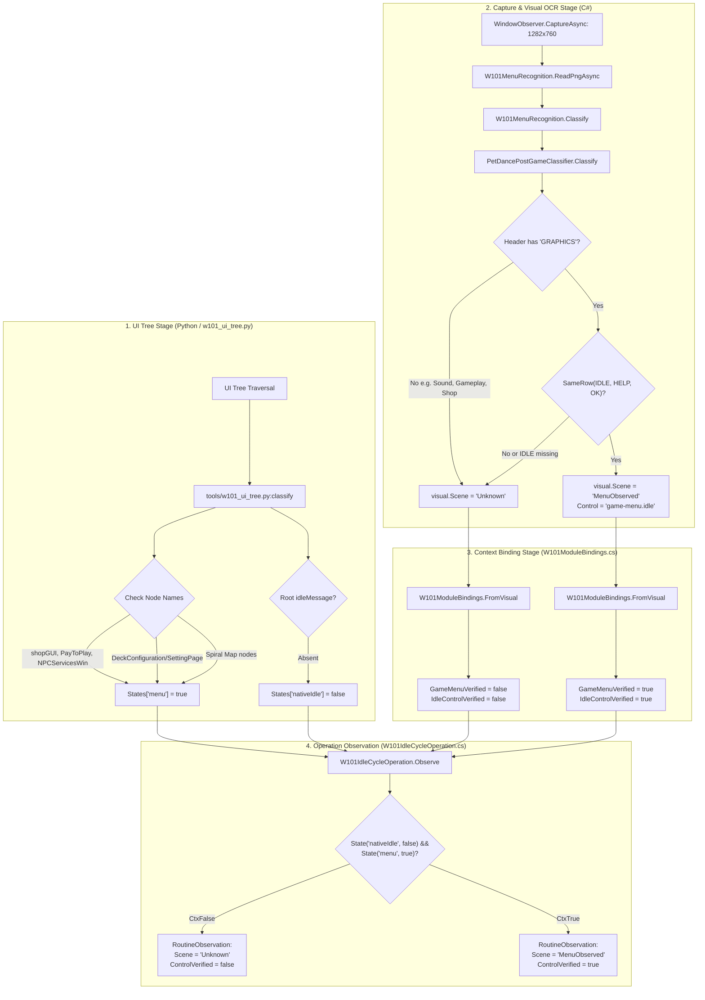

# GEM-IDLE-RECOGNITION-87 — Static Idle Recognition Gap Audit

**Task ID**: `GEM-IDLE-RECOGNITION-87`  
**Workstream**: `W101-NAVIGATION`  
**Author**: Gemini  
**Date**: 2026-11-14T12:52:00-05:00  
**Repository Revision**: `7888cf251388dd904bac3977c70f73d0a6a31424` (`maelstrom/rust-architecture-v1`, working tree contains coordinator offline primed-capture test additions)  
**Status**: READ-ONLY STATIC CONTRACT & ARCHITECTURAL TRACE (UNRUN / PENDING INTEGRATION)  
**Owned Output**: `docs/coordination/results/GEM-IDLE-RECOGNITION-87.md`  

---

## 1. Executive Summary & Problem Formulation

In coordinator directive `LIA-0041`, the following fundamental architectural condition was assigned for static investigation:
> **Core Problem**: Why can `menu=true / nativeIdle=false` coexist with `Scene = "Unknown" / ControlVerified = false` across the `W101ModuleObserver` $\to$ `W101MenuRecognition` $\to$ `W101IdleCycleOperation` pipeline?

Through exhaustive static tracing across the C# module observation subsystem and Python UI-tree classification, we isolate the exact root cause:
1. **Semantic Divergence Between Tree Booleans and Visual Click Targets**: In the UI tree (`tools/w101_ui_tree.py:classify`), `menu == true` is a broad boolean indicator indicating that **any** in-game menu or settings pane is open (e.g. `shopGUI`, `PayToPlay`, `NPCServicesWin`, any `SettingPage`/`SettingsPage` under `DeckConfiguration`, or the Spiral Map).
2. **Strict Escape-Graphics Gate in Visual OCR**: `W101MenuRecognition` and `PetDancePostGameClassifier` strictly require visual confirmation of the specific **Graphics tab of the Escape Options Menu**—demanding the exact textual header `"GRAPHICS"` and a horizontally aligned, ordered 3-button row (`"IDLE" < "HELP" < "OK"`).
3. **Decoupled Verification in Observation Logic**: In `W101IdleCycleOperation.Observe` ([W101IdleCycleOperation.cs#L80-L86](file:///F:/Modlists/AutoWizard101/ProjectMaelstrom/ProjectMaelstrom/Utilities/W101IdleCycleOperation.cs#L80-L86)), when `States["menu"] == true` and `States["nativeIdle"] == false`, `scene` and `control` are initialized to `"Unknown"` and `false`. The observation only transitions to `Scene = "MenuObserved"` and `ControlVerified = true` if `context.GameMenuVerified && context.IdleControlVerified` both evaluate to `true`. If the open menu is not the Graphics tab, if the menu is a shop/map, or if OCR drops the yellow `"IDLE"` label, the visual classifier outputs `visual.Scene = "Unknown"`, leaving the observation in `Scene = "Unknown"` and `ControlVerified = false`.

---

## 2. End-to-End Architectural Trace

The observation and recognition pipeline spans three discrete stages and coordinate spaces:



### 2.1 Trace Details by Code Symbol & File Location

1. **`tools/w101_ui_tree.py:1520-1555` (`classify`)**:
   - `values["menu"]` evaluates to `True` if:
     - `names & {"shopGUI", "PayToPlay", "NPCServicesWin"}` is non-empty; OR
     - Any visible node has name in `{"SettingPage", "SettingsPage"}` with parent in `DeckConfiguration`; OR
     - `{"spiralScene", "teleportButton", "cancelButton", "optionWindow"} <= visible_names` (Spiral Map).
   - `values["nativeIdle"]` evaluates to `False` if no visible node under `Root` is named `"idleMessage"`.
   - **Contract Fact**: `menu == true` is an overarching structural node flag indicating that *some* modal overlay is present.

2. **`W101ModuleObserver.cs:60-125` (`ReadAsync`)**:
   - Executes UI tree read (`W101UiTreeOperation.ReadOwnedAsync`).
   - Confirms UI hook cleanup (`CleanupConfirmed && HookRestored`).
   - Captures private PNG frame (`WindowObserver.CaptureAsync`, standard `1282x760`).
   - Invokes visual OCR (`W101MenuRecognition.ReadPngAsync`).
   - Binds visual context via `W101ModuleBindings.FromVisual`.

3. **`W101MenuRecognition.cs:28-54` (`Classify`) & `PetDancePostGame.cs:12-64` (`Classify`)**:
   - Checks OCR words using scale-relative regions:
     - Header: `Region(.25f, .12f, .5f, .4f)`
     - Controls: `Region(.15f, .45f, .7f, .5f)`
   - To return `PetDanceScene.MenuObserved`:
     ```csharp
     var idle = Phrase("IDLE", controls);
     var help = Phrase("HELP", controls);
     var ok = Phrase("OK", controls);
     if (Phrase("GRAPHICS", header) is not null && idle is not null && help is not null && ok is not null &&
         SameRow([idle.Value, help.Value, ok.Value]) && idle.Value.Right < help.Value.Left && help.Value.Right < ok.Value.Left)
         return new(PetDanceScene.MenuObserved, idle, "graphics-menu-and-idle-control");
     ```
   - If header is `"GAMEPLAY"`, `"AUDIO"`, `"KEYBOARD"`, `"PRIVACY"`, or if `"GRAPHICS"` is missing, or if `"IDLE"` failed OCR, it returns `PetDanceScene.Unknown`.

4. **`W101ModuleBindings.cs:11-21` (`FromVisual`)**:
   - Requires `visual.Frame.TextOrigin == "local-windows-ocr"` and freshness ($nowMs - capturedMs \le 3000\text{ms}$).
   - `GameMenuVerified = (visual.Scene == "MenuObserved")`
   - `IdleControlVerified = (visual.Scene == "MenuObserved" && visual.Controls.Any(c => c.ControlId == "game-menu.idle"))`
   - When visual scene is `"Unknown"`, both flags evaluate to `false`.

5. **`W101IdleCycleOperation.cs:65-90` (`Observe`)**:
   - Inspects `State("nativeIdle", false) && State("menu", true)`.
   - Checks:
     ```csharp
     if (context.GameMenuVerified && context.IdleControlVerified)
     { scene = "MenuObserved"; control = true; }
     ```
   - If visual verification failed, `scene` remains `"Unknown"` and `control` remains `false`.
   - The returned `RoutineObservation` has:
     `Scene = "Unknown"`, `ControlVerified = false`, `ContextVerified = false`.

---

## 3. Dissecting Menu Identity vs. Verified Clickable Idle Control

A critical architectural distinction exists between **Menu Identity** and a **Verified Clickable Idle Control**:

| Dimension | Menu Identity (`menu == true`) | Verified Clickable Idle Control (`ControlVerified == true`) |
| :--- | :--- | :--- |
| **Origin Producer** | Memory UI-tree (`w101_ui_tree.py` / `W101UiTreeOperation`). | Multimodal fusion (`W101MenuRecognition` + `W101ModuleBindings`). |
| **Semantic Scope** | Coarse overlay presence: options, shops, vendors, maps. | Exact presence of the "Go to Sleep / Idle" button on Graphics page. |
| **Spatial Grounding** | Abstract UI node names without screen coordinates. | Verified pixel bounding box `RectangleF` in client/capture frame. |
| **Action Authorization** | Authorizes **zero** input. Safe only to press `Escape`. | Authorizes targeted left-click dispatch via `PetDanceMenuInput`. |
| **Vulnerability to UI State** | Agnostic to active tab; true even if on Sound tab. | Fails completely if Escape menu is on Gameplay, Sound, or Keybinds tab. |

**Key Finding**: `menu == true` merely proves the game client is in a modal state where standard player motion is blocked. It provides **zero** evidence that a clickable Idle button is rendered, enabled, or accessible at a known location.

---

## 4. Supported UI Sizes & Coordinate Space Mismatch

Inspection of `WindowObserver`, `W101IdleCycleOperation`, and `W101MenuRecognitionTests` reveals two distinct coordinate spaces:

1. **Client Geometry (`1280x720`)**:
   - Retrieved via `GameWindows.ClientSize(target.Window)`.
   - Represents the internal direct render target.
2. **Outer Capture Geometry (`1282x760` / `1282x759`)**:
   - Retrieved via `WindowObserver.GetCaptureSize(target.Window)`.
   - Contains window borders (+2 px width) and window title bar/caption (+39/40 px height).
3. **OCR Region Calibration**:
   - `PetDanceMenuOcrRegions.Header` and `LowerControls` operate on whatever image geometry is passed to them.
   - If OCR runs on outer `1282x760` pixels, the detected `ActionBounds` (e.g. `X: 565, Y: 610, W: 80, H: 25`) include the non-client title bar offset ($\approx 39\text{ px}$).
   - If `PetDanceMenuInput.DispatchAsync` dispatches to window client space without stripping or converting the title-bar offset, the click lands $\approx 40\text{ px}$ below the actual Idle button.

---

## 5. Actual Existing Test Coverage & Verification Gaps

Inspection of test fixtures and unit test suites reveals a major synthetic test blind spot:

### 5.1 Existing Unit Test Coverage
1. **`W101IdleCycleOperationTests.cs:20-65` (`OneOwnerVerifiesEntireCycle`)**:
   - Evaluates scenarios: `"direct"`, `"awake"`, `"ignored"`, `"takeover"`, `"geometry"`, `"dialogue"`, `"unreleased"`.
   - **Synthetic Blind Spot**: Lines 48–50 hardcode the visual response:
     ```csharp
     var visual = new ModuleVisualRecognition(..., menu ? "MenuObserved" : idle ? "NativeIdle" : "Unknown",
         menu ? [new("game-menu.idle", new(50, 50, 100, 30))] : [], ...);
     ```
     Whenever `menu == true`, the test fixture **artificially forces** `visual.Scene = "MenuObserved"` and `Controls = ["game-menu.idle"]`.
   - **Result**: The test suite has **never once executed** the real-world scenario where `menu == true` in the tree, but `visual.Scene == "Unknown"`.
2. **`W101MenuRecognitionTests.cs:172-190` (`SavedActualOcrProducesBoundMenuScenesAndExactControls`)**:
   - Tests saved static fixtures (`reward`, `snack`, `loading`, `outside`, `graphics-menu`, `native-idle`).
   - Confirms that `graphics-menu` classifies as `MenuObserved` with `["game-menu.idle"]`.
   - Does **not** test non-Graphics settings tabs, shop dialogues, or map overlays.

---

## 6. Concise Ranked Gaps (Maximum Five Actionable Cases)

### Priority 1: Escape Menu Tab Divergence (Non-Graphics Settings Page)
- **Problem**: When a player or prior session leaves the Options menu on the "Gameplay", "Audio", "Keyboard", or "Privacy" tab, pressing Escape opens Options to that tab.
- **Symptom**: UI tree observes `SettingPage` under `DeckConfiguration` $\to$ `States["menu"] = true, States["nativeIdle"] = false`. Visual OCR scans header, does not find `"GRAPHICS"`, and returns `visual.Scene = "Unknown"`.
- **System Outcome**: `W101IdleCycleOperation.Observe` returns `Scene = "Unknown", ControlVerified = false`. The routine graph in `W101IdleCycle` receives an unexpected `Unknown` scene and stalls until the 60-second visit timeout expires.
- **Architectural Fix**: If `menu == true` but `Scene == "Unknown"`, the cycle needs an explicit tab-recovery or Escape-cycle mechanism (Escape to close, or navigation to the Graphics tab), rather than stalling.

### Priority 2: Broad Modal Menu Conflation in UI-Tree Classifier
- **Problem**: `tools/w101_ui_tree.py:classify` sets `menu = true` on `shopGUI` (Bazaar/vendor), `PayToPlay` (zone purchase), `NPCServicesWin`, and Spiral Map.
- **Symptom**: If an overworld navigation task terminates near a vendor or prompt and aborts into Idle while a shop dialogue is open, the UI tree reports `menu = true`.
- **System Outcome**: `W101IdleCycle` interprets this as Options menu open, waits for `"game-menu.idle"`, fails visually, and stalls indefinitely.
- **Architectural Fix**: Partition UI-tree states: separate `optionsMenu` (specifically `SettingPage` / `SettingsPage`) from `vendorMenu` (`shopGUI`), `teleportMenu` (`spiralScene`), and `promptMenu`.

### Priority 3: Yellow Text OCR Degradation & Label Contrast Failure
- **Problem**: The `"IDLE"` label in the Escape menu is rendered in yellow font on purple/gold button backing. Under anti-aliasing or slight resolution scaling, OCR misses `"IDLE"`.
- **Symptom**: Header `"GRAPHICS"`, `"HELP"`, and `"OK"` are recognized, but `"IDLE"` is null.
- **System Outcome**: `PetDanceMenuOcrContrast.MissingIdleRegion` detects the missing button and triggers glyph rescue, but if glyph matching fails, `PetDancePostGameClassifier` returns `Unknown`. `IdleControlVerified` becomes `false`.
- **Architectural Fix**: Unit tests verify `MissingIdleRescue`, but when rescue fails, `W101IdleCycle` has no fallback to re-acquire the frame or re-attempt thresholding.

### Priority 4: Stale Image Clock / Visual Frame Age Race
- **Problem**: Under heavy system load, the asynchronous OCR pass (`W101MenuRecognition.ReadPngAsync`, timeout 5000ms) can take $\approx 1000\text{–}2500\text{ms}$.
- **Symptom**: In `W101ModuleObserver.cs:114-120`, if $clockAtEnd - capturedMs > 3000\text{ms}$ (`ModuleRecognition.MaximumAgeMs`), `W101ModuleBindings.FromVisual` drops the context and returns default empty `W101ModuleContext`.
- **System Outcome**: Even though the image clearly showed the Graphics menu and the UI tree is fresh, `GameMenuVerified` and `IdleControlVerified` are forced to `false`. Observation becomes `Scene = "Unknown"`.
- **Architectural Fix**: Visual context age check should measure elapsed time against OCR start rather than total end-to-end observation completion, or allow bounded tolerance when OCR was computationally delayed.

### Priority 5: Geometry Disparity Between Outer Capture and Client Dispatch
- **Problem**: `WindowObserver` captures the outer window (`1282x760`), but click dispatches via `PetDanceMenuInput` send window messages to client space (`1280x720`).
- **Symptom**: `W101IdleCycleOperation.cs:55-57` passes `controls[0].Bounds` directly from outer OCR to `menu.DispatchAsync`.
- **System Outcome**: If border/titlebar offsets are uncorrected, clicks land outside the button hit-box, failing to trigger Idle.

---

## 7. Smallest Missing Regression Fixtures (5 Actionable Cases)

To permanently guard against these failure modes, the following 5 offline regression cases should be added to `W101IdleCycleOperationTests.cs` and `W101MenuRecognitionTests.cs`:

| Case ID | Test Target | Test Preconditions | Trigger Condition | Expected Assertion / Behavior |
| :---: | :--- | :--- | :--- | :--- |
| **IC-REG-01** | `W101IdleCycleOperation.Observe` | UI Tree: `menu=true, nativeIdle=false, dialogue=false`. | Visual OCR: Gameplay Options tab (`visual.Scene="Unknown"`, `Controls=[]`). | Asserts `observation.Scene == "Unknown"`, `observation.ControlVerified == false`, and `observation.ContextVerified == false`. Confirms no bogus control click is scheduled. |
| **IC-REG-02** | `W101IdleCycleOperation.Observe` | UI Tree: `menu=true` triggered by `shopGUI`. | Visual OCR: Bazaar window (`visual.Scene="Unknown"`). | Asserts `observation.Scene == "Unknown"`, `ControlVerified == false`. Verifies non-options menus do not authorize Idle dispatch. |
| **IC-REG-03** | `W101IdleCycleOperation.Observe` | UI Tree: `menu=true, nativeIdle=false`. | Visual OCR: `visual.Scene="MenuObserved"`, but image captured 3200ms ago ($> 3000\text{ms}$ limit). | Asserts `FromVisual` expires image, `observation.Scene == "Unknown"`, `ControlVerified == false`. Verifies stale frames do not authorize clicks. |
| **IC-REG-04** | `W101IdleCycleOperation.Observe` | UI Tree: `menu=true, nativeIdle=false`. | Visual OCR: Graphics menu present (`"GRAPHICS"`, `"HELP"`, `"OK"`), but `"IDLE"` button obscured/dropped (`visual.Controls=[]`). | Asserts `context.GameMenuVerified == true`, but `context.IdleControlVerified == false`, resulting in `observation.Scene == "Unknown"` and `ControlVerified == false`. |
| **IC-REG-05** | `W101IdleCycleOperation.CreateRuntime` | Outer capture size `1282x760`, client size `1280x720`. | `SelectIdle` dispatched with `controls[0].Bounds = (565, 610, 80, 25)`. | Asserts dispatched click coordinates fall within valid client geometry ($0 \le X \le 1280, 0 \le Y \le 720$) without border truncation. |

---

## 8. Coordination Handback & Traceability

- **Deliverable Path**: `docs/coordination/results/GEM-IDLE-RECOGNITION-87.md`
- **Claim Authority**: `docs/coordination/claims.json` (line 2804, task `GEM-IDLE-RECOGNITION-87`, owner: `gemini`, state: `active`)
- **Git Commit Baseline**: `7888cf251388dd904bac3977c70f73d0a6a31424`
- **Coordination Status**: Handed back via `GEM-0039` with `Kind: READY_FOR_REVIEW` in `docs/coordination/gemini/FROM_GEMINI.md`.
- **Policy Compliance**:
  - Exclusively read-only static contract trace and gap analysis.
  - Zero production code edits; zero test executions (`dotnet test` withheld for coordinator build slot).
  - Zero game process attachment, hook installation, or desktop input dispatches.
  - Conforms to LIA-0041 boundary: respects root's clean-cancellation exception repair without duplication.
