# GEM-MENU-INVENTORY-90 — W101 Menu Evidence & Layout Inventory (Corrected Baseline)

**Task ID**: `GEM-MENU-INVENTORY-90`  
**Workstream**: `W101-NAVIGATION`  
**Author**: Gemini  
**Date**: 2026-11-16T12:15:00-05:00 (Revised per coordinator audit `GEM-HONESTY-AUDIT-01` / `LIA-0121`)  
**Repository Revision**: HEAD `6dd15e5` (`maelstrom/rust-architecture-v1`)  
**Status**: READ-ONLY STATIC CONTRACT & EVIDENCE INVENTORY (CORRECTED)  
**Owned Output**: `docs/coordination/results/GEM-MENU-INVENTORY-90.md`  

---

## 1. Executive Summary & Architecture Context

Per user request, coordinator directive `LIA-0042`, review corrections in `LIA-0044`, and honesty audit `LIA-0121` (`GEM-HONESTY-AUDIT-01`), this report establishes a verified offline inventory of Wizard101 menu layouts, navigation mechanisms, and interpretation evidence across `ProjectMaelstrom`.

### 1.1 Four-Layer Evidence Separation
To eliminate conflation between historical community claims and actual tested code, this inventory strictly partitions findings into four discrete evidence layers:
1. **Layer A — Qualified Callable C# Routines**: Production routines integrated with `OperationScheduler`, `W101ControlScope`, `GameInputLease`, and `W101IdleFailsafe` (`W101WorldGateVisit`, `W101CharacterOperation`, `W101IdleCycleOperation`, `W101QuestConversation`). *Note*: `PetDanceLiveTrial` executes bounded specialist trials but, per `PetDanceLiveTrial.cs:91`, installs no hooks, owns no message loop, and never acquires an input lease.
2. **Layer B — Current Observed UI-Tree Telemetry**: Verified in-memory layout hooks and classification in `tools/w101_ui_tree.py` (`classify` at line 1739) and `W101UiTreeOperation.ReadOwnedAsync`.
3. **Layer C — Saved Offline Test Fixtures**: Deterministic image frames and JSON traces (`ProjectMaelstrom.Tests/TestData/Modules/W101Menus/`, `ProjectMaelstrom.Tests/TestData/QuestConversation/quinn-offer.json`, `tools/fixtures/w101_ui_tree_review.json`).
4. **Layer D — Legacy Community Paths & Historical Conventions**: Archived widget paths from community projects (`Deimos-Wizard101/src/paths.py`). These serve as structural hints; they are **not** assumed operational without independent verification.

### 1.2 Invariant Operational Rules
- **No Guessed Click Coordinates**: Button bounds are derived strictly from OCR word boxes (`PetDanceMenuWord.Bounds`) or memory node rectangles (`rawRectangle`).
- **Escape Key Asymmetry & Modal Traps**: `Escape` is **not** a universal exit. In quest dialogue, `Escape` or `btnLeft` can decline a quest; in pet postgame, `Escape` does not dismiss rewards; and on the Spiral Map, **`Escape` is not Exit** (`tools/w101_ui_tree.py:1758–1766`), as pressing `Escape` opens Options *over* the map rather than closing it.
- **Quarantine of Purchasing & Feeding**: No automation is authorized to spend Crowns, Gold, Arena Tickets, or pet snacks. Menus with financial or irreversible inventory consequences must remain read-only or strictly locked against click dispatch.
- **Historical Claims Labeled**: Minigame energy costs (historically claimed as 2–10 energy; actual client costs scale with pet level up to Ultra) and mnemonic shortcuts (`P`, `Q`, `B`, `M`, `C`) are treated as unverified historical claims unless evidenced in current client traces.

---

## 2. Master Menu Evidence Matrix

The inventory spans all 7 core menu families defined in `docs/W101_MENU_MAP.md`:

| Menu Family & Stable ID | UI-Tree Node Path / Memory Anchor | Visual / OCR / Fixture Evidence Seam | Control Symbols & Semantic IDs | Open / Close Mechanism | Evidence Layer & Status | Progression / Purchase / Logout Effects |
| :--- | :--- | :--- | :--- | :--- | :---: | :--- |
| **1. Options Menu (Multi-Tab)** `w101.menu.options` | `Root/WorldView/DeckConfiguration/SettingPage` / `SettingsPage` | `graphics-menu.png` (1,013,443 B, SHA256: `bc665c42c816e2204405634de2b1bf590e441f79eba9c92d74f0a8c1f02bb4e4`) | `QuitButton` `game-menu.idle` (OCR) *(Note: only `game-menu.idle` exists in code)* | **Open**: `ESCAPE` **Close**: `ESCAPE` (no implemented `game-menu.ok` mechanism exists) | **Layer A (C# Routine)** Broadened options-header OCR accepts verified Idle row | **Safe**: Read-only settings view; Idle button transitions to native sleep. |
| **1. Native Idle Overlay** `w101.overlay.native-idle` | `Root/idleMessage/idleBackground/idleText` (text: `"YOU ARE IDLE"`) | `native-idle.png` (844,233 B, SHA256: `21cc5af30ff62e37ff8c2326539e692a48858e444603c34505f636f81fab6160`) | None (modal banner across overworld) | **Open**: Idle button click or 15m inactivity **Wake**: `ESCAPE` or movement key | **Layer A (C# Routine)** Live verified in op `425a8312...` | **Safe**: Retains player in unmoving idle state; halts logout timer. |
| **2. NPC Dialogue Window** `w101.dialogue.quest` | `Root/WorldView/wndDialogMain` `txtArea/txtMessage` `btnRight`, `btnLeft` | `quinn-offer.json` (2,936 B, SHA256: `9654db1e447edda7a019925fc759c2e423c8b4434ba57348dee21f1c7816e0d8`) | `btnRight` (`advanceDialogue`) `btnLeft` (`declineQuest`) `txtMessage` (spoken text) | **Open**: Proximity + `X` **Advance**: `btnRight` or `SPACE` **Close**: Complete or `btnLeft` | **Layer A (C# Routine)** `W101QuestConversation` | **Quest Progression**: Advances questline, accepts objectives, or declines sidequests. |
| **2. NPC Services / Multi-Quest** `w101.dialogue.services` | `Root/WorldView/NPCServicesWin` `wndDialogMain/Exit` | `tools/w101_ui_tree.py:1750` (`dialogue=true`) | `Exit` (`cancel_multiple_quest_menu`) Service selection buttons | **Open**: Proximity + `X` **Close**: `Exit` button | **Layer B (Observed Tree)** Missing dedicated C# service handler | **Quest/Service Commitment**: Can lock character into training or vendor menus. |
| **2. NPC Interaction Prompt** `w101.prompt.npc-range` | `Root/WorldView/NPCRangeWin` `wndTitleBackground/NPCRangeTxtTitle` | `tools/w101_ui_tree.py:1749` (`interactionPrompt=true`) | `NPCRangeTxtTitle` `TeamUpButton` | **Open**: Walk into range **Trigger**: `X` key **Close**: Walk away | **Layer A (C# Routine)** `W101UiTreeOperation` | **Safe**: Read-only HUD indicator for talk/sigil/chest interaction. |
| **3. Equipment & General Shop** `w101.shop.equipment` | `Root/WorldView/shopGUI` `buyWindow/exit` | `tools/w101_ui_tree.py:1754` (`menu=true`) | `buyAction` `exit` Item catalogue list | **Open**: NPC interaction (`X`) **Close**: `exit` button or `ESCAPE` | **Layer B (Observed Tree)** Layer D (`paths.py:61`) | **High Financial Risk**: Spends Gold or Crowns. Quarantined. |
| **3. Pet Snack / Reagent Shop** `w101.shop.snack-reagent` | `Root/WorldView/ShoppingPetSnackWindow` `Root/WorldView/ShoppingReagentWindow` | Layer D (`paths.py:64-67`) | `buyWindow/exit` Item scroll list | **Open**: Vendor interaction (`X`) **Close**: `exit` button | **Layer D (Legacy Path)** Unobserved in current tests | **High Financial Risk**: Spends Gold or Arena Tickets. Quarantined. |
| **3. Potion Shop Window** `w101.shop.potions` | `Root/WorldView/main` `buyAction` `fillallpotions` `exit` | Layer D (`paths.py:12-15`) | `buyAction` `fillallpotions` `exit` | **Open**: Vendor interaction (`X`) **Close**: `exit` button | **Layer D (Legacy Path)** Unobserved in current tests | **Gold Spend**: Refills potion bottles. Quarantined. |
| **3. Pay-to-Play Zone Prompt** `w101.prompt.pay-to-play` | `Root/WorldView/PayToPlay` / `MessageBoxModalWindow` | `tools/w101_ui_tree.py:1754` (`menu=true`) | Zone purchase buttons `centerButton` / `rightButton` | **Open**: Entering unpurchased premium zone **Close**: `cancelButton` | **Layer B (Observed Tree)** Layer D (`paths.py:51`) | **Crowns Spend**: Prompts real-money account transaction. Quarantined. |
| **4. World Gate / Spiral Door** `w101.transport.world-gate` | `Root/WorldView/messageBoxBG/ControlSprite/optionWindow` `wbtn<World>` / `teleportButton` | `test_w101_ui_tree.py:777` (`wbtnZafaria`) `W101WorldGateVisitTests.cs` | `leftButton` / `rightButton` (cycle) `teleportButton` `selectedWorldCheckMark` `cancelButton` | **Open**: Proximity + `X` **Close**: `cancelButton` (Escape opens Options!) | **Layer A (C# Routine)** `W101WorldGateVisit` implements inspect, close, travel, cooldown | **World Teleportation**: Initiates cross-world loading screen and cooldown timer. |
| **4. Compass HUD Teleporters** `w101.hud.teleporters` | `Root/WorldView/windowHUD/compassAndTeleporterButtons` | `test_w101_ui_tree.py:793` (`btnHome`) | `btnHome` `RecallButton` (mark recall) `ResumeInstanceButton` | **Open**: Always visible on HUD **Trigger**: Click or `HOME` key | **Layer A (C# Routine)** `W101CharacterOperation.GoHome` | **Teleportation**: Teleports player to Dorm/Castle or recalled marker. |
| **5. Character Selection** `w101.screen.char-select` | `Root/WorldView/mainWindow/btnPlay` `wndCharacter` | `W101CharacterOperation.cs` (`ReadBanner`, `btnPlay`) | `btnPlay` `txtCharName`, `txtCharLevel` `txtCharLocation` | **Open**: Client launch or Logout **Action**: Select character $\to$ `btnPlay` | **Layer A (C# Routine)** `W101CharacterOperation.EnterSelectedWizard` | **Session Boot**: Boots into world session. **Invariant**: Native Idle is completely unavailable here. |
| **6. Pet Dance: Sigil Entry** `w101.minigame.dance.entry` | `Root/WorldView/PetGameTracks` `wndTracks/btnTrack0` `btnNext` | `PetDanceEntryVision.cs` `PetDanceEntryImageReviewTests` | `btnTrack0` (WC track) `btnNext` (`Play`) `SkipGameButton` `btnBack` (`Cancel`) | **Open**: Pavilion sigil + `X` **Close**: `btnBack` (`sigil.dance.cancel`) | **Layer A (C# Routine)** `PetDanceVisitReplay` | **Energy Commitment**: Consumes Pet Energy upon clicking `Play` (scaled by pet level). |
| **6. Pet Dance: Gameplay Frame** `w101.minigame.dance.play` | `Root/WorldView/PetGameSplash/PetGameDance/wndControls` | `PetDanceVisualSequenceReview.cs` | Visual arrow prompt display `wndActionBkg/txtAction` | **Start**: After `btnNext` loading **End**: Round 5 completion or failure | **Layer A (C# Routine)** `PetDanceLiveTrial` | **In-Game Action**: Consumes player arrow key responses. |
| **6. Pet Dance: Reward Screen** `w101.minigame.dance.reward` | `Root/WorldView/PetGameSplash/PetGameRewards` `btnNext` | `reward.png` (951,106 B, SHA256: `47d3e9eb90ed759caed626d01a1538b7e9bf93c51f214f15b61c18b59b003e61`) | `pet-dance.next` (`btnNext`) Reward stat readouts | **Open**: End of minigame **Close**: `btnNext` | **Layer A (C# Routine)** `PetDancePostGame` | **Reward Acceptance**: Commits minigame XP and pet stat gains. |
| **6. Pet Dance: Snack Offer** `w101.minigame.dance.snack` | `Root/WorldView/PetGameSplash/PetGameRewards` `btnBack` `chkSnackCard0` | `snack.png` (964,471 B, SHA256: `ab687d77b17c20540c95a761bebfebde7f721c6b986fb98a19580fd63e5c2291`) | `pet-dance.finish-without-snack` (`btnBack`) `chkSnackCard0` (snack card) | **Open**: After Reward `btnNext` **Close**: `btnBack` (`Finish`) | **Layer A (C# Routine)** `PetDancePostGame` | **Snack Consumption Risk**: Maelstrom strictly enforces `btnBack` (no-feed). |
| **6. Pet Level Up Popup** `w101.minigame.dance.levelup` | `Root/WorldView/PetGameSplash/PetLevelUpWindow` `wndPetLevelBkg/btnPetLevelClose` | Layer D (`paths.py:171-178`) | `btnPetLevelClose` `txtAnnounceText` | **Open**: Pet XP crosses tier threshold **Close**: `btnPetLevelClose` | **Layer D (Legacy Path)** Unobserved in current tests | **Modal Trap**: Blocks postgame flow until close button is clicked. |
| **7. Spellbook: Deck / Spells** `w101.spellbook.deck` | `Root/WorldView/DeckConfiguration` | `tools/w101_ui_tree.py:1751–1757` | `Close_Button` Spell inventory grid | **Open**: `P` key (historical) **Close**: `Close_Button` or hotkey | **Layer B (Observed Tree)** Missing sub-page classifier | **Deck Modification**: Modifies active spell cards and side deck. |
| **7. Spellbook: Quest Log** `w101.spellbook.quests` | `Root/WorldView/DeckConfiguration/wndQuestList` | Layer D (`paths.py:184-187`) | `QuestLogAllButton` `wndQuestInfo1` | **Open**: `Q` key (historical) **Close**: `Close_Button` or hotkey | **Layer D (Legacy Path)** Unobserved in current tests | **Quest Tracking**: Changes active quest compass indicator. |
| **7. Spellbook: Backpack** `w101.spellbook.backpack` | `Root/WorldView/DeckConfiguration/InventorySpellbookPage` | Layer D (`paths.py:136-144`) | `EquipmentManager` `top_scroll/title` | **Open**: `B` key (historical) **Close**: `Close_Button` or hotkey | **Layer D (Legacy Path)** Unobserved in current tests | **Gear State**: Equips/unequips gear, weapons, pets, mounts. |
| **7. Spellbook: Spiral Map** `w101.spellbook.map` | `Root/WorldView/messageBoxBG/spiralScene` | `tools/w101_ui_tree.py:1761–1766` (`spiralScene`) | `teleportButton` `cancelButton` | **Open**: `M` key (historical) **Close**: `cancelButton` (**Escape is NOT Exit!**) | **Layer B (Observed Tree)** Layer A close in WorldGate | **Zone Map / Teleport**: Displays current zone map; allows port to commons. |
| **7. Character Status & Stats** `w101.spellbook.character` | `Root/WorldView/DeckConfiguration/ControlSprite/wndEnergyFrame` | `W101CharacterOperation.cs` (`VerifyLoadedAsync`, `CharacterInfo`) | `txtEnergy` Stat value readouts | **Open**: `C` key (`CharacterInfo`) **Close**: `C` key | **Layer A (C# Routine)** `W101CharacterOperation` | **Safe**: Read-only display of health, mana, energy, training points. |

---

## 3. Transition Mechanisms, Hotkeys & Operational Hazards

### 3.1 Modal State Machine & Navigation Transitions

```mermaid
stateDiagram-v2
    [*] --> Overworld_Walkable : Normal Gameplay
    Overworld_Walkable --> Options_Menu : Press ESCAPE
    Options_Menu --> Overworld_Walkable : Press ESCAPE (Safe Close; no implemented OK button dispatch)
    Options_Menu --> Native_Idle : Click 'IDLE' Button (game-menu.idle)
    Native_Idle --> Overworld_Walkable : Press ESCAPE or Movement (Wake)
    
    Overworld_Walkable --> Quest_Dialogue : Proximity + Press 'X'
    Quest_Dialogue --> Quest_Dialogue : Press SPACE / Click 'btnRight' (Advance)
    Quest_Dialogue --> Overworld_Walkable : Click 'btnLeft' (DECLINE QUEST TRAP!)
    
    Overworld_Walkable --> World_Gate_Map : Proximity + Press 'X'
    World_Gate_Map --> Overworld_Walkable : Click 'cancelButton' (NOTE: ESCAPE OPENS OPTIONS!)
    World_Gate_Map --> Loading_Screen : Click 'teleportButton' (TRAVEL COMMITTED!)
    Loading_Screen --> Overworld_Walkable : Loading Cleared (W101NavigationTransition)
    
    Overworld_Walkable --> Shop_Modal : Proximity + Press 'X'
    Shop_Modal --> Overworld_Walkable : Click 'Exit' (FINANCIAL CURRENCY RISK!)
    
    Overworld_Walkable --> Minigame_Sigil : Sigil Proximity + Press 'X'
    Minigame_Sigil --> Overworld_Walkable : Click 'btnBack' (Safe Cancel)
    Minigame_Sigil --> Minigame_Active : Click 'btnNext' (ENERGY COMMITTED!)
```

### 3.2 Detailed Hazard Breakdown
1. **The Spiral Map Trap (`Escape != Exit`)**:
   In `tools/w101_ui_tree.py:1758-1766`, Spiral Map presence is observed via `{"spiralScene", "teleportButton", "cancelButton", "optionWindow"} <= visible_names`.
   Crucially, **`Escape` does not dismiss the Spiral Map**. Pressing `Escape` opens `DeckConfiguration/SettingPage` *underneath or over* the active map overlay. Closing the map safely requires clicking `cancelButton` or pressing `M`. `W101WorldGateVisit` implements this correctly via explicit cancel button pulsing.
2. **Quest Dialogue Decline Trap (`btnLeft`)**:
   In `wndDialogMain`, `btnRight` advances dialogue, while `btnLeft` declines or cancels the quest. Blindly firing `Escape` or left buttons during active dialogue can permanently abandon non-repeatable quest storylines.
3. **Shop Currency Bleed**:
   In `shopGUI` and `ShoppingPetSnackWindow`, double-clicking an item executes an immediate currency transaction (Gold or Crowns) without a confirmation prompt. Input must be quarantined whenever shop nodes are visible.
4. **Pet Snack Consumption**:
   In `PetGameRewards` postgame, clicking `chkSnackCard0` queues an irreversible snack feed. `PetDancePostGame` strictly enforces dispatching `btnBack` (`pet-dance.finish-without-snack`).
5. **Character Selection Seat Boundary**:
   In `W101CharacterOperation`, `ReadBanner` and `btnPlay` operate in the pre-game character selection lobby. **Native Idle is completely unavailable** here; the client cannot enter idle until after `btnPlay` click and `LoadingTransitionGate` confirms entry into the live game world.

---

## 4. Analysis of Existing C# Routines vs. Actual Integration Gaps

LIA-0044 specifically highlighted that World Gate and Character Selection already have robust C# implementations. Here we document the exact contracts present and their precise remaining gaps:

### 4.1 World Gate (`W101WorldGateVisit.cs`)
- **Existing C# Contracts**:
  - `PromptMatches(reading, now)`: Verifies exact `"World Gate"` interaction title, not loading, dialogue false, menu false.
  - `CanReinteractOverlay(reading, now)`: Handles re-interaction when gate is already in overlay state.
  - `MenuMatches(text)`: OCR verification requiring normalized text containing `"SPIRALMAP"`, `"GOTOWORLD"`, and `"EXIT"`.
  - `W101TravelCard.SelectAsync`: Selects destination world via OCR/tree checks and `PetDanceMenuInput` clicks.
  - `W101NavigationTransition.WaitAsync`: Gated loading screen verification following `teleportButton` click.
  - `RecordCooldown`: Tracks `HomeAvailable` status over 40 sample intervals to model home teleport cooldown.
  - `RestoreIdle`: Automatically recovers to verified Native Idle via `W101IdleFailsafe` if prompt or transition fails.
- **Actual Concrete Gaps**:
  1. *Carousel Pagination*: No automated carousel loop to click `leftButton`/`rightButton` when the target world is on a secondary carousel page.
  2. *Locked World Handling*: No telemetry check for grayed-out/locked worlds (players lacking zone purchase or quest unlocks).
  3. *Cooldown Abort Gating*: Does not preemptively check if the character is on teleport cooldown before initiating the visit.

### 4.2 Character Selection (`W101CharacterOperation.cs`)
- **Existing C# Contracts**:
  - `ReadBanner(trace)`: Scans UI-tree observation traces for `btnPlay` enabled, reading `txtCharName`, `txtCharLevel`, and `txtCharLocation`.
  - `Matches(banner, profile)`: Validates selected wizard identity against `WizardProfile` (name and school matching).
  - `EnterSelectedWizard`: Dispatches left-click on `btnPlay[0].Bounds` using `PetDanceMenuInput`.
  - `VerifyLoadedAsync`: Gated with `LoadingTransitionGate` (up to 45s), waits for `windowHUD`, presses `C` (`CharacterInfo`), captures stats image, OCRs character stats, closes `C`, and completes in verified native Idle via `W101IdleCycleOperation`.
  - `FinalizeFailureAsync`: Ensures native Idle is safely restored upon any intermediate failure during loaded character verification.
- **Actual Concrete Gaps**:
  1. *Roster Cycling / Pedestal Selection*: Assumes the desired wizard is already active on the main pedestal; lacks mechanisms to rotate the carousel between character slots 1–7.
  2. *Lobby Safety Interlocks*: Lacks explicit software locks to prevent clicks on `btnDelete` or `btnNew`.
  3. *Pre-Game Idle Exclusion*: Must document that Character Selection has zero native Idle support; routines must never attempt Idle cycle until `VerifyLoadedAsync` succeeds.

---

## 5. Five Prioritized Architectural Gaps

Based on this comprehensive inventory, the following 5 highest-priority gaps must be addressed to complete the workspace menu atlas:

### Priority 1: Multi-Tab Options Dialog State & Sub-Dialog Recovery
- **Current Status**: Root broadened options-header OCR to accept any options tab presenting the verified `game-menu.idle` button (`IDLE < HELP < OK` row visually, but `game-menu.idle` is the sole control symbol verified in code).
- **Remaining Gap**: If the Escape menu was opened while a sub-modal was active (e.g. keybinding assignment prompt or resolution confirmation modal), the Idle row is disabled or blocked.
- **Action**: Implement a sub-dialog check in `W101IdleCycleOperation`: if `menu == true` but OCR detects a modal prompt over options, send an escape pulse to cancel the sub-dialog before evaluating Idle.

### Priority 2: Spellbook Sub-Page Disambiguation in UI Tree
- **Current Status**: In `tools/w101_ui_tree.py:1754-1757`, `menu = true` requires a `SettingPage` or `SettingsPage` child under `DeckConfiguration` (or other menu windows like `shopGUI`, `PayToPlay`, `NPCServicesWin`, `spiralScene`). `DeckConfiguration` alone does not set `menu = true`.
- **Remaining Gap**: `DeckConfiguration` encompasses the Deck Editor, Spell Inventory, Backpack (`InventorySpellbookPage`), Quest Log (`wndQuestList`), Character Stats, and Options Settings. When non-settings spellbook pages are open, `menu` remains false and no discrete sub-page semantics exist.
- **Action**: Refine `w101_ui_tree.py:classify` to inspect direct children of `DeckConfiguration` and expose discrete semantic states: `spellbook.deck`, `spellbook.quests`, `spellbook.inventory`, and `options.settings`.

### Priority 3: World Gate Multi-Page Carousel Navigation
- **Current Status**: `W101WorldGateVisit` and `W101TravelCard` select worlds visible on the immediate option window.
- **Remaining Gap**: Worlds beyond the initial 4–5 entries require cycling via `rightButton` and tracking `selectedWorldCheckMark`.
- **Action**: Add carousel step logic to `W101TravelCard.SelectAsync`: if destination world is not found in visible text, click `rightButton` up to $N$ times while checking `streamTitle` before failing.

### Priority 4: Character Selection Multi-Seat Pedestal Navigation
- **Current Status**: `W101CharacterOperation` verifies and enters the wizard already present on the active pedestal.
- **Remaining Gap**: If the account has multiple wizards (e.g. Pyromancer on slot 1, Necromancer on slot 3), there is no mechanism to rotate the roster pedestals.
- **Action**: Locate roster rotation arrows in `mainWindow` (e.g. `btnLeftArrow`/`btnRightArrow`) and implement sequential banner re-reading until `Matches(banner, profile)` is satisfied.

### Priority 5: Strict Software Interlocks for Purchasing & Pet Feeding Windows
- **Current Status**: Policy prohibits spending Crowns, Gold, or pet snacks, but interlocks rely on routine discipline.
- **Remaining Gap**: Inadvertent mouse clicks during asynchronous OCR lag or recovery loops can accidentally land on `buyAction` (shops) or `chkSnackCard0` (pet feeding).
- **Action**: Enforce hard software interlocks in `GameInputLease`: any window belonging to `shopGUI`, `PayToPlay`, `ShoppingPetSnackWindow`, or `ShoppingReagentWindow` must lock click dispatch unless an explicit user-confirmed policy override is supplied.

---

## 6. Coordination Handback & Traceability

- **Deliverable Path**: `docs/coordination/results/GEM-MENU-INVENTORY-90.md`
- **Claim Authority**: `docs/coordination/claims.json` (line 2838, task `GEM-MENU-INVENTORY-90`, owner: `gemini`, state: `active`)
- **Git Commit Baseline**: `7888cf251388dd904bac3977c70f73d0a6a31424` (audited and corrected at HEAD `6dd15e5` per `LIA-0121` / `GEM-HONESTY-AUDIT-01`)
- **Coordination Status**: Handed back via `GEM-0043` / `GEM-0108` with `Kind: READY_FOR_REVIEW` in `docs/coordination/gemini/FROM_GEMINI.md`.
- **Policy Compliance**:
  - Exclusively read-only static contract audit and evidence inventory.
  - Zero production code edits; zero test executions (`dotnet test` withheld for coordinator build slot).
  - Zero game process attachment, hook installation, or desktop input dispatches.
  - Accurately credits existing `W101WorldGateVisit` and `W101CharacterOperation` implementations and identifies their concrete remaining gaps.
